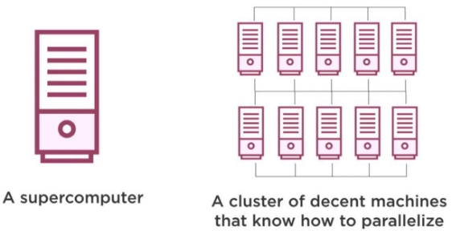
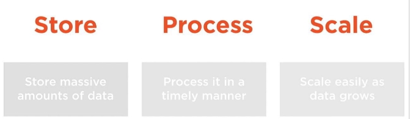
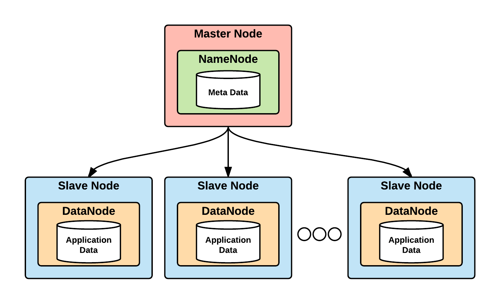
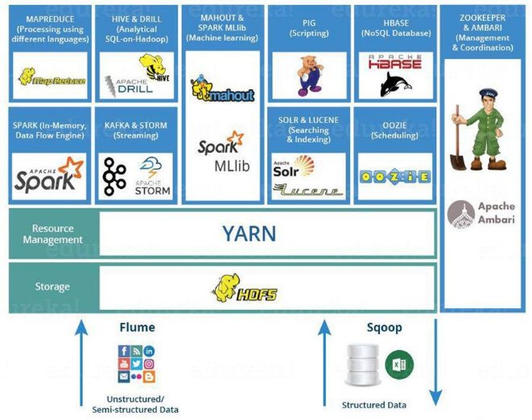

[Sommaire](Readme.md) · [Chapitre suivant →](02-presentation-env-hadoop.md)

 

# **Introduction à Hadoop**

> **Objectifs** : situer Hadoop dans l'histoire du Big Data · comprendre son architecture (HDFS, MapReduce, YARN) · connaître les fichiers de configuration · situer l'écosystème historique en 2026.
> **Prérequis** : aucun · **Durée** : ~3 h · **Type** : cours de contexte

## **Sommaire**

- [**Qu'est-ce que Hadoop ?**](#quest-ce-que-hadoop-)
  - [**Définition**](#définition)
  - [**Origines de la solution Hadoop**](#origines-de-la-solution-hadoop)
  - [**Où stocker les données ?**](#où-stocker-les-données-)
  - [**Comment Hadoop stocke les données ?**](#comment-hadoop-stocke-les-données-)
  - [**Synthèse visuelle**](#synthèse-visuelle)
- [**Écosystème de Hadoop**](#écosystème-de-hadoop)
- [**Fichiers de configuration principaux**](#fichiers-de-configuration-principaux)
  - [**hadoop-env.sh**](#hadoop-envsh)
  - [**core-site.xml**](#core-sitexml)
  - [**hdfs-site.xml**](#hdfs-sitexml)
  - [**mapred-site.xml**](#mapred-sitexml)
  - [**yarn-site.xml**](#yarn-sitexml)
- [**Positionnement de Hadoop dans l'écosystème Big Data**](#positionnement-de-hadoop-dans-lécosystème-big-data)
- [**Distributions principales d’Hadoop**](#distributions-principales-dhadoop)
  - [**Principales distributions**](#principales-distributions)

---

## **Qu'est-ce que Hadoop ?**

---

### **Définition**

Hadoop est un **framework java open-source** conçu par **Apache** pour le **stockage et le traitement distribué** des **volumes massifs de données** sur des **clusters** de serveurs.

Etant donné qu'il **peut être utilisé avec plusieurs langages de programmation**, **python** s’impose comme un langage clé pour le **Big Data** grâce à sa **simplicité**, sa **richesse en bibliothèques** _(TensorFlow, NumPy, Matplotlib, etc.)_

### **Origines de la solution Hadoop**

Face à l’augmentation continue des volumes de données, les entreprises ont d’abord adopté une architecture **client/serveur** reposant sur un **serveur central puissant** et un **SGBDR** pour le stockage et le traitement des données. L’évolution des besoins était gérée par **upsizing**, c’est-à-dire l’augmentation des capacités matérielles du serveur.

Cependant, cette approche montre rapidement ses limites :

* la croissance des données dépasse les capacités raisonnables des architectures centralisées,
* l’upsizing est contraint par les limites physiques du matériel et ne permet pas une scalabilité infinie.

Google a été l’une des premières entreprises à identifier ces faiblesses. En s’appuyant sur la baisse du coût des ordinateurs, elle a proposé une nouvelle approche basée sur des **clusters de machines standards**, dans lesquels le **stockage est distribué** et le **traitement parallélisé** sur plusieurs nœuds.



Cette vision marque une rupture avec l’architecture client/serveur traditionnelle.
**Hadoop** est aujourd’hui l’implémentation logicielle la plus mature et la plus utilisée pour mettre en œuvre cette stratégie de stockage distribué et de calcul parallèle.

---

### **Où stocker les données ?**

De la même manière que le **traitement des données** doit être réparti, le **stockage** doit lui aussi être **distribué** afin d’éviter la saturation liée à des volumes de données toujours plus importants.

Les bases de données relationnelles classiques (SGBDR), conçues pour fonctionner sur **un serveur unique**, atteignent rapidement leurs limites en termes de **capacité** et de **performances**. Elles ne sont donc plus adaptées aux besoins du Big Data.

Pour répondre à ces contraintes, on adopte une approche basée sur la **distribution du stockage sur plusieurs machines**, appelée **scaling out**, qui permet d’augmenter la capacité et la tolérance aux pannes en ajoutant simplement de nouveaux nœuds.



### **Comment Hadoop stocke les données ?**

Hadoop stocke les données en les **répartissant sur l’ensemble des machines** (nœuds) d’un cluster. Chaque nœud participe à la fois au **stockage** et, potentiellement, au **traitement** des données, ce qui permet de passer à l’échelle efficacement.

Selon les besoins, Hadoop peut s’appuyer sur :

* un **système de fichiers distribué**, **HDFS**, pour le stockage de fichiers volumineux ;
* une **base de données NoSQL distribuée**, **HBase**, pour le stockage et l’accès rapide à de grandes quantités de données structurées ou semi-structurées.

---

### **Synthèse visuelle**

L’ensemble de ces nœuds constitue le **socle de l’architecture distribuée d’Hadoop**, permettant de répartir le stockage et le calcul sur plusieurs machines afin de traiter efficacement de très grands volumes de données.



* **MasterNode** : nœud central chargé de la **coordination globale du cluster**, notamment la gestion du système de fichiers et l’orchestration des traitements.
* **NameNode** : service exécuté sur le MasterNode, responsable de la **gestion des métadonnées HDFS** (emplacement des fichiers, découpage en blocs, réplication).
* **SlaveNode** : nœuds de travail du cluster, chargés de **stocker les données** et d’**exécuter les traitements distribués**.
* **DataNode** : service exécuté sur les SlaveNodes, responsable du **stockage des blocs de données HDFS** et de la participation aux opérations de traitement.

---

## **Écosystème de Hadoop**

---

En plus de **HDFS** et de **HBase**, l’écosystème Hadoop regroupe **plusieurs composants essentiels** permettant le **stockage**, le **traitement** et la **gestion** de données à grande échelle.

À l’origine, **Hadoop 1.x** reposait principalement sur deux briques fondamentales :
* **HDFS**, pour le stockage distribué des données
* **MapReduce**, pour leur traitement distribué

Cette première architecture présentait toutefois une **limite majeure** : le **NameNode constituait un point unique de défaillance**. En cas de panne de celui-ci, l’ensemble du cluster devenait inutilisable.

Avec l’évolution de Hadoop, l’écosystème s’est considérablement enrichi afin de répondre à ces problématiques. Des mécanismes de **haute disponibilité** ont été introduits, notamment :
* la **redondance du NameNode**
* la possibilité de **basculement automatique (failover)** entre nœuds en cas de panne
* l’ajout de services dédiés à la **coordination et à la gestion des ressources**



---

Dans le cadre de ce cours, nous nous concentrerons principalement sur :
* **HDFS** (Hadoop Distributed File System) : système de fichiers distribué, conçu pour stocker de très grands volumes de données ;
* **YARN** (Yet Another Resource Negotiator) : gestionnaire des ressources et des applications du cluster ;
* **ZooKeeper** : service de coordination distribué, essentiel pour la synchronisation et la haute disponibilité ;
* **MapReduce** : modèle de programmation pour le traitement distribué et parallèle des données ;
* **Hive** : entrepôt SQL par-dessus HDFS — interroger les données stockées sans écrire de job (séquence 05) ;
* **HBase** : base de données NoSQL distribuée, orientée colonnes, s’appuyant sur HDFS (séquence 06) ;
* **NiFi** : plateforme d’ingestion et de routage des données — amener les données jusqu’au cluster (séquence 07).

> **L’écosystème historique — statut 2026.** L’écosystème Hadoop a compté d’autres briques, aujourd’hui retirées du périmètre de ce cours car elles ne sont plus maintenues :
>
> * **Sqoop** (transfert HDFS ↔ bases relationnelles) : projet retiré vers l’[Attic d’Apache en juin 2021](https://attic.apache.org/projects/sqoop.html), incompatible Hadoop 3.x. En industrie, on utilise aujourd’hui **Spark JDBC** (`spark.read.format("jdbc")`) ou **Kafka Connect**.
> * **Oozie** (ordonnanceur de workflows) : en [mode maintenance depuis 2018](https://oozie.apache.org/), déprécié par les distributions (Cloudera CDP notamment). En industrie, l’orchestration s’est déplacé vers **Apache Airflow** (standard de fait), Dagster ou Prefect.
> * **Pig** (flux de données SQL-like) : encore présent dans quelques clusters legacy, mais supplanté par Spark et Hive pour les nouveaux projets ; cité pour la culture générale.
>
> **Hive et NiFi, eux, sont toujours actifs** : Hive (v4.x) évolue vers les architectures lakehouse avec Apache Iceberg et reste massivement déployé en entreprise ; NiFi est la référence de l'ingestion visuelle multi-sources. Tous deux sont couverts par ce cours (séquences 05 et 07) — et installés dans le cluster du cours. La suite de l'écosystème moderne — Spark, Kafka, Airflow — est hors périmètre : ce cours vous en donne les fondations.
>
> **Et maintenant ?** Ce socle (HDFS, YARN, MapReduce, Hive, HBase, NiFi) reste le langage commun du Big Data on-premise et la base conceptuelle des technos actuelles : Spark s’exécute sur YARN, les concepts de shuffle et de parallélisation de MapReduce se retrouvent partout (jusque dans le SQL de Hive), et HBase demeure utilisé en production. Comprendre Hadoop, c’est comprendre le pourquoi de tout ce qui l’a remplacé.

## **Fichiers de configuration principaux**

---

Pour faire en sorte que les différents composants d'Hadoop communiquent entre eux, il est nécessaire de configurer certains fichiers. Ces fichiers de configuration permettent de définir les paramètres essentiels pour le fonctionnement du cluster Hadoop.

Pour voir les fichiers de configuration principaux :

```bash
ls -l  $HADOOP_HOME/etc/hadoop
# hadoop-env.sh
# core-site.xml
# hdfs-site.xml
# mapred-site.xml
# yarn-site.xml
```

> Tous les fichiers de configuration d'Hadoop sont disponibles dans le répertoire **$HADOOP_HOME/etc/hadoop** (sur le cluster du cours : `/opt/hadoop/etc/hadoop` — pas `/etc/hadoop/conf`, un reliquat d'anciennes distributions).

### [**hadoop-env.sh**](https://hadoop.apache.org/docs/stable/hadoop-project-dist/hadoop-common/UnixShellGuide.html)

Permet de définir les **variables d’environnement** utilisées par les démons Hadoop, notamment celles liées au **JDK**. Hadoop étant développé en **Java**, la variable **`JAVA_HOME`** est essentielle pour indiquer l’environnement d’exécution Java utilisé par les services Hadoop.

**ligne 21 -> 50 :**
```bash
# set JAVA_HOME in this file, so that is it correctly defined on remote nodes.

# The java implementation to use.
export JAVA_HOME=/usr/lib/jvm/java-17-openjdk-amd64

# The jsvc implementation to use. Jsvc is required to run secure datanodes that bind to priviliged prots to provide authentication of data transfer protocol. Jsvc is not required if SASL is configured for authentication of data transfert protocol using non-privileged ports.
# export JSVC_HOME=/usr/bin

export HADOOP_CONF_DIR=${HADOOP_CONF_DIR:-/etc/hadoop}

# Extra Java CLASSPATH elements. Automaticaly insert capacity-scheduler.
for f in $HADOOP_HOME/contrib/capacity-scheduler/*.jar; do
   if [ "$HADOOP_CLASSPATH" ]; then
      HADOOP_CLASSPATH=$HADOOP_CLASSPATH:$f
   else
      HADOOP_CLASSPATH=$f
   fi
done

# The maximum amount of heap to use, in MB. Default is 1000.
# export HADOOP_HEAPSIZE=
# export HADOOP_NAMENODE_INIT_HEAPSIZE=""

# Extra Java runtime options. Empty by default.
export HADOOP_OPTS="$HADOOP_OPTS -Djava.net.preferIPv4Stack=true"
```

### [**core-site.xml**](http://hadoop.apache.org/docs/current/hadoop-project-dist/hadoop-common/core-default.xml)

Permet de définir les **paramètres de configuration cœur de Hadoop** et indique notamment l’**emplacement du NameNode dans le cluster**. Il regroupe les **configurations communes** utilisées par **HDFS** et **MapReduce**, telles que les **paramètres d’entrées/sorties**.

La propriété **fs.defaultFS** (avant : fs.default.name) permet de spécifier le nom du système de fichier. Ainsi tous les répertoires et fichiers HDFS sont préfixés par **hdfs://hadoop-master:9000** (le NameNode du cluster du cours s'appelle `hadoop-master` — l'IP/le nom du conteneur maître, pas `localhost`, même si depuis ce conteneur c'est équivalent).

```xml
<?xml version="1.0"?>
<configuration>
   <property>
      <name>fs.defaultFS</name>
      <value>hdfs://hadoop-master:9000</value>
   </property>
</configuration>
```

### [**hdfs-site.xml**](http://hadoop.apache.org/docs/current/hadoop-project-dist/hadoop-hdfs/hdfs-default.xml)

Définis l'emplacement du **NameNode** et des **datanode**. Il contient aussi les paramètres de **réplication**.

```xml
<?xml version="1.0"?>
<configuration>
   <property>
      <name>dfs.namenode.name.dir</name>
      <value>file:///data/hdfs/namenode</value>
      <description>NameNode directory.</description>
   </property>
   <property>
      <name>dfs.datanode.data.dir</name>
      <value>file:///data/hdfs/datanode</value>
      <description>DataNode directory</description>
   </property>
   <property>
      <name>dfs.replication</name>
      <value>1</value>
      <description>1 (cluster du cours) — chaque bloc a une seule copie. Ne confondez pas avec le ratio 3 de la documentation historique.</description>
   </property>
</configuration>
```

### [**mapred-site.xml**](http://hadoop.apache.org/docs/stable/hadoop-mapreduce-client/hadoop-mapreduce-client-core/mapred-default.xml)

Spécifie la **configuration de MapReduce**, afin de **choisir quel framework doit être utilisé**.

Depuis la version 2.x d'Hadoop avec l'arrivée de **Yarn**, ce fichier de configuration est épaulé par **yarn-site.xml**. Ainsi, si vous souhaitez utiliser **Yarn** comme implémentation de MapReduce, il faudra configurer le fichier **mapred-site.xml** comme présenté ci-dessous.

```xml
<?xml version="1.0"?>
<configuration>
   <property>
      <name>mapreduce.framework.name</name>
      <value>yarn</value>
   </property>
</configuration>
```

### [**yarn-site.xml**](http://hadoop.apache.org/docs/r2.3.0/hadoop-yarn/hadoop-yarn-common/yarn-default.xml)

Le fichier `yarn-site.xml` est utilisé pour la configuration de **Yarn**, **Shuffling**, **scheduling policy**...

```xml
<?xml version="1.0"?>
<configuration>
   <property>
      <name>yarn.nodemanager.aux-services</name>
      <value>mapreduce_shuffle</value>
   </property>
   <property>
      <name>yarn.nodemanager.aux-services.mapreduce.shuffle.class</name>
      <value>org.apache.hadoop.mapred.ShuffleHandler</value>
   </property>
   <property>
      <name>yarn.resourcemanager.hostname</name>
      <value>hadoop-master</value>
   </property>
</configuration>
```

---

## **Positionnement de Hadoop dans l'écosystème Big Data**

---


## **Distributions principales d’Hadoop**

---

Hadoop est composé de multiples briques logicielles, développées et maintenues par différents acteurs. Cette diversité rend la gestion des versions et la configuration complexe. Pour répondre à ce défi, des distributions Hadoop ont émergé : des ensembles pré-packagés, configurés et optimisés pour fonctionner ensemble, offrant un déploiement plus rapide et un support technique.

### **Principales distributions**

| Distribution | Statut 2026 | Hadoop livré |
|---|---|---|
| **Cloudera** | La seule distribution on-premise encore vivante. Hortonworks a fusionné avec elle en janvier 2019 ; CDH et HDP sont hors support depuis 2021-2022. Produit actuel : Cloudera Base on premises 7.3.2 (mars 2026), support garanti jusqu'en 2032. | 3.4.1 |
| **Amazon EMR** | Service managé d'AWS, le plus répandu du marché. Version courante : emr-7.14.0 (septembre 2026). Existe aussi en EMR on EKS et EMR Serverless. | 3.4.2 |
| **Google Cloud** | **Dataproc a été renommé « Managed Service for Apache Spark »** en 2026. Images 2.2 et 2.3 encore supportées ; l'image 3.0 (juillet 2026) est la plus récente. | 3.3.6 (2.3) · 3.5.0 (3.0) |
| **Azure HDInsight** | Service maintenu, mais sans nouvelle version depuis HDInsight 5.1 (novembre 2023). Les versions 4.0 et 5.0 ont été retirées le 31 mars 2025. | 3.3.4 |
| **MapR** | Radiée. Rachetée par HPE en août 2019, devenue « HPE Data Fabric » (8.2.0, octobre 2026) : plateforme compatible Hadoop, mais qui remplace HDFS par son propre système de fichiers. Ce n'est plus une distribution Hadoop. | — |

> **Ce que le marché est devenu.** Le modèle « distribution » de 2013 — packager Hadoop et le vendre avec un support — a survécu là où les entreprises gardent leurs serveurs (Cloudera). Partout ailleurs, la distribution est devenue un **service managé** : on choisit un label de version, plus un éditeur. Les acteurs historiques ont fusionné ou disparu (Hortonworks avalée par Cloudera, MapR rachetée par HPE).

> **Quelle version d'Apache Hadoop en 2026 ?** La branche courante est **3.5** (3.5.0, avril 2026). La branche **3.4** (3.4.3, février 2026) est celle qu'embarquent Cloudera 7.3.2 et AWS EMR. Le cluster de ce cours tourne sous **3.3.6** (juin 2023) : c'est aussi la version de l'image 2.3 du service Google — un choix délibéré, pour que ce que vous manipulez ressemble aux clusters réellement déployés en entreprise. Les écarts qui comptent pour vous sont ceux entre 2.x et 3.x (les ports, vus au chapitre 02), pas ceux entre 3.3 et 3.5.

---

[Sommaire](Readme.md) · [Chapitre suivant →](02-presentation-env-hadoop.md)
