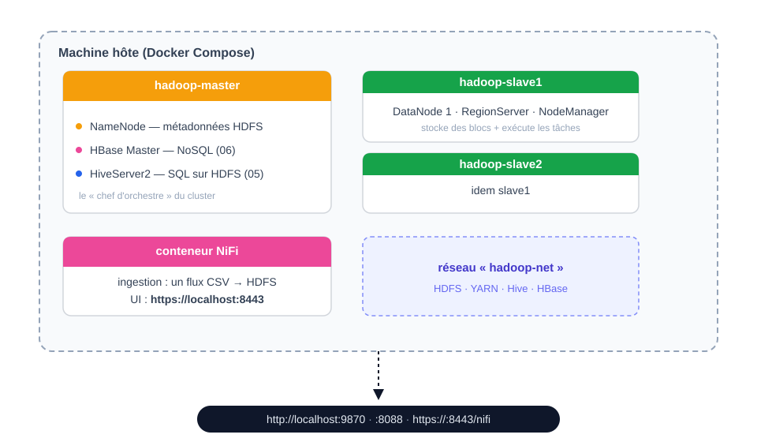
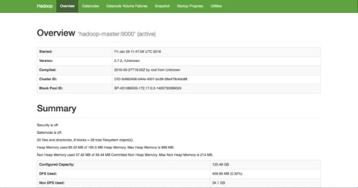
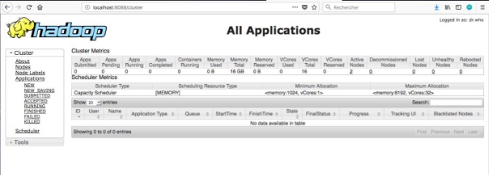

[← Chapitre précédent](01-introduction-hadoop.md) · [Sommaire](Readme.md) · [Chapitre suivant →](03-hdfs.md)

 

# 02 - Présentation de l'environnement Hadoop

> **Objectifs** : comprendre l'architecture de l'environnement de TP (cluster Docker local, conteneurs, services) · connaître les scripts de manipulation et leur usage.
> **Mise en pratique** : [Exercices](#v-exercices)
## Sommaire

- [I. Où se trouve l'environnement Hadoop ?](#i-où-se-trouve-lenvironnement-hadoop-)
- [II. Architecture de l'environnement](#ii-architecture-de-lenvironnement)
  - [A. Pourquoi Docker ?](#a-pourquoi-docker-)
  - [B. L'environnement Hadoop de Diginamic](#b-lenvironnement-hadoop-de-diginamic)
  - [C. Configurations logicielles](#c-configurations-logicielles)
- [III. Scripts de configuration & manipulation](#iii-scripts-de-configuration--manipulation)
  - [A. Sur la machine hôte (Docker)](#a-sur-la-machine-hôte-docker)
  - [B. Dans le conteneur master (dans /home)](#b-dans-le-conteneur-master-dans-home)
  - [C. Arrêter les services](#c-arrêter-les-services)
- [IV. Accéder à l'environnement à distance](#iv-accéder-à-lenvironnement-à-distance)
- [V. Exercices](#v-exercices)
  - [A. Démarrer les conteneurs](#a-démarrer-les-conteneurs)
  - [B. Lancer les services Hadoop](#b-lancer-les-services-hadoop)
  - [C. Accéder aux interfaces web](#c-accéder-aux-interfaces-web)
  - [D. Transférer un fichier vers HDFS](#d-transférer-un-fichier-vers-hdfs)
- [VI. Vérifiez vos acquis](#vi-vérifiez-vos-acquis)

## I. Où se trouve l'environnement Hadoop ?

L'environnement de TP est un **cluster Docker local** : il tourne sur la machine du formateur ou sur votre propre poste, piloté par Docker Compose. Il se compose de **quatre conteneurs** — un master Hadoop, deux slaves, et un conteneur NiFi — construits à partir d'un projet de déploiement fourni avec le cours.

Contrairement à un vrai cluster, tout tient sur une seule machine : les mêmes logiciels (HDFS, YARN, HBase, Hive), les mêmes configurations, à l'échelle de votre portable. C'est le compromis classique de la formation : **la fidélité des outils, l'échelle du laboratoire**.

La procédure complète (lancer les conteneurs, démarrer les services, ouvrir les interfaces web) est détaillée dans la section [« Exercices »](#v-exercices). La section [« Accéder à l'environnement à distance »](#iv-accéder-à-lenvironnement-à-distance) couvre le cas d'un cluster hébergé sur une VM distante.

## II. Architecture de l'environnement

### A. Pourquoi Docker ?

Docker permet de créer facilement des conteneurs et des applications basées sur les conteneurs. On les utilise ici pour virtualiser notre environnement Hadoop :

* Un environnement d'exécution **léger**, alternative aux méthodes de virtualisation traditionnelles basées sur les machines virtuelles ;
* Le conteneur **partage le kernel de son OS** avec d'autres conteneurs ;
* Un conteneur est plus léger et plus simple qu'une machine virtuelle.

### B. L'environnement Hadoop de Diginamic

L'environnement est virtualisé avec Docker et se compose de :

* Un réseau nommé **hadoop-net**
* **Trois conteneurs de cluster** (1 master & 2 slaves), image : `hadoop-cluster-base` (Debian 12)
    - **Hadoop 3.3.6** · HBase 2.5.15 · ZooKeeper 3.8.6 · Hive 4.1.0 · Java 17 · Python 3.11
    - Volumes Docker pour les données HDFS (elles survivent aux redémarrages)
    - Redirection de ports nécessaires pour accéder aux interfaces web de Hadoop
* **Un conteneur NiFi** (séquence 07), image officielle `apache/nifi` 2.x, sur le même réseau



> **Note sur les versions :** le cluster local tourne sur **Hadoop 3.3.6** (et non 2.x) : les ports d'interface ont changé entre les deux branches — l'UI du NameNode est sur le **9870** en 3.x (50070 en 2.x). Les cours et exercices utilisent les ports 3.x.

> **Note sur NiFi :** NiFi vit dans son propre conteneur (image officielle `apache/nifi`, branche **2.x** — Java 21 et client Hadoop 3.x, cohérents avec notre Hadoop 3.3.6). Aucun script à lancer : il démarre avec les conteneurs et se pilote à l'interface web. Détails en cours 07, section « NiFi dans l'environnement du cours ».

### C. Configurations logicielles

| Composant | Version | Remarque |
|---|---|---|
| Hadoop | 3.3.6 | HDFS + YARN + MapReduce |
| HBase | 2.5.15 | NoSQL colonnes (séquence 06) |
| Hive | 4.1.0 | SQL sur HDFS (séquence 05) |
| ZooKeeper | 3.8.6 | coordination HBase |
| Java | OpenJDK 17 | tous les services |
| **Python** | **3.11** | mappers/reducers, HappyBase, pandas… |
| NiFi | 2.x | ingestion (séquence 07, conteneur dédié) |

Python **3.11** supporte les syntaxes modernes (f-strings y compris). Les bibliothèques utiles sont préinstallées :

| Bibliothèque | Usage |
|---|---|
| happybase | interagir avec HBase depuis Python |
| matplotlib | visualisation, export PDF |
| pandas | manipulation de données |
| thriftpy2 | support Thrift pour happybase |

## III. Scripts de configuration & manipulation

Plusieurs scripts facilitent les manipulations — deux familles : ceux de **l'hôte** (votre machine, au niveau Docker) et ceux **du master** (dans le conteneur, au niveau des services Hadoop).

> Je recommande de **regarder le contenu des scripts** pour voir les vraies commandes lancées.

### A. Sur la machine hôte (Docker)

| Script / commande | Rôle | Utilisé quand |
|---|---|---|
| `docker compose up -d` | build (si besoin) et démarre les 4 conteneurs | début de chaque séance de TP |
| `docker compose down` | arrête les conteneurs (les volumes persistent) | fin de séance |
| `./bash_hadoop_master.sh` | ouvre un terminal bash dans le conteneur master | dès qu'il faut lancer des commandes Hadoop |
| `docker exec -it hadoop-slave1 bash` | terminal bash dans un slave | vérifier les services sur les slaves |

> Les conteneurs démarrent **froids** : SSH est actif, mais **aucun service Hadoop n'est lancé**. C'est voulu — les services se démarrent à la main depuis le master, et vous apprendrez à le faire dans la section [« Exercices »](#v-exercices).

### B. Dans le conteneur master (dans /home)

| Script | Rôle | Utilisé quand |
|---|---|---|
| `start-all.sh` | démarre tous les services dans l'ordre (ZK → HDFS → YARN → Historique → HBase → Thrift → REST → Hive) | raccourci une fois les ordres compris |
| `start-zookeeper.sh` | démarre ZooKeeper | avant HBase |
| `start-dfs.sh` | démarre HDFS (NameNode + DataNodes) | début de toute séance |
| `start-yarn.sh` | démarre YARN (ResourceManager + NodeManagers) | EX MapReduce / Hive |
| `start-hbase.sh` | démarre HBase (Master + RegionServers) | EX HBase (séquence 06) |
| `start-thrift.sh` | démarre le service Thrift d'HBase (port 9090) | EX HappyBase (séquence 06) |
| `start-rest.sh` | démarre l'API REST d'HBase (port 9091) | connexion Power BI (annexe) |
| `start-hive.sh` | démarre HiveServer2 (port JDBC 10000) | EX Hive (séquence 05) |

> **NiFi : aucun script à lancer** — le conteneur démarre avec le compose et son interface est auto-suffisante (séquence 07).

> **Vérifier ce qui tourne** : dans le master ou un slave, la commande `jps` liste les processus Java actifs (NameNode, DataNode, ResourceManager, HMaster, ThriftServer, HiveServer2…).

### C. Arrêter les services

Depuis le master : `pkill -f '<nom du service>'` (ex. `pkill -f 'NameNode'`), puis `docker compose down` sur l'hôte. L'ordre des services importe peu pour l'arrêt.

## IV. Accéder à l'environnement à distance

Le cluster décrit ci-dessus tourne **localement** (formateur ou poste apprenant). Pour une session où le cluster serait hébergé sur une **VM distante** (VPN, salle de formation, cloud), seuls les points d'accès changent :

* **Interfaces web** : remplacer `localhost` par l'adresse de la VM (`http://<IP_VM>:9870`, etc.) — les ports restent les mêmes, à condition qu'ils soient ouverts sur la VM ;
* **Terminal master** : `ssh <utilisateur>@<IP_VM>` puis les mêmes scripts `docker exec` / `bash_hadoop_master.sh` ;
* **Transferts de fichiers** : `scp` ou FileZilla (SFTP) vers la VM, même destination.

Le guide complet de déploiement sur VM est fourni avec le projet Docker du cours (`docs/deploiement-vm.md`) : prérequis, build, ports, vérifications. Dans tous les cas, **l'adresse exacte vous est communiquée par votre formateur en début de séance** — hors session locale, tout le reste de ce cours s'applique à l'identique.

## V. Exercices

Pour réaliser cet exercice, vous aurez besoin de la machine hôte du cluster (la vôtre en session locale, ou la VM fournie par votre formateur en session distante — cf. [section « Accéder à l'environnement à distance »](#iv-accéder-à-lenvironnement-à-distance)).

### A. Démarrer les conteneurs

Dans un terminal de la machine hôte (le projet de déploiement est fourni avec le cours) :

```bash
docker compose up -d
docker compose ps
```

**Résultat attendu** : quatre conteneurs `Up` — `hadoop-master`, `hadoop-slave1`, `hadoop-slave2` et `hadoop-nifi`.

> Les conteneurs démarrent **froids** : seuls SSH et l'entrypoint tournent. Aucun service Hadoop n'est encore actif — c'est l'objet de la section B.

Entrez dans le conteneur master :

```bash
./bash_hadoop_master.sh
# ou : docker exec -it hadoop-master bash
```

✅ Vous devez obtenir un terminal bash dans `hadoop-master` (prompt et `/home` comme répertoire de travail).

### B. Lancer les services Hadoop

#### 1. Démarrer les services

Depuis le master, dans `/home` :

```bash
./start-all.sh
```

Ce script lance les services **dans l'ordre des dépendances** : ZooKeeper → HDFS → YARN → JobHistory → HBase → Thrift → REST → Hive. Vous pouvez aussi les lancer un à un (`./start-zookeeper.sh`, `./start-dfs.sh`, `./start-yarn.sh`, …) — c'est même recommandé la première fois, pour voir ce que fait chaque script (cattez-les !).

#### 2. Vérifier que les services sont actifs

```bash
jps
```

Résultat attendu dans le master :

```text
NameNode            # HDFS
SecondaryNameNode   # HDFS (checkpoint)
ResourceManager     # YARN
JobHistoryServer    # MapReduce (historique des jobs)
HMaster             # HBase
ThriftServer        # HBase (API Thrift)
RESTServer          # HBase (API REST)
RunJar              # HiveServer2 (apparaît comme RunJar)
QuorumPeerMain      # ZooKeeper
```

> ⚠️ **`QuorumPeerMain` (et non `HQuorumPeer`)** : c'est le vrai nom du process ZooKeeper dans cette distribution. `HQuorumPeer` était le ZooKeeper *embarqué* de HBase dans des versions plus anciennes — si une vieille doc le mentionne, ignorez-la.
> Les `DataNode` et `NodeManager` ne s'affichent **pas** dans le master : ils tournent sur les slaves (voir ci-dessous). `JobHistoryServer` et `RESTServer` sont bien lancés par `start-all.sh` et doivent apparaître dans la liste.

> Si vous faites `jps` dans un slave (`docker exec -it hadoop-slave1 jps`), vous aurez :
> ```text
> DataNode        # HDFS
> NodeManager     # YARN
> HRegionServer   # HBase
> ```

> Les services HBase/Hive/HBase-Thrift peuvent mettre quelques dizaines de secondes à apparaître après leur script — relancez `jps` si la liste semble incomplète.

### C. Accéder aux interfaces web

Depuis votre navigateur (sur la machine hôte : `localhost` ; en session distante : l'adresse communiquée par votre formateur) :

1. **Interface web du NameNode (HDFS)** : <http://localhost:9870>
 

2. **Interface web du ResourceManager (YARN)** : <http://localhost:8088>
 

> Hadoop 3.x : l'UI du NameNode vit sur le port **9870** (c'était 50070 en 2.x — si vous voyez ce port dans une vieille doc, c'est qu'elle date d'Hadoop 2).

3. Retrouvez les configurations des fichiers XML vus précédemment dans l'interface web du NameNode (9870, onglet **Utilities** → **Browse the file system** ou **Configs**) :
    - **core-site.xml**
    - **hdfs-site.xml**
    - **yarn-site.xml**
    - **mapred-site.xml**

> En session locale, remplacez `localhost` par l'adresse de la machine qui héberge le cluster si ce n'est pas la vôtre.

### D. Transférer un fichier vers HDFS

Pour boucler la boucle avec la séquence 03 : déposez un petit fichier dans HDFS depuis le master.

1. Depuis votre machine locale, copiez un fichier `test.txt` dans le master (option A : `docker cp test.txt hadoop-master:/home/` — option B en session distante : `scp test.txt utilisateur@<IP_VM>:~/` puis `docker cp` vers le conteneur) ;
2. Dans le master :

```bash
hdfs dfs -mkdir -p /user/root
hdfs dfs -put /home/test.txt /user/root/
hdfs dfs -ls /user/root
```

**Résultat attendu** : `test.txt` apparaît dans le listing HDFS — et aussi dans l'UI du NameNode (9870 → Utilities → Browse the file system).

C'est exactement le point de départ des exercices MapReduce (EX 04) : vos données sont désormais **dans le cluster**.

## VI. Vérifiez vos acquis

*Formatif, jamais noté. Répondez sans relire le chapitre. Les réponses se déplient juste après le séparateur : ce qui compte est de repérer où vous vacillez, pas de faire 5 sur 5.*

**1.** Après `docker compose up -d`, les quatre conteneurs sont `Up`. Que liste la commande `jps` lancée dans le master ?

- A. Tous les services Hadoop, du NameNode au HiveServer2 : l'image les démarre à la montée des conteneurs et `jps` les montre tous
- B. Aucun service Hadoop : seuls SSH (accès à distance) et l'entrypoint tournent, les services se démarrent à la main
- C. HDFS (le système de fichiers distribué de Hadoop) et YARN (le gestionnaire de ressources), HBase et Hive restant à lancer
- D. Les services du master et des slaves, `docker compose` démarrant les quatre conteneurs à la fois

**2.** Vous ouvrez l'interface web du NameNode depuis la machine hôte, en session locale. Quelle adresse saisissez-vous ?

- A. `http://localhost:50070`, port du NameNode sous Hadoop 2.x, encore rencontré dans les documentations anciennes qui détaillent l'interface de cette branche
- B. `http://localhost:8088`, port de l'interface web de YARN, qui affiche les applications lancées
- C. `http://localhost:9870`, le port de l'interface web du NameNode retenu par Hadoop 3.x
- D. `http://localhost:9090`, port du service Thrift d'HBase, qui sert aussi d'interface web au NameNode

**3.** On arrête le cluster avec `docker compose down`, puis on le relance le lendemain. Qu'en est-il des fichiers déposés dans HDFS ?

- A. Ils sont conservés : des volumes Docker montés sur les conteneurs du cluster leur servent de disque
- B. Ils sont perdus, car l'arrêt des conteneurs efface le contenu de leur système de fichiers, y compris les répertoires HDFS
- C. Ils sont conservés dans le conteneur NiFi, qui sert de stockage partagé aux trois conteneurs du cluster
- D. Ils sont perdus pour les slaves et conservés pour le master, parce que seul le master possède un volume Docker monté sur son répertoire de travail

**4.** Le cours recommande de lancer les scripts de démarrage un à un la première fois. Pourquoi ?

- A. Parce que `start-all.sh` ne démarre que HDFS et YARN et qu'il faut ajouter les autres services à la main
- B. Parce que les lancements individuels évitent le délai de quelques dizaines de secondes que prend `start-all.sh`
- C. Parce que l'ordre des dépendances diffère entre le master et les slaves et qu'il faut le vérifier sur chaque nœud
- D. Pour voir ce que fait chaque script et reprendre, l'un après l'autre, les services qu'il lance

**5.** *Question ouverte (2-3 lignes).* Un apprenant lance `jps` dans le master et n'y voit ni `DataNode` ni `NodeManager`. Expliquez pourquoi, et indiquez comment vérifier malgré tout qu'ils fonctionnent.

---

<details>
<summary>Vérifier ses réponses</summary>

### Réponses

**1. B.** Les conteneurs démarrent froids : `docker compose up -d` les démarre, mais aucun service Hadoop n'est lancé.
**Pourquoi :** c'est voulu — les services se démarrent à la main depuis le master avec les scripts `start-*.sh` ; `jps` ne liste donc que l'entrypoint du conteneur, et les `DataNode` comme `NodeManager` tournent de leur côté, sur les slaves.

**2. C.** Le cluster du cours tourne sous Hadoop 3.3.6 : l'interface web du NameNode y est sur le port **9870**, donc `http://localhost:9870` en session locale.
**Pourquoi :** 50070 est le port de cette interface sous Hadoop 2.x, 8088 celui de l'interface du ResourceManager (YARN) et 9090 celui du service Thrift d'HBase. En session distante, on remplace seulement `localhost` par l'adresse de la VM.

**3. A.** Les fichiers déposés dans HDFS survivent aux arrêts : ils sont écrits sur des volumes Docker.
**Pourquoi :** `docker compose down` arrête et retire les conteneurs mais laisse les volumes en place — c'est ce qui permet de retrouver les données d'une séance à l'autre. NiFi, lui, est un conteneur d'ingestion, pas un stockage partagé pour le cluster.

**4. D.** Lancer les scripts un à un est un choix d'apprentissage : on voit ce que fait chaque script, et on peut le lire pour découvrir les vraies commandes lancées.
**Pourquoi :** `start-all.sh` fait la même chose d'un bloc, dans l'ordre des dépendances (ZooKeeper → HDFS → YARN → JobHistory → HBase → Thrift → REST → Hive) ; le lire ne dispense pas de comprendre ce qu'il exécute.

**5.** Attendu : `jps` ne liste que les processus Java du conteneur où on le lance ; `DataNode` et `NodeManager` tournent sur les slaves, pas sur le master. On vérifie avec `docker exec -it hadoop-slave1 jps`, qui les montre aux côtés de `HRegionServer`.
**Pourquoi :** chaque conteneur a ses propres processus ; les interfaces web du NameNode (9870) et du ResourceManager (8088) permettent aussi de confirmer que les nœuds sont bien enregistrés dans le cluster.

</details>

---

[← Chapitre précédent](01-introduction-hadoop.md) · [Sommaire](Readme.md) · [Chapitre suivant →](03-hdfs.md)
