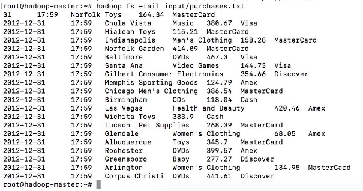

[← Chapitre précédent](02-presentation-env-hadoop.md) · [Sommaire](Readme.md) · [Chapitre suivant →](04-mapreduce-et-yarn.md)

 

# 03 - HDFS (Hadoop File System)

> **Objectifs** : comprendre l'architecture HDFS (NameNode, DataNode, blocs, réplication) · maîtriser les opérations de base (put, get, ls…) · configurer et démarrer le cluster.
> **Mise en pratique** : [Exercices](#vi-exercices)
## Sommaire

- [I. Introduction HDFS](#i-introduction-hdfs)
  - [A. Pourquoi HDFS ?](#a-pourquoi-hdfs-)
  - [B. Présentation de HDFS](#b-présentation-de-hdfs)
  - [C. Accès à HDFS](#c-accès-à-hdfs)
  - [D. Comment utiliser HDFS](#d-comment-utiliser-hdfs)
  - [E. API HDFS](#e-api-hdfs)
- [II. Principes HDFS](#ii-principes-hdfs)
  - [A. Caractéristiques générales](#a-caractéristiques-générales)
  - [B. Réplication](#b-réplication)
  - [C. Sous-réplication](#c-sous-réplication)
  - [D. Taille des blocs](#d-taille-des-blocs)
  - [E. Codecs de compression](#e-codecs-de-compression)
  - [F. Permissions](#f-permissions)
- [III. Architecture des services](#iii-architecture-des-services)
  - [A. Fonctionnement](#a-fonctionnement)
  - [B. Le NameNode](#b-le-namenode)
  - [C. La communication](#c-la-communication)
  - [D. NameNode (rôle résumé)](#d-namenode-rôle-résumé)
  - [E. DataNode](#e-datanode)
  - [F. Secondary NameNode](#f-secondary-namenode)
- [IV. Opérations HDFS](#iv-opérations-hdfs)
- [V. Configurer et démarrer HDFS](#v-configurer-et-démarrer-hdfs)
  - [A. Initialiser et démarrer](#a-initialiser-et-démarrer)
  - [B. Démarrer le cluster HDFS](#b-démarrer-le-cluster-hdfs)
- [VI. Exercices](#vi-exercices)
  - [A. Mémo des commandes HDFS](#a-mémo-des-commandes-hdfs)
  - [B. Manipulation des commandes HDFS](#b-manipulation-des-commandes-hdfs)
- [VII. Vérifiez vos acquis](#vii-vérifiez-vos-acquis)

## I. Introduction HDFS

### A. Pourquoi HDFS ?

- Ce système de fichiers est distribué sur des centaines voire des milliers de serveurs, et chaque nœud stocke une partie du système fichier. Pour éviter le risque de perdre des données, chaque donnée est stockée à plusieurs emplacements (ratio 3 par défaut — 1 sur le cluster du cours, voir plus bas la section Réplication).
- Il est très adapté au Big Data. Des dizaines de millions de fichiers peuvent être supportés sur une seule instance. Par ailleurs, cela assure la cohérence et l’intégrité des données pour éviter tout désagrément.
- HDFS est connu par sa portabilité. Il peut fonctionner sur différents types de commodity hardwares sans aucun problème de compatibilité.
- Plus qu’une base de données, ce système de fichier distribué se présente comme une Data Warehouse. Il est impossible de déployer un langage de requête *direct* sur HDFS : les données sont lues par des programmes MapReduce, ou requêtées en SQL via une couche dédiée (**Hive**, séquence 05) qui compile le SQL en MapReduce. Les données adhèrent à un modèle de cohérence simple et robuste.

### B. Présentation de HDFS

- HDFS est le système de fichiers de Hadoop.
- Comme tout système de fichiers, HDFS a vocation à être accédé à la fois :
  - pour écrire,
  - pour interroger,
  - pour lire les données qui y sont stockées.
- Cependant, on ne va jamais l'interroger en direct.
- En effet, Hadoop possède une couche d'abstraction nommée HadoopFS qui permet d'interroger, de lire et d'écrire des données directement dans un système de fichiers.
- Cette couche d'abstraction a le gros avantage d'avoir plusieurs backend et plusieurs frontend.
- En backend, on entend les systèmes de fichiers supportés.

### C. Accès à HDFS

- Ainsi, HadoopFS va permettre d'accéder à la fois à l'HDFS, mais également aux fichiers locaux,
- Et par exemple : à Amazon S3, aux fichiers stockés sur un FTP, à OpenStack Swift, à OrangeFS, Windows Azure, Cassandra, CephFS, le Google Storage, MapR-FS ou Quantcast ….
- Tous ces backend vont être gérés avec les mêmes interfaces, et ainsi un logiciel qui va utiliser HadoopFS, va pouvoir accéder aux données quel que soit le système de fichiers sur lequel elles sont stockées.
- Et ainsi, un outil qui utilise HadoopFS, va pouvoir accéder aux données quel que soit le système de fichiers utilisé.

### D. Comment utiliser HDFS

- Pour ce faire, on va utiliser des URI — des « Uniform Resource Identifier » — et plus précisément des URL, des « Uniform Resource Locator », pour savoir où les données sont stockées.
- A chaque fois, on va avoir donc, un protocole qui va définir le type de système de fichiers
- Ainsi, si on veut parler de l'HDFS, on va avoir notre URI qui va commencer par hdfs://, tout comme si on veut parler d'une ressource sur le système de fichiers local, on va utiliser file://.
- **Je vous encourage vivement à toujours utiliser HadoopFS sans spécifier le protocole afin de laisser la possibilité à l'utilisateur de votre application de le faire.**
- **Cela permettra que tous vous outils fonctionnent maintenant avec HadoopFS, puissent fonctionner quel que soit le système de fichiers derrière.**

### E. API HDFS

- HadoopFS met donc à disposition diverses API
- C'est-à-dire qu'on va pouvoir y accéder par exemple en ligne de commande, pour pouvoir interroger le système de fichiers quel qu'il soit ou via une API Java (ou aussi une API dans notre cas en Python avec une API JAVA)
- Qui permet de créer d'écrire, de modifier, de supprimer des fichiers.
- Via une librairie C, qui est en fait construite grâce à JNI, Java Native Interface, qui permet d'avoir les méthodes Java accessibles directement en C. Via Thrift, un protocole directement pour accéder aux données, qui est propre à Apache.
- Ou encore via Fuse par exemple, pour le monter dans l'espace utilisateur, ou en WebDAV, pour l'interroger, par exemple, grâce à une API HTTP.

## II. Principes HDFS

### A. Caractéristiques générales

- Concernant la Réplication : La Réplication est le fait d'avoir les données accessibles à plusieurs endroits simultanément.
- Cette Réplication, sur l'HDFS, se fait par blocs.
- C'est à dire que ce sont les blocs, non pas les fichiers, qui sont accessibles à plusieurs endroits simultanément.
- Elles ne concernent bien entendu que les fichiers.

### B. Réplication

- En effet, les dossiers, à proprement parler, n'existent que dans l'index.
- Par défaut, l'HDFS a un ratio de Réplication de 3.
- C'est à dire que chaque bloc de chaque fichier doit être à trois endroits simultanément. ⚠️ **Mais ce n'est qu'une valeur par défaut, modifiable** : sur le cluster du cours `dfs.replication=1` (configuré dans `hdfs-site.xml`, voir la séquence 01) — l'économie de place est au prix de la redondance.
- Il est personnalisable fichier par fichier, ou répertoire par répertoire, grâce à la commande du FsShell : `hdfs dfs -setrep [-R] [-w] <nombre de copies> <chemin>` — par exemple `hdfs dfs -setrep -w 3 input/Spotify_Most_Streamed_Songs.csv`, puis `hdfs dfs -stat %r <chemin>` pour vérifier la valeur enregistrée.
- Il peut ainsi donc être ajusté en fonction des besoins, notamment si la donnée doit être plus répliquée
- Par exemple parce qu'elle est sensible, ou pour augmenter les performances en lecture, ou moins répliquée, parce qu'elle consomme beaucoup trop d'espace de stockage pour sa criticité.

### C. Sous-réplication

- On peut avoir des cas de sous-réplication, c'est à dire qu'à un moment donné, il n'existe pas assez de réplicas d'un même bloc
- Dans ce cas-là, le système essaye de le corriger au plus vite, et des cas de sur réplication
- C'est à dire qu'à un moment donné, trop de réplicas existent pour un même bloc, auquel cas, le système HDFS le corrige également au plus vite, simplement en supprimant un ou plusieurs réplicas.
- Le nombre de réplicas est visible dans chacune des interfaces, que ce soit l'interface web ou la ligne de commande. On a également la notion de Block Size.

### D. Taille des blocs

- Toutes les données étant stockées par blocs, la taille du bloc est un paramètre du cluster, configuré dans `hdfs-site.xml` (`dfs.blocksize`, 128 Mio par défaut ici).
- Ce que ce découpage implique pour la lecture des fichiers et le nombre de mappers : **chapitre 04, section « Du fichier au bloc »**.

### E. Codecs de compression

- L'HDFS supporte nativement la **compression** : tout ce qui est écrit ou lu de l'HDFS peut être compressé ou décompressé à la volée.
- On va passer par des codecs de compression, soit écrits en Java, soit natifs directement sur le système s'ils sont disponibles.
- Bien entendu, compresser réduit l'espace de stockage nécessaire pour stocker les données et augmente de ce fait les vitesses de transfert, également, puisque moins de données à transférer.
- Par contre, cela induit une charge CPU supplémentaire, et en plus, empêche les données de pouvoir être « splittées », c'est-à-dire découpées en plusieurs parties — ce que cela bloque pour MapReduce, le chapitre 04 le montre.
- Différents codecs de compression sont disponibles, on va retrouver notamment Gzip, Bzip2, Snappy et LZO.
- **Chaque codec ayant ses avantages et ses inconvénients en fonction de nos besoins.**

### F. Permissions

- l'HDFS a également un système de permission.
- De façon similaire à ce qu'on retrouve sous Linux, chaque fichier et répertoire a un propriétaire et un groupe.
- Les trois sont alors définis pour le propriétaire, le groupe et les autres, et à chaque fois, pour la lecture, l'écriture et la traversée du répertoire.
- On a également un sticky bit pour les répertoires et l'HDFS supporte les ACL POSIX pour avoir des permissions plus fines avec par exemple getfacl.
- Le système de permission peut se désactiver pour l'intégralité de l'HDFS mais dans ce cas-là, il peut cependant être nécessaire, toujours, d'utiliser le SuperUser qui est le user HDFS par défaut. Ce système de permission va de paire avec un système d'Authentification qui se fait soit de façon simple avec un login mot de passe, soit via Kerberos.

## III. Architecture des services

### A. Fonctionnement

- L'HDFS fonctionne grâce à deux types de service, le NameNode et un ou plusieurs DataNode.
- Les DataNodes vont être là où vont être stockés les données.
- Il peut donc s'agir de serveurs totalement différents avec de le hardware totalement différent avec un ou plusieurs disques, il faut juste éviter d'avoir des raids sur les DataNodes.
- Les DataNodes vont stocker les données, données qui sont répliquées, c'est-à-dire que la même donnée, par exemple A va se retrouver à plusieurs endroits et qui sont stockées par blocs. A, B, C, D, E, F et G sont, de ce fait-là, des blocs.

### B. Le NameNode

- Le NameNode quant à lui va avoir l'index des fichiers
- Il va savoir qu'il y a un fichier /totaux.txt qui va être composé des blocs A, B, C et D.
- Nous n'avons pas de blocs partiels, juste les blocs peuvent être vides sur leur fin, si jamais le fichier ne le remplit pas entièrement.
- C'est le NameNode qui va également avoir la structure hiérarchique des répertoires.
- Par ailleurs, le NameNode va savoir quels blocs sont sur quels serveurs.
- Ainsi, il va savoir que le bloc A est présent à la fois sur le DataNode 1 et 2, le bloc B sur le DataNode 1 et 3, etc…
- Toutes les métadonnées sont stockées physiquement sur le disque système dans deux types de fichiers spécifiques : edits_xxx et fsimage_xxx.
- Chaque cluster comporte un Namenode individuel faisant office de serveur principal. Ainsi, les clients peuvent accéder aux bonnes données au bon moment. Le Namenode se charge également d’ouvrir, fermer, renommer les fichiers ou même les dossiers. Chaque nœud comporte également un ou plusieurs Datanode, auquel est assignée la tâche de gérer le stockage associé au nœud. Les blocs sont cartographiés par le Namenode pour les Datanodes.


### C. La communication

- Il y a, une communication permanente entre les DataNodes et le NameNode afin d'informer les uns et les autres de qui possède quel bloc.
- Le NameNode stocke ces données-là, les métadatas dans un fichier appelé le FS Image et va stocker les modifications au fur et à mesure de la vie du NameNode dans un EditLog qui est un journal des modifications.
- Ce dernier a tendance à grossir avec la vie du NameNode et il est mergé directement dans le FS Image au démarrage du NameNode.
- Le NameNode peut se mettre en SafeMode :
  - Dans ce cas-là, c'est un mode simplement où tout est accessible uniquement en lecture seule, qui se met généralement soit au démarrage,
  - Le temps qu'il se connecte à tous les DataNodes, ou à la demande d'un administrateur ou en cas de soucis afin de faciliter le débogage.
  - Il possède également un mode Recovery interactif permettant de contrôler plus précisément ce qui se fait dessus.

### D. NameNode (rôle résumé)

- La position des blocs dans les Data nodes est reconstruite à chaque démarrage du Namenode dans un mode appelé safe mode.
- Le safe mode bloque l'écriture sur HDFS, car le Name node charge les fichiers edits_xxx et fsimage_xxx et attend le retour des Data nodes sur la position des blocs.
- Le Name node charge tout en mémoire, chaque fichier, répertoire et bloc dans HDFS est représenté comme un objet dans la mémoire et occupe 150 octets.

### E. DataNode

- Il contient les blocs de données et sont surnommés les Workers.
- Les Data nodes sont sous les ordres du Name Node:
- En lecture, les Data nodes vont transmettre au client les blocs correspondant au fichier à transmettre.
- En écriture, les Data nodes vont retourner l'emplacement des blocs fraîchement créés.
- Les Data nodes sont également sollicités lors de l'initialisation du Name node et aussi de manière périodique, afin de retourner la liste des blocs stockés.

### F. Secondary NameNode

- Il vérifie périodiquement l'état du Name Node principal et **agit comme « checkpoint »** : il fusionne les fichiers `edits_xxx` dans `fsimage_xxx` (voir les schémas ci-dessous), allégeant le journal du NameNode.
- ⚠️ **Le NameNode secondaire n'est PAS un NameNode de secours.** Si le NameNode principal tombe, le secondaire **ne prend pas sa place** : le cluster redevient disponible seulement après le redémarrage du NameNode principal (ou via la **haute disponibilité** — un *standby NameNode* actif piloté par ZooKeeper, hors périmètre de notre petit cluster). Reprenez le schéma de la séquence 01 : la redondance « active » du NameNode passe par le failover HA, pas par le SNN.

 

 

## IV. Opérations HDFS


- Quelques exemples d’opérations :
- **Démarrage de HDFS**
  - Sur une installation vierge, vous devez d'abord formater le système de fichiers HDFS configuré, depuis le namenode (serveur HDFS) :
    **hdfs namenode -format**
  - > Sur le cluster du cours, ce formatage est déjà fait au premier démarrage du conteneur (entrypoint) — à ne **jamais** relancer, sous peine de perdre les données.
  - Après avoir formaté le HDFS, démarrez le système de fichiers distribué. La commande suivante démarrera le namenode ainsi que les nœuds de données en tant que cluster.
    **start-dfs.sh** (dans le cluster du cours : `./start-dfs.sh` depuis le master)
- **Liste des fichiers dans HDFS**
  - Après avoir chargé les informations dans le serveur, nous pouvons trouver la liste des fichiers dans un répertoire, l'état d'un fichier, en utilisant ‘**ls**’. Voici la syntaxe de **ls** que vous pouvez passer à un répertoire ou à un nom de fichier comme argument.
    **$HADOOP_HOME/bin/hadoop fs -ls <args>**
- **Insertion de données dans HDFS**
  - Supposons que nous ayons des données dans le fichier appelé file.txt dans le système local qui doivent être enregistrées dans le système de fichiers hdfs. Suivez les étapes ci-dessous pour insérer le fichier requis dans le système de fichiers Hadoop.
  1. Étape 1
      - Vous devez créer un répertoire d'entrée.
      **$HADOOP_HOME/bin/hadoop fs -mkdir /user/exemple1**
  2. Étape 2
      - Transférez et stockez un fichier de données des systèmes locaux vers le système de fichiers Hadoop à l'aide de la commande put.
       **$HADOOP_HOME/bin/hadoop fs -put /home/file.txt /user/exemple1**
  3. Étape 3
      - Vous pouvez vérifier le fichier à l'aide de la commande ls.
      **$HADOOP_HOME/bin/hadoop fs -ls /user/exemple1**
- **Récupération de données depuis HDFS**
  - Supposons que nous ayons un fichier en HDFS appelé outfile. Vous trouverez ci-dessous une démonstration simple pour récupérer le fichier requis à partir du système de fichiers Hadoop.
    1. Étape 1
        - Au départ, affichez les données de HDFS en utilisant `cat`.
      **$HADOOP_HOME/bin/hadoop fs -cat /user/output/outfile**
    2. Étape 2
        - Récupérez le fichier de HDFS vers le système de fichiers local en utilisant `get`.
      **$HADOOP_HOME/bin/hadoop fs -get /user/output/ /home/hadoop_tp/**
- **Arrêt HDFS**
  - Vous pouvez arrêter le HDFS à l'aide de la commande suivante.
    **stop-dfs.sh**

## V. Configurer et démarrer HDFS

### A. Initialiser et démarrer

1. Initialiser le système de fichiers HDFS
    - `hdfs namenode -format` ne configure pas le NameNode : elle **initialise** son répertoire de métadonnées (le `fsimage`).
    - À ne lancer **qu'une seule fois**, avant le premier démarrage : la relancer efface le namespace et désaligne le `clusterID` des DataNodes. ⚠️ Sur le cluster du cours, ce formatage est déjà fait : ne le relancez jamais.

2. Démarrer HDFS
    - `start-dfs.sh` démarre les démons HDFS : le **NameNode** (master) et les **DataNodes** (nœuds de stockage).

3. Démarrer YARN
    - `start-yarn.sh` démarre les démons YARN : le **ResourceManager** (master) et les **NodeManagers** (workers).

4. Interface web HDFS
    - L'interface web du **NameNode** écoute par défaut sur le port **9870** (**50070** avant Hadoop 3).
    - On y parcourt le système de fichiers, les blocs et les DataNodes.
    - <http://localhost:9870/>

5. Interface web YARN
    - L'interface web du **ResourceManager** écoute par défaut sur le port **8088** : on y suit les applications du cluster.
    - **<http://localhost:8088/>**

 

### B. Démarrer le cluster HDFS

- Une fois la configuration effectuée, on peut démarrer les démons HDFS : le **NameNode** et les **DataNodes**, afin d'accéder à HDFS.

- Les scripts de démarrage/arrêt des démons se trouvent dans le répertoire `sbin` de l'installation Hadoop (par exemple `/opt/hadoop/sbin` sur le cluster du cours).

| Script | Effet |
|---|---|
| `start-dfs.sh` | démarre HDFS (NameNode + DataNodes) sur Linux |
| `start-dfs.cmd` | équivalent Windows |
| `stop-dfs.sh` | arrête HDFS |

> **En production :** plutôt que d'exécuter les démons sous `root`, la bonne pratique est de créer un utilisateur dédié **hdfs**, lui donner les permissions sur les répertoires Hadoop, et exécuter les démons sous ce compte. Dans notre environnement de TP, on reste en `root` pour simplifier.

- Le démarrage se fait donc par `./start-dfs.sh` (déjà connecté en `root` dans notre environnement de TP — pas de `sudo` ni de mot de passe ici).
- Ces manipulations seront pratiquées lors des exercices.

## VI. Exercices

### A. Mémo des commandes HDFS

Pour ces commandes, il existe 2 syntaxes possibles:
- Avec hadoop: avec une syntaxe du type `hadoop fs <commande>`,
- Avec hdfs: la syntaxe est `hdfs dfs <commande>`.

Ces commandes sont proche de celles utilisées par le Shell linux comme ls, mkdir, rm, cat, etc…

> **1. Lister le contenu d’un répertoire**

* Pattern : `hdfs dfs -ls <chemin du répertoire>`
* Exemple: `hdfs dfs -ls /user`

> **2. Afficher le contenu d’un fichier**

* Pattern : `hdfs dfs -cat <chemin_src>`
* Exemple : `hdfs dfs -cat /user/135-0.txt`

> **3. Créer un répertoire**

* Pattern : `hdfs dfs -mkdir <chemin_src>`
* Exemple: `hdfs dfs -mkdir /user/output`

> **4. Envoyer un fichier sur HDFS**

* Pattern : `hdfs dfs -put <chemin_src> <chemin_dest_HDFS>`
* Exemple: `hdfs dfs -put TextFile.txt /user`

> **5. Copier un fichier de HDFS sur HDFS**

* Pattern : `hdfs dfs -cp <chemin_src> <chemin_dest_HDFS>`
* Exemple: `hdfs dfs -cp ./TextFile.txt /user/output`

> **6. Récupérer un fichier de HDFS**

* Pattern : `hdfs dfs -get <chemin_dest_HDFS> <chemin_src>`
* Exemple: `hdfs dfs -get /user/HdfsTextFile2.txt ./LocalTextFile2.txt`

> **7. Supprimer un fichier**

* Pattern : `hdfs dfs -rm <chemin_dest_HDFS>`
* Exemple: `hdfs dfs -rm /user/TextFile2.txt`

> **8. Supprimer un répertoire**

* Pattern : `hdfs dfs -rmdir <chemin_dir_empty>` ou `hdfs dfs -rm -r <chemin_dir>`
* Exemple:
   - `hdfs dfs -rmdir /user/output2`
   - `hdfs dfs -rm -r /user/output`

### B. Manipulation des commandes HDFS

Nous allons utiliser **`Spotify_Most_Streamed_Songs.csv`** comme entrée pour tous les traitements MapReduce du cursus. C'est le jeu de données de référence du cours (`data/` — le TP final change de jeu), et **les exercices 03 à 07 ne travaillent que sur lui** — gardez-le.

> ⚠️ **Le fichier n'est pas dans le conteneur.** `data/` vit sur *votre* machine ; le master HDFS ne le voit pas encore. Toutes les sessions du cursus partent d'une copie faite **une fois pour toutes** :
>
> ```bash
> # depuis la machine où tourne Docker, pas depuis le conteneur
> docker cp ../data/Spotify_Most_Streamed_Songs.csv hadoop-master:/home/
> # puis, dans le conteneur :
> docker exec -it hadoop-master bash
> ls -l /home/Spotify_Most_Streamed_Songs.csv   # 155593 octets
> ```
>
> Si le `ls -l` suivant affiche `No such file`, c'est que le `docker cp` n'a pas été fait depuis le répertoire du cours.

1. Créer un répertoire `input` dans HDFS.

   ```bash
   hdfs dfs -mkdir -p input
   ```

   **Résultat attendu** : aucune sortie. `hdfs dfs -ls input` liste ensuite le répertoire (vide, sans erreur).

2. Charger le fichier dans le répertoire `input` de HDFS.

   ```bash
   hdfs dfs -put Spotify_Most_Streamed_Songs.csv input/
   ```

   **Résultat attendu** : aucune sortie ; c'est la question 3 qui confirme.

3. Afficher le contenu du répertoire input.

   ```bash
   hdfs dfs -ls input
   ```

   **Résultat attendu** (mesuré) :
   ```
   Found 1 items
   -rw-r--r--   1 root supergroup    155593 2026-09-11 18:33 /user/root/input/Spotify_Most_Streamed_Songs.csv
   ```

   Quatre choses à lire dans cette ligne, toutes vérifiables :
   - le **premier chiffre après les droits est 1**, pas 3 : c'est le facteur de réplication, et le cluster du cours est configuré à `dfs.replication=1`. Un `3` signifierait que vous avez monté un autre cluster ;
   - la taille est **155 593 octets** exactement — le même nombre qu'en local : personne n'a transformé le fichier ;
   - le chemin absolu est `/user/root/input/…` : `input`, sans `/`, est relatif à votre répertoire utilisateur HDFS ;
   - la date et l'heure affichées sont **celles de l'envoi** : les vôtres différeront de la mesure ci-dessus, c'est normal.

4. Afficher les 10 dernières lignes du fichier stocké dans HDFS.

   ```bash
   hdfs dfs -cat input/Spotify_Most_Streamed_Songs.csv | tail -10
   ```

   **Résultat attendu** : 10 lignes de 25 champs séparés par des virgules, dont certaines entre guillemets parce qu'elles contiennent des virgules — `"Feid, Paulo Londra"`, `"Marília Mendonça, Hugo & G"`. La toute dernière est `Alone,Burna Boy,…`. C'est le **même contenu** que le fichier local : vérifiez en comparant.



> **INFO :** `-p` dans `hdfs dfs -mkdir -p input` crée les répertoires parents manquants, comme `mkdir -p` en shell.
>
> **INFO — `hdfs dfs -tail` est un piège, et votre cours vous y envoyait.** `-tail` relit **les derniers 1024 octets** du fichier, sans égard pour les fins de ligne. Mesuré sur ce fichier, il affiche **7 lignes dont la première est coupée en plein milieu d'un champ** :
>
> ```
> 022,11,4,1060,0,106249219,3,8,5,0,0,120,D,Major,64,11,53,1,0,25,27,…
> ```
>
> Ce n'est pas un accident de ce fichier : `-tail` ne sait pas où commence une ligne, il ne sait que seek à `taille − 1024`. Pour « les N dernières lignes » sur HDFS, l'outil est `hdfs dfs -cat … | tail -N`. Gardez `-tail` pour *surveiller un fichier en cours d'écriture* (un log, un `part-*` qui grossit), usage pour lequel il est conçu.

## VII. Vérifiez vos acquis

*Formatif, jamais noté. Répondez sans relire le chapitre. Les réponses se déplient juste après le séparateur : ce qui compte est de repérer où vous vacillez, pas de faire 5 sur 5.*

**1.** Le NameNode principal tombe. Que fait le Secondary NameNode, d'après le chapitre ?

- A. Il reprend le service à sa place, puisque le `fsimage` qu'il tient est une copie chaude du NameNode
- B. Il fusionne les `edits_xxx` dans `fsimage_xxx` périodiquement, mais ne le remplace pas
- C. Il place les DataNodes en lecture seule et les bloque jusqu'au retour du NameNode principal
- D. Il recopie les blocs manquants sur les autres DataNodes pour rétablir le facteur de réplication

**2.** Vous listez le système de fichiers distribué HDFS (Hadoop File System) avec `hdfs dfs -ls input`, et un « 1 » apparaît juste après les droits. Que signifie ce chiffre ?

- A. Le fichier occupe un seul bloc de 128 Mio, la taille minimale que sache gérer HDFS
- B. Le fichier appartient à un seul utilisateur, le propriétaire du répertoire courant
- C. Le fichier n'a pas encore été répliqué, le NameNode étant en safe mode au moment de la mesure
- D. Le facteur de réplication vaut 1 sur ce cluster, et non le 3 par défaut d'HDFS

**3.** Pourquoi éviter de compresser un fichier que MapReduce devra traiter en parallèle ?

- A. Parce qu'un fichier compressé ne se découpe pas : un seul map le traite
- B. Parce que la compression supprime les fins de ligne, ce qui rend les champs illisibles
- C. Parce que les codecs du cours ne s'appliquent qu'aux fichiers texte, jamais aux CSV
- D. Parce que HDFS refuse d'écrire un bloc compressé sur plusieurs DataNodes

**4.** Le NameNode vient de démarrer et reste en safe mode. Que peut-on faire sur HDFS à cet instant ?

- A. Écrire normalement, mais pas lire : les blocs ne sont pas encore cartographiés
- B. Rien du tout : le NameNode attend son `fsimage` et refuse toute connexion
- C. Lire seulement : l'écriture reste bloquée tant que les DataNodes n'ont pas répondu
- D. Tout faire, le safe mode n'étant qu'un bandeau d'avertissement sur l'interface du port 8088

**5.** *Question ouverte (2-3 lignes).* Un cluster ne répond plus et un collègue propose de relancer `hdfs namenode -format` « pour repartir proprement ». Que lui répondez-vous ?

---

<details>
<summary>Vérifier ses réponses</summary>

### Réponses

**1. B.** Le Secondary NameNode est un checkpoint, pas un NameNode de secours : il allège le journal du NameNode principal sans jamais le remplacer.
**Pourquoi :** le chapitre insiste en encadré — si le NameNode principal tombe, le secondaire ne prend pas sa place ; le cluster redevient disponible après redémarrage du NameNode principal, ou via la haute disponibilité (un *standby NameNode* actif piloté par ZooKeeper), hors périmètre du cluster du cours.

**2. D.** Ce premier chiffre après les droits est le facteur de réplication : ici 1, parce que le cluster du cours est configuré `dfs.replication=1`.
**Pourquoi :** le 3 est la valeur par défaut d'HDFS, pas une obligation ; elle se règle fichier par fichier ou répertoire par répertoire avec `hdfs dfs -setrep`, et l'exercice signale qu'un `3` affiché ici signalerait un autre cluster.

**3. A.** Un fichier compressé ne se « splitte » pas : un seul map le lit, et le parallélisme disparaît.
**Pourquoi :** le chapitre range cette perte parmi les inconvénients de la compression, à côté de la charge CPU supplémentaire — les avantages (place gagnée, transferts plus rapides) ne se discutent qu'en connaissance de ce prix.

**4. C.** Le safe mode est un mode lecture seule : le NameNode charge ses métadonnées et attend que les DataNodes lui déclarent les blocs qu'ils détiennent.
**Pourquoi :** le chapitre décrit ce mode déclenché au démarrage (ou à la demande d'un administrateur, ou pour déboguer) et précise qu'il bloque l'écriture sur HDFS le temps de la reconstruction de la cartographie des blocs.

**5.** Attendu : il ne faut pas relancer ce formatage. `hdfs namenode -format` n'est pas une commande de configuration mais une **initialisation** du répertoire de métadonnées : relancée, elle efface le namespace et désaligne le `clusterID` des DataNodes, donc détruit les données. Sur le cluster du cours le formatage est déjà fait au premier démarrage du conteneur ; on repart par un simple `./start-dfs.sh`.
**Pourquoi :** le chapitre pose la règle deux fois (section Opérations HDFS puis « Initialiser et démarrer ») : à ne lancer qu'une seule fois, avant le premier démarrage — un cluster qui ne répond plus se redémarre, xMARKERx

</details>

---

[← Chapitre précédent](02-presentation-env-hadoop.md) · [Sommaire](Readme.md) · [Chapitre suivant →](04-mapreduce-et-yarn.md)
