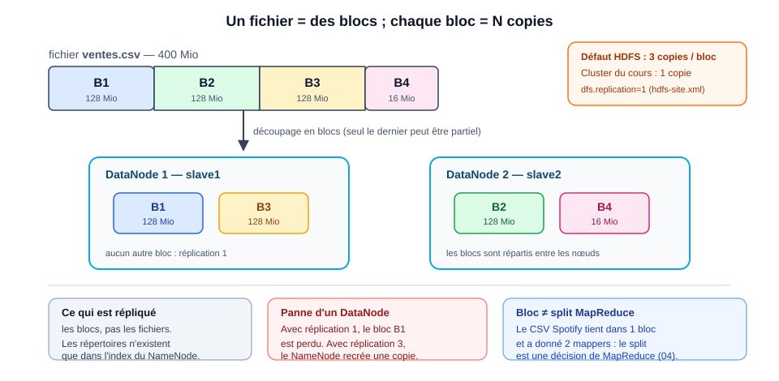
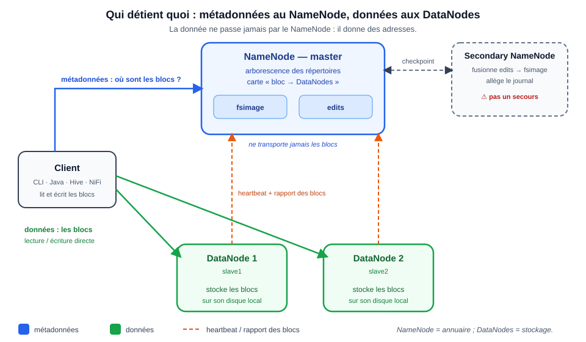
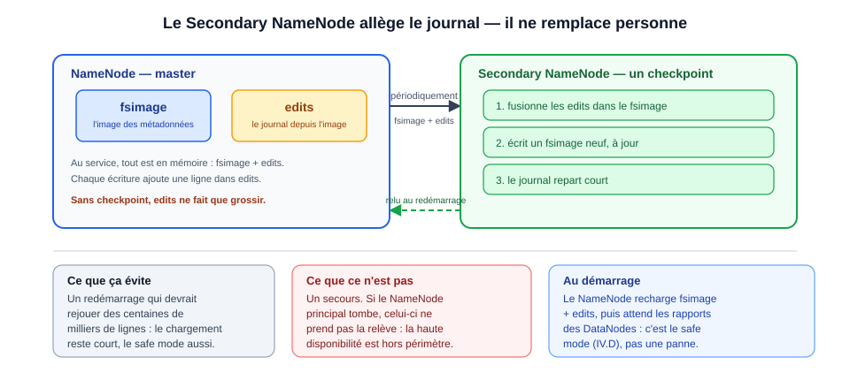
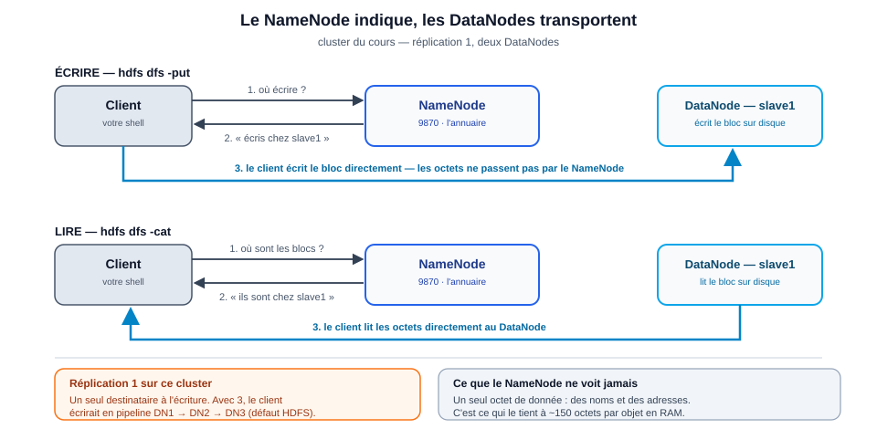

[← Chapitre précédent](02-presentation-env-hadoop.md) · [Sommaire](Readme.md) · [Chapitre suivant →](04-mapreduce-et-yarn.md)

# 03 - HDFS (Hadoop Distributed File System)

> **Objectifs** : comprendre pourquoi HDFS existe et comment il range les octets (blocs, réplication) · décrire le NameNode, les DataNodes et le Secondary NameNode · maîtriser `ls`, `cat`, `put`, `get`, `rm` · lire les métadonnées d'un fichier (taille, blocs, réplication).
> **Mise en pratique** : [Exercices](#vi-exercices)

> **La vérité vient de la mesure** : les chiffres de ce chapitre (128 Mio, réplication 1, 155 593 octets, 1 bloc, port 9870) ont été reproduits sur le cluster du cours (Hadoop 3.3.6). Quand une règle de la littérature ne colle pas à notre cluster, c'est la mesure qui fait foi.

## Sommaire

- [I. Pourquoi HDFS — le problème avant la solution](#i-pourquoi-hdfs--le-problème-avant-la-solution)
  - [A. Trois murs du stockage centralisé](#a-trois-murs-du-stockage-centralisé)
  - [B. Le contrat HDFS](#b-le-contrat-hdfs)
  - [C. Ce que HDFS n'est pas](#c-ce-que-hdfs-nest-pas)
- [II. Blocs et réplication — comment les octets sont rangés](#ii-blocs-et-réplication--comment-les-octets-sont-rangés)
  - [A. Le bloc, unité de stockage](#a-le-bloc-unité-de-stockage)
  - [B. La réplication se fait par bloc](#b-la-réplication-se-fait-par-bloc)
  - [C. Ce que le système corrige tout seul](#c-ce-que-le-système-corrige-tout-seul)
  - [D. Le prix à payer](#d-le-prix-à-payer)
- [III. Les commandes HDFS — le geste quotidien](#iii-les-commandes-hdfs--le-geste-quotidien)
  - [A. Une syntaxe, des chemins](#a-une-syntaxe-des-chemins)
  - [B. Le mémo](#b-le-mémo)
  - [C. Lire les métadonnées](#c-lire-les-métadonnées)
  - [D. Les pièges](#d-les-pièges)
  - [E. Mise en pratique : le CSV Spotify](#e-mise-en-pratique--le-csv-spotify)
- [IV. L'architecture — qui détient quoi](#iv-larchitecture--qui-détient-quoi)
  - [A. Le NameNode : l'annuaire](#a-le-namenode--lannuaire)
  - [B. Les DataNodes : les blocs](#b-les-datanodes--les-blocs)
  - [C. Le Secondary NameNode : un checkpoint, pas un secours](#c-le-secondary-namenode--un-checkpoint-pas-un-secours)
  - [D. Le safe mode](#d-le-safe-mode)
  - [E. Une lecture, une écriture : qui parle à qui](#e-une-lecture-une-écriture--qui-parle-à-qui)
  - [F. Tableau des pannes](#f-tableau-des-pannes)
- [V. Démarrer, vérifier, dépanner](#v-démarrer-vérifier-dépanner)
  - [A. Ne jamais reformater](#a-ne-jamais-reformater)
  - [B. Vérifier que HDFS tourne](#b-vérifier-que-hdfs-tourne)
  - [C. Le safe mode, côté réflexe](#c-le-safe-mode-côté-réflexe)
  - [D. Où sont les logs](#d-où-sont-les-logs)
- [VI. Exercices](#vi-exercices)
  - [A. Mémo sans filet](#a-mémo-sans-filet)
  - [B. Manipulation Spotify](#b-manipulation-spotify)
  - [C. Défi blocs et réplication](#c-défi-blocs-et-réplication)
- [VII. Vérifiez vos acquis](#vii-vérifiez-vos-acquis)

## I. Pourquoi HDFS — le problème avant la solution

Un disque de 1 To ne stocke pas un fichier de 4 To. Un cluster de centaines de disques, oui — encore faut-il savoir où est chaque morceau et quoi faire quand un disque meurt.

Avant toute commande, il faut la raison d'être. HDFS n'est pas un système de fichiers qui aurait grossi : c'est une réponse à trois problèmes qu'une machine seule ne résout pas. Ces trois réponses expliquent tout ce qui suit, y compris les parties qui semblent arbitraires.

### A. Trois murs du stockage centralisé

Trois choses arrêtent un serveur unique dès qu'on parle de données massives. Regardez-les une par une : chacune a sa réponse, et ces trois réponses *sont* le design d'HDFS.

| Mur | Ce qui bloque | Réponse HDFS |
|---|---|---|
| **Volume** | un fichier dépasse le plus gros disque | découper en blocs |
| **Panne** | plus il y a de disques, plus il y en a qui tombent | répliquer chaque bloc |
| **Réseau** | rapatrier des téraoctets coûte plus cher que d'y envoyer le calcul | calculer sur place (chapitre 04) |

Retenez la troisième ligne : c'est la moins évidente et la plus décisive. Tant qu'on rapporte la donnée jusqu'au calcul, un cluster de cent nœud ne sert qu'à stocker.

À l'échelle d'un cluster, la panne d'un disque est la norme. HDFS est conçu pour qu'elle ne se voie pas.

### B. Le contrat HDFS

Le contrat tient en quatre engagements. Leur ordre n'est pas décoratif : c'est l'ordre dans lequel HDFS traite un fichier.

1. **découper** chaque fichier en blocs de taille fixe ;
2. **répliquer** chaque bloc sur plusieurs machines ;
3. **exposer** une arborescence unique (`/user/root/input/...`) ;
4. **déplacer le calcul vers les données** : lire le bloc là où il est stocké.

En échange : écrire une fois, lire en flux, tolérer la panne. Ce n'est pas un système de fichiers généraliste.



### C. Ce que HDFS n'est pas

Le corollaire du contrat tient en quatre idées reçues. Elles reviennent chaque année en salle, et chacune a déjà envoyé quelqu'un construire une architecture qui ne tient pas.

| HDFS n'est pas… | Conséquence |
|---|---|
| **une base de données** | pas d'index, pas d'`UPDATE` : on lit en flux, MapReduce (chapitre 04) ou Hive (chapitre 05) interroge. |
| **un système POSIX** | pas d'édition au milieu d'un fichier : on écrit, on ajoute en fin, on relit. |
| **un terrain pour des millions de petits fichiers** | chaque objet vit en mémoire du NameNode ; le chiffre est en II.D. |
| **un entrepôt de données** | il stocke ; Hive donne le schéma et le SQL (chapitre 05). |

HDFS range des octets. Il ne les comprend pas.

## II. Blocs et réplication — comment les octets sont rangés

HDFS ne range pas des fichiers : il range des blocs.

C'est la seule notion qu'il faut avoir comprise avant de toucher une commande. La réplication que vous allez lire dans un `ls`, le nombre de tâches du chapitre 04, la mort des petits fichiers — tout découle de là. Prenez ces quatre sous-sections dans l'ordre : la première définit l'objet, les trois suivantes disent ce qu'on en fait.

### A. Le bloc, unité de stockage

Un bloc est un morceau de fichier de taille fixe, considéré par HDFS comme autonome : c'est lui qu'on stocke, lui qu'on copie, lui qu'on remplace — jamais « le fichier ».

- **128 Mio** par défaut (`dfs.blocksize`), dérogeable à la création.
- Un fichier = **n blocs** ; seul le dernier peut être partiel.

Le mot « bloc » désigne ensuite deux choses différentes selon qui parle, et les confondre fait dire n'importe quoi au chapitre 04 :

| Notion | Décidée par | Rôle |
|---|---|---|
| **bloc** | HDFS | stockage et réplication |
| **split** | MapReduce | tranche de lecture, une par tâche map |

Une fois la distinction posée, le reste est une mesure. Mesuré : le CSV Spotify (155 593 o) tient dans **1 bloc** — et le chapitre 04 lui a donné **2 splits**. Un bloc peut donc nourrir plusieurs mappers. 400 Mio donneraient 4 blocs (3 × 128 + 16).

**On lit, on ne devine pas** : `hdfs fsck input/Spotify_Most_Streamed_Songs.csv -files -blocks`.

### B. La réplication se fait par bloc

Un bloc existe donc en plusieurs exemplaires. Deux questions : combien, et où ?

- **3 par défaut** ; **1 sur le cluster du cours** (`dfs.replication=1`).
- Elle se lit dans `hdfs dfs -ls` : **le premier chiffre après les droits**.

```text
-rw-r--r--   1 root supergroup    155593 ... /user/root/input/Spotify_Most_Streamed_Songs.csv
             ^ facteur de réplication
```

- Réglable par fichier ou répertoire : `hdfs dfs -setrep [-R] [-w] 2 <chemin>`, vérifiable avec `hdfs dfs -stat %r <chemin>`.
- Les copies vivent sur des nœuds différents — et des racks différents quand il y en a.
- **Pas de RAID sur les DataNodes** : la redondance est logicielle, c'est HDFS qui réplique.

> **Pourquoi 1 ici ?** Le cluster n'a que **deux DataNodes** : une réplication à 3 resterait sous-répliquée (2 copies maximum). Le `1` économise l'espace, mais la panne d'un slave perd des blocs. Choix de TP, pas de production.

Ce sont les **blocs** qui sont répliqués, pas les fichiers. Les répertoires n'existent que dans l'index du NameNode.

### C. Ce que le système corrige tout seul

Trois copies sur trois nœuds : il arrive qu'il n'en reste plus que deux. Personne n'intervient, et c'est le but.

- **Sous-réplication** : un DataNode ne répond plus → le NameNode recrée les copies manquantes.
- **Sur-réplication** : `setrep` baisse → le surplus est supprimé.
- **Contrôle** : `hdfs fsck ...` signale les blocs sous-répliqués ou corrompus.

Une réserve, sinon on se trompe de diagnostic : l'auto-réparation attend que le heartbeat manque depuis assez longtemps. Un `fsck` lancé juste après une panne montre encore l'état ancien.

### D. Le prix à payer

Ce design se paie à trois endroits, et le deuxième est celui qui coûte le plus cher sans qu'on le voie venir.

| Choix | Ce qu'on paie |
|---|---|
| **petits fichiers** | ~150 octets par objet en RAM du NameNode : des millions le tuent |
| **compression** | du CPU, et parfois tout le parallélisme — détail ci-dessous |
| **permissions** | propriétaire / groupe / autres, superutilisateur HDFS, Kerberos pour la vraie authentification (hors TP) |

**La compression mérite d'être développée, parce qu'on l'interroge en fin de chapitre.** Un *codec* est un programme qui range les octets plus serrés : le fichier pèse moins lourd et se transporte plus vite, contre du temps de CPU à l'écriture et à la lecture. Ça, c'est l'échange annoncé. Le piège est ailleurs, et il est grossier : un fichier compressé en **gzip** (`.gz`) ne se lit qu'en séquence, du premier octet au dernier. HDFS ne peut donc pas le découper, MapReduce (chapitre 04) n'y trouve **qu'un seul split**, donc un seul mapper — et un cluster de dix nœuds regarde un seul nœud travailler. **snappy** (`.snappy`) tombe sous le même coup. **bzip2** (`.bz2`), lui, découpe en blocs indépendants et laisse le parallélisme entier.

D'où la règle : beaucoup de gros fichiers, et la compression seulement quand le codec laisse découper.

## III. Les commandes HDFS — le geste quotidien

Vous savez ce qu'HDFS range, et où il le range. Il reste à y poser les mains.

Douze commandes suffisent pour tout ce que fait le cours, et elles se ressemblent toutes. On les prend dans l'ordre du geste — une syntaxe, le mémo, la lecture des métadonnées — puis on regarde ce qui marche mal et pourquoi, et on dépose le CSV du cours pour de bon.

### A. Une syntaxe, des chemins

- `hdfs dfs <commande>` = `hadoop fs <commande>`. Les exercices utilisent `hdfs dfs`.
- `/` est la racine HDFS ; `input` = `/user/<utilisateur>/input`.
- `hdfs://namenode:9000/...` ne sert qu'à lever une ambiguïté : la couche **HadoopFS** choisit le backend selon le schéma (`hdfs://`, `file://`, `s3a://`…).
- CLI, API Java, Hive et NiFi passent tous par cette couche.

Retenez le deuxième point : c'est ce qui fait qu'on écrit `input` et non un chemin absolu partout dans le cours.

### B. Le mémo

Le mémo d'abord, pour l'avoir sous les yeux pendant la manipulation de III.E. La colonne *Usage* dit ce que la commande fait ; les limites sont toutes en III.D.

| Commande | Exemple | Usage |
|---|---|---|
| `ls` | `hdfs dfs -ls input` | lister (déjà long : pas de `-l`) |
| `mkdir -p` | `hdfs dfs -mkdir -p input/2026` | créer, parents compris comme en shell |
| `put` | `hdfs dfs -put fichier.csv input/` | local → HDFS (refuse d'écraser sans `-f`) |
| `cat` | `hdfs dfs -cat input/fichier.csv` | afficher |
| `get` | `hdfs dfs -get input/fichier.csv ./` | HDFS → local |
| `cp` | `hdfs dfs -cp input/a.csv input/b.csv` | HDFS → HDFS |
| `mv` | `hdfs dfs -mv input/a.csv input/archive/` | déplacer / renommer |
| `rm` / `rm -r` | `hdfs dfs -rm -r input/archive` | supprimer (récursif) |
| `du -s -h` | `hdfs dfs -du -s -h input` | taille occupée |
| `stat` | `hdfs dfs -stat %r input/fichier.csv` | réplication |
| `setrep` | `hdfs dfs -setrep -w 2 input/fichier.csv` | changer la réplication |
| `fsck` | `hdfs fsck input/fichier.csv -files -blocks` | blocs et état |

### C. Lire les métadonnées

`hdfs dfs -ls` est déjà long : droits, **réplication**, propriétaire / groupe, taille, date, chemin absolu. Quand on veut une valeur seule, `stat` évite de la découper à la main :

| Format | Ce qu'il affiche | Mesure |
|---|---|---|
| `%r` | réplication | `1` |
| `%b` | taille totale des blocs | `155593` |
| `%o` | taille d'un bloc | `134217728` |

État global du cluster : `hdfs dfsadmin -report`.

### D. Les pièges

Six pièges. Tous réels, tous rencontrés au moins une fois en salle — aucun n'est une hypothèse d'école.

- **`-ls` est déjà long** : `hdfs dfs -ls -l` échoue, `-l` n'existe pas.
- **`-tail` ne lit pas des lignes** : il renvoie les **1024 derniers octets**, sans égard aux fins de ligne. Sur notre CSV : 7 lignes, la première coupée en plein milieu d'un champ. Pour « les N dernières lignes », l'outil est `hdfs dfs -cat … | tail -N`. `-tail` n'est pas pour autant un jouet cassé : c'est **l'outil qu'il faut** pour surveiller un fichier qui grossit sous vos yeux — un log, un `part-*` en cours d'écriture. Il ne sait pas où commence une ligne, il sait se placer à `taille − 1024` ; ça a un usage, et ce n'est pas celui-là.


- **`-cp` reste dans HDFS** : local → HDFS, c'est `-put` ; HDFS → local, c'est `-get`.
- **`-get` prend la source HDFS d'abord** : `<source_HDFS> <destination_locale>`.
- **`-put` n'écrase pas sans `-f`** : c'est une protection, pas un bug.
- **`-rm` sans `-r`** refuse un répertoire non vide ; `-rmdir` n'accepte qu'un répertoire vide.

### E. Mise en pratique : le CSV Spotify

Le fichier vit dans `data/` sur votre machine ; le master ne le voit pas. On le copie une fois :

```bash
# depuis la machine hôte, à la racine du dépôt du cours
docker cp data/Spotify_Most_Streamed_Songs.csv hadoop-master:/home/
docker exec -it hadoop-master bash

hdfs dfs -mkdir -p input
hdfs dfs -put /home/Spotify_Most_Streamed_Songs.csv input/
hdfs dfs -ls input
hdfs dfs -cat input/Spotify_Most_Streamed_Songs.csv | tail -10
```

Résultat mesuré du `ls` :

```text
Found 1 items
-rw-r--r--   1 root supergroup    155593 2026-09-11 18:33 /user/root/input/Spotify_Most_Streamed_Songs.csv
```

Quatre choses à lire dans cette ligne, toutes vérifiables : le **1** après les droits (réplication — pas 3 ; un `3` signifierait que vous n'êtes pas sur le cluster du cours), la taille **155 593** identique au local (personne n'a transformé le fichier), le chemin absolu `/user/root/...` (`input`, sans `/`, est relatif à votre répertoire utilisateur), et la date de l'envoi — les vôtres différeront, c'est normal.

Le `cat | tail -10` rend 10 lignes de 25 champs, dont des valeurs entre guillemets parce qu'elles contiennent des virgules (`"Feid, Paulo Londra"`) ; la toute dernière est `Alone,Burna Boy,…`. Même contenu que le local (954 lignes) : comparez pour vous en assurer. Le fichier est dans le cluster ; le chapitre 04 le traite.

## IV. L'architecture — qui détient quoi

Vous avez déposé un fichier et lu une ligne de `ls` en une demi-seconde. Qui sait quoi, dans ce cluster, pour répondre aussi vite ? Et qui porte les octets, vous l'avez déjà deviné : pas celui qui répond.

Trois rôles : un annuaire, des ouvriers, et un comptable qui n'est pas un secours.



### A. Le NameNode : l'annuaire

- **Arborescence** des répertoires + **carte « bloc → DataNodes »**.
- **Ne transporte jamais les données** : il donne des adresses.
- Sur disque : `fsimage` + `edits`, tout chargé en mémoire (~150 octets par objet).
- Point unique de défaillance ; la haute disponibilité (standby + ZooKeeper) sort du périmètre.

Ce dernier point est le plus important du chapitre côté production : tout ce que vous voyez ici tient parce qu'un seul serveur sait où est tout.

### B. Les DataNodes : les blocs

- Stockent les blocs sur leur **disque local**.
- Envoient un **heartbeat** et un **rapport des blocs** au NameNode.
- Lisent et écrivent les blocs quand le client leur parle, après l'adresse fournie par le NameNode.
- NameNode sur le master ; DataNodes sur les slaves.

Reste une question ouverte par le premier point de A : le NameNode tient sa carte en mémoire. Au redémarrage, comment la retrouve-t-il ?

### C. Le Secondary NameNode : un checkpoint, pas un secours

C'est le rôle le plus mal compris du cours, et le QCM vous y enverra. Deux phrases suffisent à ne plus se tromper :

- Fusionne périodiquement `edits` dans `fsimage` : il **allège le journal**.
- **Ne remplace jamais** le NameNode principal : s'il tombe, on redémarre le principal — ou on passe par la haute disponibilité, hors périmètre.



### D. Le safe mode

Le redémarrage du NameNode a une phase que tout le monde prend pour une panne :

- Au démarrage, le NameNode charge `fsimage` + `edits` et **attend les rapports des DataNodes**.
- **Lecture seule** : les lectures passent, les écritures sont bloquées.
- Sortie automatique, ou `hdfs dfsadmin -safemode get` / `leave`.
- Un `put` qui échoue juste après le démarrage n'est pas un bug : c'est le safe mode.

Le réflexe côté dépannage est en V.C.

### E. Une lecture, une écriture : qui parle à qui

Un même principe, deux trajets : le NameNode indique, les DataNodes transportent.

| Opération | Déroulé |
|---|---|
| **Lire** | client → NameNode (adresses) → DataNodes (lecture directe) |
| **Écrire** | client → NameNode (où écrire) → pipeline de DataNodes → accusé |

Le NameNode ne voit passer que des noms et des adresses ; les octets vont du client aux DataNodes.



### F. Tableau des pannes

De quoi le chapitre a parlé, mise à plat : ce qui tombe, ce qu'on perd, et ce qui se répare tout seul.

| Panne | Conséquence | Réaction |
|---|---|---|
| DataNode | blocs sous-répliqués | re-réplication automatique |
| Disque | réplica perdu | idem, via les autres réplicas |
| NameNode | cluster indisponible | redémarrage ; HA hors périmètre |
| Secondary NameNode | aucun secours | il allège seulement le journal |

## V. Démarrer, vérifier, dépanner

Le chapitre 02 a monté le cluster. Ici : ce qui est propre à HDFS et ce qu'on fait quand il ne répond pas.

### A. Ne jamais reformater

- `hdfs namenode -format` **initialise** le namespace, ce n'est pas de la configuration.
- Relancée sur un cluster existant : namespace effacé, `clusterID` désaligné, **données perdues**.
- Sur le cluster du cours, c'est fait à la création du conteneur. Si HDFS ne répond plus : `./start-dfs.sh`, jamais `-format`.

### B. Vérifier que HDFS tourne

Quatre vérifications, dans cet ordre — elles vont du processus à l'interface :

| Vérification | Commande | Attendu |
|---|---|---|
| master | `jps` | `NameNode`, `SecondaryNameNode` |
| slave | `docker exec -it hadoop-slave1 jps` | `DataNode` |
| interface | <http://localhost:9870> | page *Overview* |
| cluster | `hdfs dfsadmin -report` | `Live datanodes (2)` |

Le démarrage standard reste `./start-dfs.sh` depuis le master (déjà vu en 02) ; l'arrêt, `./stop-dfs.sh`. `jps` ne montre que le conteneur où on le lance : les DataNodes sont sur les slaves.

### C. Le safe mode, côté réflexe

Le *pourquoi* est en IV.D. Ici, seulement le geste :

- **Symptôme** : une écriture échoue avec `Safe mode is ON`, une lecture passe.
- **Reconnaître** : `hdfs dfsadmin -safemode get`.
- **Attendre** la sortie automatique ; `leave` force la sortie si le NameNode a fini de charger.

### D. Où sont les logs

`$HADOOP_HOME/logs` (souvent `/opt/hadoop/logs`). NameNode : `hadoop-root-namenode-<hôte>.log` ; DataNode : `hadoop-root-datanode-<hôte>.log`. Premier réflexe : `tail -n 50`. Sur un slave, le log est sur le slave.

## VI. Exercices

Une heure environ sur le cluster du cours. Les résultats attendus sont donnés au fil de l'eau : c'est la sortie qui tranche, pas l'énoncé.

### A. Mémo sans filet

Sans regarder III.B, écrivez la commande qui : crée `input/2026` avec les parents ; dépose `fichier.csv` dans `input/` ; liste `input/` ; affiche les 5 dernières lignes d'un fichier HDFS ; récupère un fichier HDFS dans le répertoire courant ; supprime un répertoire non vide. Vérifiez ensuite dans le tableau : c'est la sortie qui tranche.

### B. Manipulation Spotify

Refaites III.E sans regarder, puis vérifiez : fichier dans `/user/root/input/` ; `1` en réplication et `155593` en taille ; 10 lignes de 25 champs dont la dernière est `Alone,Burna Boy,…` ; contenu identique au local.

### C. Défi blocs et réplication

1. Combien de blocs pour le CSV ? Prouvez-le avec `hdfs fsck ... -files -blocks`.
2. Lisez la réplication avec `stat %r`, puis dans `ls`.
3. Passez une **copie** à 2 réplicas (`setrep -w 2`), vérifiez, revenez à 1. Pourquoi 2 copies mais pas 3 ?
4. Créez un répertoire non vide, essayez `rmdir`, relevez le message, puis `rm -r`.

Deux DataNodes = deux copies maximum.

## VII. Vérifiez vos acquis

*Formatif, jamais noté. Répondez sans relire le chapitre. Les réponses se déplient juste après le séparateur : ce qui compte est de repérer où vous vacillez.*

**1.** Un fichier de 400 Mio est déposé dans HDFS (blocs de 128 Mio). Combien de blocs occupe-t-il ?

- A. 1, parce que HDFS compresse avant de découper
- B. 3, parce que 400 / 128 = 3,125 et HDFS ignore le reste
- C. 4, parce que 3 blocs pleins sont suivis d'un bloc partiel de 16 Mio
- D. 400, parce qu'un bloc fait 1 Mio

**2.** Vous listez `input` avec `hdfs dfs -ls`, et un « 1 » apparaît juste après les droits. Que signifie ce chiffre ?

- A. Le fichier occupe un seul bloc de 128 Mio, la taille minimale que sache gérer HDFS
- B. Le fichier appartient à un seul utilisateur, le propriétaire du répertoire courant
- C. Le fichier n'a pas encore été répliqué, le NameNode étant en safe mode au moment de la mesure
- D. Le facteur de réplication vaut 1 sur ce cluster, et non le 3 par défaut d'HDFS

**3.** Pourquoi éviter de compresser un fichier que MapReduce devra traiter en parallèle ?

- A. Parce qu'un fichier compressé ne se découpe pas : un seul map le traite
- B. Parce que la compression supprime les fins de ligne, ce qui rend les champs illisibles
- C. Parce que les codecs du cours ne s'appliquent qu'aux fichiers texte, jamais aux CSV
- D. Parce que HDFS refuse d'écrire un bloc compressé sur plusieurs DataNodes

**4.** Que stocke le NameNode ?

- A. Les blocs eux-mêmes, répartis sur ses disques
- B. Uniquement le contenu des fichiers, sans les noms
- C. Les métadonnées : l'arborescence et la carte « bloc → DataNodes »
- D. Une copie complète du disque de chaque DataNode

**5.** Le NameNode principal tombe. Que fait le Secondary NameNode ?

- A. Il reprend le service à sa place, puisque le `fsimage` qu'il tient est une copie chaude du NameNode
- B. Il fusionne les `edits_xxx` dans `fsimage_xxx` périodiquement, mais ne le remplace pas
- C. Il place les DataNodes en lecture seule et les bloque jusqu'au retour du NameNode principal
- D. Il recopie les blocs manquants sur les autres DataNodes pour rétablir le facteur de réplication

**6.** Le NameNode vient de démarrer et reste en safe mode. Que peut-on faire sur HDFS à cet instant ?

- A. Écrire normalement, mais pas lire : les blocs ne sont pas encore cartographiés
- B. Rien du tout : le NameNode attend son `fsimage` et refuse toute connexion
- C. Lire seulement : l'écriture reste bloquée tant que les DataNodes n'ont pas répondu
- D. Tout faire, le safe mode n'étant qu'un bandeau d'avertissement sur l'interface du port 8088

**7.** *Question ouverte (2-3 lignes).* Un cluster ne répond plus et un collègue propose de relancer `hdfs namenode -format` « pour repartir proprement ». Que lui répondez-vous ?

---

<details>
<summary>Vérifier ses réponses</summary>

### Réponses

**1. C.** 400 / 128 = 3,125 : trois blocs pleins, puis un bloc partiel de 16 Mio.
**Pourquoi :** le nombre de blocs se lit dans `hdfs fsck <fichier> -files -blocks`, il ne se devine pas.

**2. D.** Ce chiffre est le facteur de réplication : 1, parce que le cluster du cours est configuré `dfs.replication=1`.
**Pourquoi :** le 3 est le défaut d'HDFS, pas une obligation ; il se règle avec `hdfs dfs -setrep`.

**3. A.** Un fichier compressé avec gzip ne se « splitte » pas : un seul map le lit, le parallélisme disparaît.
**Pourquoi :** c'est le prix de la compression, avec la charge CPU — les gains d'espace et de transfert ne se discutent pas sans lui.

**4. C.** Le NameNode détient l'arborescence et la carte « bloc → DataNodes ». Il ne transporte jamais les données.
**Pourquoi :** un annuaire central léger, des DataNodes qui portent les octets : c'est tout le modèle.

**5. B.** Le Secondary NameNode est un checkpoint : il allège le journal, il ne remplace pas le NameNode.
**Pourquoi :** si le principal tombe, le cluster attend son redémarrage — ou passe par la haute disponibilité (standby + ZooKeeper), hors périmètre.

**6. C.** Le safe mode est un mode lecture seule : le NameNode charge ses métadonnées et attend les rapports des DataNodes.
**Pourquoi :** il bloque l'écriture le temps de reconstruire la carte des blocs, puis sort tout seul.

**7.** Attendu : ne pas relancer ce formatage. `hdfs namenode -format` **initialise** le répertoire de métadonnées ; relancée, elle efface le namespace et désaligne le `clusterID` des DataNodes, donc détruit les données. Sur le cluster du cours, le formatage est déjà fait : on repart par `./start-dfs.sh`, puis on vérifie `jps`, le safe mode et les logs.

</details>

---

[← Chapitre précédent](02-presentation-env-hadoop.md) · [Sommaire](Readme.md) · [Chapitre suivant →](04-mapreduce-et-yarn.md)
