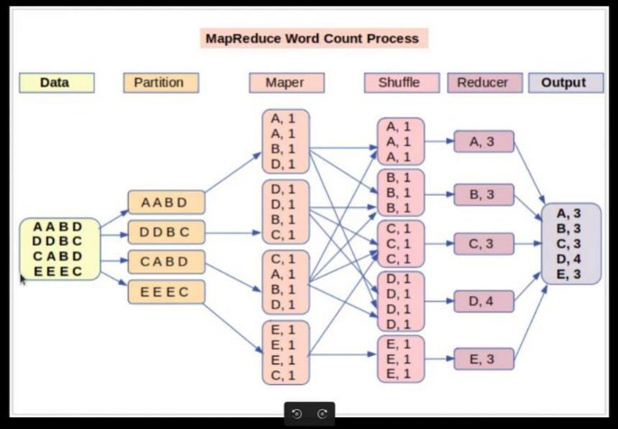
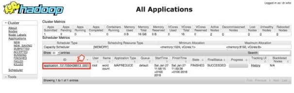
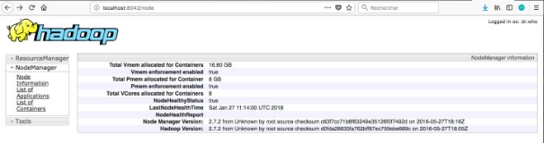
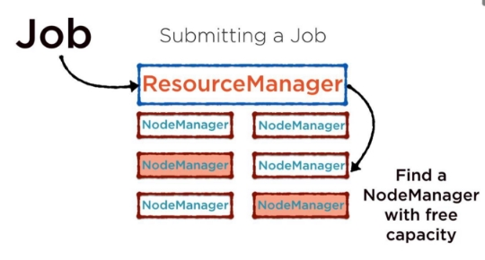
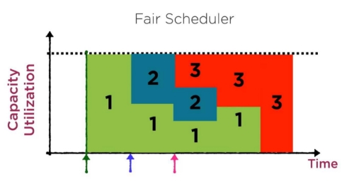

[← Chapitre précédent](03-hdfs.md) · [Sommaire](Readme.md) · [Chapitre suivant →](05-hive.md)

 

# MapReduce et YARN

> **Objectifs** : modéliser le pipeline MapReduce (bloc → split → map → partition → shuffle/sort → reduce) · connaître le contrat d'exécution (processus par tâche, tri, partition) · développer un MapReduce en Python via Hadoop Streaming · tester en local, lancer, suivre et diagnostiquer un job sur le cluster.
> **Prérequis** : séquence 03 (HDFS) · **Durée** : ~6 h · **Type** : cours + code
> **La vérité vient de la mesure** : tous les chiffres de ce chapitre (nombre de splits, de reducers, latences, compteurs) ont été reproduits sur le cluster du cours (Hadoop 3.3.6). Quand une règle de la littérature ne colle pas à notre cluster, c'est la mesure qui fait foi.
> **Mise en pratique** : [exercices/04 — MapReduce & YARN](exercices/04-mapreduce.md)

## Sommaire

- [I. Temps 1 — Le modèle](#i-temps-1--le-modèle)
  - [A. Le pipeline complet](#a-le-pipeline-complet)
  - [B. Bloc → Split : combien de mappers ?](#b-bloc--split--combien-de-mappers-)
  - [C. Map](#c-map)
  - [D. Partition, shuffle et sort](#d-partition-shuffle-et-sort)
  - [E. Reduce](#e-reduce)
- [II. Temps 2 — Le contrat d'exécution](#ii-temps-2--le-contrat-dexécution)
  - [A. Un processus par tâche](#a-un-processus-par-tâche)
  - [B. L'en-tête n'existe que dans le premier split](#b-len-tête-nexiste-que-dans-le-premier-split)
  - [C. Tri lexicographique](#c-tri-lexicographique)
  - [D. Combien de reducers ?](#d-combien-de-reducers-)
  - [E. Le combiner ne sait pas moyenner](#e-le-combiner-ne-sait-pas-moyenner)
- [III. Temps 3 — Le geste](#iii-temps-3--le-geste)
  - [A. Hadoop Streaming : le contrat clé/valeur](#a-hadoop-streaming--le-contrat-clévaleur)
  - [B. Tester son code en local avant le cluster](#b-tester-son-code-en-local-avant-le-cluster)
  - [C. Lancer un job et lire les résultats](#c-lancer-un-job-et-lire-les-résultats)
  - [D. Suivre une application](#d-suivre-une-application)
  - [E. Quand un job échoue : les compteurs se lisent ailleurs](#e-quand-un-job-échoue--les-compteurs-se-lisent-ailleurs)
  - [F. `yarn logs` : la preuve dans les journaux](#f-yarn-logs--la-preuve-dans-les-journaux)
  - [G. La latence réelle d'un job](#g-la-latence-réelle-dun-job)
  - [H. Script d'automatisation](#h-script-dautomatisation)
- [IV. YARN](#iv-yarn)
  - [A. Présentation de YARN](#a-présentation-de-yarn)
  - [B. Fonctionnement de YARN](#b-fonctionnement-de-yarn)
  - [C. Allouer de la mémoire à MapReduce](#c-allouer-de-la-mémoire-à-mapreduce)

## I. Temps 1 — Le modèle

### A. Le pipeline complet

MapReduce est le modèle de programmation du framework Hadoop : il permet d'analyser des volumes de données massifs en traitement **parallèle**. Les données sont découpées, traitées indépendamment sur plusieurs serveurs, puis les résultats partiels sont agrégés en un résultat consolidé.

Le traitement d'un job suit une chaîne **fixe**, où chaque étape est jouée par une pièce différente du framework :

```
bloc ──> split ──> map ──> partition ──> shuffle / sort ──> reduce ──> part-0000N
  │        │        │          │              │               │            │
  HDFS   fichier  un task    clés        tri des clés      agrégation   un fichier
  (128 M) lu par  émettant   routées      vers le bon      par clé      par reducer
          degré de  clé\tvaleur  vers les      reducer
          parallélisme           reducers
```

- **Bloc** : le fichier HDFS est découpé en blocs de **128 Mio** (c'est le *block size*, vu en séquence 03). Notre CSV Spotify fait 156 547 octets : **un seul bloc**.
- **Split** : à chaque job, Hadoop découpe les blocs en *splits* — des « tranches de lecture » attribuées aux mappers. **Un split = une tâche map = un mapper.**
- **Map** : le mapper lit les lignes de son split (`stdin`), émet des paires intermédiaires `clé\tvaleur`.
- **Partition** : les paires sont routées vers les reducers — par défaut, « même clé → même reducer ».
- **Shuffle / sort** : le framework regroupe et **trie** les pairs par clé avant de les donner aux reducers.
- **Reduce** : le reducer agrège les valeurs de même clé, émet le résultat final.
- **Sortie** : un dossier HDFS contenant **un fichier par reducer** (`part-00000`, `part-00001`, …), plus un `_SUCCESS` vide si tout a bien fini.


### B. Bloc → Split : combien de mappers ?

> **La règle à retenir de tout ce chapitre : le nombre de mappers se *lit*, il ne se devine pas.** La littérature dit « le nombre de splits = taille / taille de bloc ». Sur **notre** cluster, c'est faux : la vraie commande est lue dans le log du job, ligne `number of splits:`.

Ce qui a été **mesuré** sur le cluster du cours :

| Situation | Splits / mappers observés |
|---|---|
| une `-input` d'**un seul bloc** (156 547 o), sans option | **2 splits** — parce que `mapreduce.job.maps` vaut **2 par défaut** ici |
| même fichier, `-D mapreduce.job.maps=1` | **1 split** |
| même fichier, `-D mapreduce.job.maps=4` | **4 splits** (toujours le même bloc unique) |
| fichier de 1 095 829 o (1 bloc), `-D mapreduce.job.maps=8` | **8 splits**, `Map input records=6678` |

Deux enseignements :
1. Le nombre de splits dépend d'un **hint de configuration** (`mapreduce.job.maps`) autant que de la taille des données — pas d'une formule mentale.
2. « Un mapper = un split », mais **pas** forcément « un mapper = un bloc » : plusieurs mappers peuvent lire le même bloc.

Pour lire la vérité d'un job, après lancement :

```bash
hadoop jar $HADOOP_HOME/share/hadoop/tools/lib/hadoop-streaming-*.jar \
  -D mapreduce.job.maps=2 \
  -file mapper.py -mapper "python3 mapper.py" \
  -file reducer.py -reducer "python3 reducer.py" \
  -input input/Spotify_Most_Streamed_Songs.csv \
  -output output/wordcount 2>&1 | grep "number of splits"
# 22/09/11 10:31:42 INFO mapreduce.JobSubmitter: number of splits:2
```

> Le `2>&1 | grep "number of splits"` met en évidence la ligne — le job se lance comme d'habitude, la sortie du *launcher* est juste filtrée.

### C. Map

- Le mapper reçoit les lignes de **son** split sur l'entrée standard, **une par tour de boucle**.
- Il émet sur la sortie standard des paires `clé\tvaleur` — **une paire par ligne**.
- **Un mapper = un processus `python3 mapper.py` lancé une fois.** Pas d'état conservé entre deux appels : tout ce qu'il doit « retenir », il le met dans la clé ou la valeur.


### D. Partition, shuffle et sort

Après la map, trois étapes intermédiaires préparent les données pour les reducers :

1. **Partition** : chaque paire intermédiaire est attribuée à un reducer. Par défaut, la partition est déterminée par la clé (hash) : **toutes les valeurs d'une même clé vont au même reducer**.
2. **Shuffle** : les paires voyagent du mapper vers le reducer qui les attend — et un reducer ne peut démarrer **tant qu'un mapper est encore actif**.
3. **Sort** : pour chaque reducer, les paires reçues sont **triées par clé**. C'est ce tri qui rend le reducer simple : il n'a qu'à accumuler les valeurs **consécutives** de même clé.

 

> Le tri est **lexicographique** (ordre des chaînes, pas des nombres) : `"10"` passe **avant** `"2"`. Conséquence concrète : les années sortent comme `1930, 1931, …, 2023` tant que les années ont 4 chiffres (alignement par hasard correct), mais `"2023" < "897"`. Et en HBase, on retrouvera le même tri — une clé `"1975"` arrive avant `"2023"` uniquement parce que `'1' < '2'`, pas parce que 1975 < 2023 (cf. séquence 06).

### E. Reduce

- Le reducer reçoit sur `stdin` des lignes `clé\tvaleur` **déjà groupées et triées par clé**.
- Il agrée les valeurs de chaque groupe et émet le résultat final, toujours en `clé\tvaleur`.
- **Un reducer = aussi un processus unique**, lancé entre 1 et N fois (une fois par *task* reduce). Comme le mapper, il ne garde rien entre deux exécutions.



## II. Temps 2 — Le contrat d'exécution

### A. Un processus par tâche

La conséquence la plus importante du modèle — et celle qu'on oublie le premier jour — : **chaque tâche (map comme reduce) est un processus isolé, lancé de zéro**. Un mapper ne connaît que ce qui passe sur son `stdin`, un reducer de même.

Trois corollaires concrets :

- **Pas de contention de ressources « intra-task »** : si votre code écrit un fichier sur le disque local, chaque mapper/Reducer l'écrit **à son propre emplacement** — le fichier de l'un écrase celui de l'autre.
- **Le graphe (EX 04, exercice 3) ne sort qu'à la fin du reducer** : le reducer lit **tout** son `stdin` avant de produire le PDF, puis `plt.savefig()` est appelé **après** la boucle — jamais pendant. Une sortie avant la fin produit un PDF vide.
- **« Retenir la clé précédente »** est le seul état toléré : on le porte dans des variables *locales* au processus (le pattern `current_key`), pas dans un fichier externe.

### B. L'en-tête n'existe que dans le premier split

Notre CSV a une ligne d'en-tête. Elle n'est **lue qu'une fois** — par le premier mapper à lire la première ligne du premier split. **Les autres mappers ne la voient jamais.**

>C'est pourquoi on écarte l'en-tête *par la valeur* (`if row[0] == 'track_name': continue`), **et jamais** par un `next(csv.reader(...))`. Mesuré sur le cluster : avec `next()`, le job **réussit**, `Map input records` est **identique** (954), et le résultat diffère d'**une paire** (1480 contre 1481) — impossible à distinguer avec les compteurs, dénombrable seulement en comparant à une valeur attendue.

### C. Tri lexicographique

Voir [Temps 1 — Partition, shuffle et sort](#partition-shuffle-et-sort) : le tri est sur les **clés sous forme de chaînes**. Vérifiez toujours, sur un petit échantillon, que vos clés trient dans l'ordre que votre reducer suppose.

### D. Combien de reducers ?

Par défaut : **1 reducer** — et donc **un seul fichier de sortie** : `part-00000`. Le `ls` du répertoire de sortie montre exactement un fichier de données plus le `_SUCCESS` :

```bash
hdfs dfs -ls output/wordcount
# Found 2 items
# -rw-r--r--   1 root supergroup  ... output/wordcount/_SUCCESS
# -rw-r--r--   1 root supergroup  ... output/wordcount/part-00000
```

Pour obtenir plusieurs fichiers (`part-00000`, `part-00001`, …), demandez plusieurs reducers — chaque reducer produira son propre fichier :

```bash
-D mapreduce.job.reduces=2
```

> **Pourquoi un seul fichier par défaut ?** Un seul reducer garantit une sortie **globalement triée** et un fichier unique, simple à relire. On augmente le nombre de reducers quand la sortie est volumineuse ou qu'on veut du parallélisme d'écriture — au prix de perdre le tri global et d'éclater le résultat en plusieurs fichiers.


### E. Le combiner ne sait pas moyenner

Le **combiner** est un « mini-reducer » exécuté **sur le serveur du mapper**, avant le shuffle, pour alléger le trafic réseau : il agrée localement ce que le mapper vient d'émettre (souvent le même code que le reducer).

Un combiner suppose une propriété mathématique : les valeurs partielles doivent se combiner sans perdre d'information. La somme et le compte en bénéficient — **pas la moyenne** :

```
moyenne(10, 20, 30) = 20
combiner : groupe1 = moyenne(10, 20) = 15  ;  groupe2 = moyenne(30) = 30
moyenne(15, 30) = 22,5   ≠   20   ✗
```

Règle : **pour une moyenne, on ne combine jamais des moyennes.** On fait remonter **somme + compte**, et on divise **à la fin du reducer**. C'est exactement le pattern demandé par l'exercice « moyenne par année » de l'EX 04 — et la moyenne des moyennes est la signature d'un bug classique à repérer dans les rendus.

## III. Temps 3 — Le geste

### A. Hadoop Streaming : le contrat clé/valeur

MapReduce est écrit en Java, mais grâce à **Hadoop Streaming**, on écrit ses mappers et reducers dans **n'importe quel langage** (Python, Ruby, Bash…) : le jar streaming lit l'entrée sur `stdin` de vos programmes et collecte leur `stdout`. Le contrat tient en trois lignes :

- le **mapper** lit des lignes sur `stdin`, écrit sur `stdout` des paires `clé\tvaleur` (une par ligne) ;
- Hadoop fait la **partition** et le **shuffle/sort** entre les deux ;
- le **reducer** lit sur `stdin` les paires `clé\tvaleur` **déjà groupées et triées par clé**, écrit le résultat agrégé sur `stdout`.

**Structure minimale d'un mapper :**

```python
import sys

for line in sys.stdin:
    line = line.strip()
    # ... extraction de la clé et de la valeur ...
    print("%s\t%s" % (cle, valeur))
```

**Structure minimale d'un reducer** (agrégation des valeurs consécutives de même clé) :

```python
import sys

current_key = None
current_total = 0

for line in sys.stdin:
    line = line.strip()
    parts = line.split('\t', 1)
    if len(parts) < 2:
        continue
    key, value = parts[0], parts[1]
    try:
        value = int(value)
    except ValueError:
        continue

    if current_key == key:          # même clé : on accumule
        current_total += value
    else:
        if current_key:             # nouvelle clé : on émet la précédente
            print("%s\t%s" % (current_key, current_total))
        current_key = key
        current_total = value

if current_key:                     # ne pas oublier la dernière clé
    print("%s\t%s" % (current_key, current_total))
```

> **Pourquoi le `int()` est protégé ?** Une ligne mal formée (notre CSV en contient une : ligne 576, `streams` corrompu) fait planter un `int()` direct. En local le test le montre immédiatement ; sur le cluster, c'est **l'échec du job** avec un compteur trompeur (voir ci-dessous). Toujours tester en local d'abord.

Le jar à utiliser est fourni avec Hadoop : `hadoop-streaming-<version>.jar` (sur le cluster du cours, Hadoop 3.3.6), dans `$HADOOP_HOME/share/hadoop/tools/lib`.

### B. Tester son code en local avant le cluster

Simuler le pipeline MapReduce en local avec des pipes Unix est l'habitude la plus rentable du développement Hadoop :

```bash
# mapper seul : vérifier les paires émises
echo "bonjour bonsoir bonjour bonsoir" | python mapper.py

# mapper + reducer : sans le tri, le reducer échoue (clés non regroupées)
echo "bonjour bonsoir bonjour bonsoir" | python mapper.py | python reducer.py

# mapper + sort + reducer : simulation fidèle du shuffle
echo "bonjour bonsoir bonjour bonsoir" | python mapper.py | sort | python reducer.py
```

Le `sort` du shell **simule le shuffle** : sur le cluster, Hadoop regroupe et trie les clés avant le reducer. **Si votre code fonctionne avec `| sort |`, il fonctionnera sur le cluster** — et c'est aussi le moyen de voir les paires `clé\tvaleur` telles que le reducer les recevra.

> **Sous Windows** (avant de se connecter au master) : `type fichier.txt | python mapper.py | sort | python reducer.py`.


### C. Lancer un job et lire les résultats

Une fois le code validé en local, on soumet le job :

```bash
hadoop jar $HADOOP_HOME/share/hadoop/tools/lib/hadoop-streaming-*.jar \
-file mapper.py -mapper "python3 mapper.py" \
-file reducer.py -reducer "python3 reducer.py" \
-input input/Spotify_Most_Streamed_Songs.csv \
-output output/wordcount
```

- `-file` : envoie le script au cluster (il sera exécuté sur les nœuds) ;
- `-mapper` / `-reducer` : la commande exacte exécutée pour chaque tâche ;
- `-input` / `-output` : chemins **HDFS** (le répertoire de sortie **ne doit pas exister**).

> **ATTENTION :** le nom des fichiers doit être cohérent entre `-file` et `-mapper`/`-reducer` : si vous envoyez `mapper.py` avec `-file`, la commande doit référencer `mapper.py` (et pas un autre nom).

Le résultat est un répertoire HDFS, un fichier par reducer :

```bash
hdfs dfs -ls output/wordcount     # part-00000, part-00001, _SUCCESS
hdfs dfs -cat output/wordcount/part-00000   # lire le résultat complet
# (tail ne montre que le dernier Ko : pour un petit résultat, préférez -cat)
```


### D. Suivre une application

Le ResourceManager de YARN expose une interface web : **<http://localhost:8088>**. On y suit l'état (RUNNING, SUCCEEDED, FAILED), la progression, et — réflexe n°1 quand un job échoue — les liens vers les logs détaillés.

Le comportement des nœuds esclaves est visible sur **<http://localhost:8041>** (slave1) et **<http://localhost:8042>** (slave2) : mémoire, conteneurs actifs, tâches en cours.

 

### E. Quand un job échoue : les compteurs se lisent ailleurs

Un job en échec, c'est un job dont on a le *résultat* — pas forcément le *diagnostic*. Deux cas mesurés sur le cluster :

**1. `int(row[8])` non protégé** (ligne 576 corrompue) :

```
PipeMapRed.waitOutputThreads(): subprocess failed with code 1
```

Le job échoue après plusieurs tentatives. Les compteurs affichent `Map input records=473` — **le seul task survivant**, pas les 954. **Ne lisez jamais les compteurs d'un job en échec comme ceux d'un job réussi** : un compteur n'est fiable que si l'on sait *quel* task l'a monté.

**2. `next(csv.reader(...))` pour sauter l'en-tête** : le job **réussit**, `Map input records` est **identique** (954), mais il manque une paire (1480 contre 1481). Les compteurs ne le montrent pas — c'est en comparant à **une valeur attendue** (par exemple le `COUNT(*)` de Hive, ou le total calculé en Python) qu'on le détecte.

Il y a donc **deux sortes d'échec** : l'échec *visible* (yarn logs, comme le `subprocess failed with code 1`) et l'échec *silencieux* (job vert, résultat faux d'une paire). Le second exige de disposer d'une **valeur de contrôle** écrite avant le job.

### F. `yarn logs` : la preuve dans les journaux

Quand l'UI 8088 ne suffit plus, on va chercher la preuve dans les journaux :

```bash
yarn logs -applicationId application_1690000000000_0001 2>&1 | grep -n "PipeMapRed\|stderr\|Exception" | head
```

- `application_…` : l'identifiant affiché dans l'UI 8088 (et dans la sortie du launcher, après `INFO mapreduce.JobSubmitter`) — le prenez **avant** l'échec ou dans l'historique.
- L'option `-containerId` cible un conteneur précis (ex. `container_e1_1690000000000_0001_01_000002`) ; sans elle, `yarn logs` affiche les journaux de **toutes** les tâches. Pour lister les conteneurs avec leur nœud : `-show_application_log_info`.

> Cette commande manquait au cursus alors que le « réflexe n°1 » y est affirmé : **c'est *le* moyen de voir le `stderr` d'un mapper qui a planté** (exception Python, code de sortie, ligne en cause).

### G. La latence réelle d'un job

Dimensionnez votre journée avec la mesure, pas avec le mythe d'un MapReduce instantané. Sur le cluster du cours, même un « petit » job a un prix fixe : **35 s à 69 s pour un `COUNT(*)` sur un CSV de 154 ko** — allocation des conteneurs, upload des scripts, lancement des JVM, écriture sur HDFS.

Quand un exercice annonce « je lance un job », prévoir : chaque lancement = 1 à 2 minutes de cluster, à multiplier par le nombre d'essais. C'est la raison n°1 de **tester en local d'abord** (section précédente) : chaque aller-retour cluster en échec coûte ce temps-là.

### H. Script d'automatisation

L'enchaînement « démarrer les services → créer les répertoires HDFS → copier les données → soumettre le job → lire le résultat » est répétitif. Un script shell automatise tout. Exemple complet fourni dans [`annexes/utils/0-job.sh`](annexes/utils/0-job.sh) :

```bash
#!/bin/bash

INPUT_FILE="Spotify_Most_Streamed_Songs.csv"
OUTPUT_FILE="exemple"

./start-dfs.sh                     # NameNode & DataNodes (./ : /home hors PATH)
./start-yarn.sh                    # ResourceManager & NodeManagers
# pas de HBase/Thrift ici : ce job écrit sur stdout (voyez utils/5 pour HBase)

hdfs dfs -mkdir -p input
hdfs dfs -put -f $INPUT_FILE input
hdfs dfs -rm -r -f output/$OUTPUT_FILE    # le répertoire de sortie ne doit pas exister

hadoop jar $HADOOP_HOME/share/hadoop/tools/lib/hadoop-streaming-*.jar \
-file mapper.py -mapper "python3 mapper.py" \
-file reducer.py -reducer "python3 reducer.py" \
-input input/$INPUT_FILE \
-output output/$OUTPUT_FILE

hdfs dfs -cat output/$OUTPUT_FILE/part-00000
```

Adaptez les noms de fichiers d'entrée/sortie et les services nécessaires à votre job (pas besoin de HBase si votre reducer écrit sur stdout).

## IV. YARN

### A. Présentation de YARN

- **YARN** = « **Y**et **A**nother **R**esource **N**egotiator ». C'est le gestionnaire de ressources de Hadoop, devenu sous-projet Apache avec Hadoop 2.0 (2012-2013).
- Avant YARN, Hadoop ne pouvait exécuter que des applications MapReduce. En découplant la **gestion des ressources** de l'**exécution des traitements**, YARN permet à Hadoop d'héberger d'autres types d'applications (Spark, Hive, Tez…) sur le même cluster.

### B. Fonctionnement de YARN

Trois rôles :

- **ResourceManager** (RM) — sur le master : alloue les ressources, planifie les applications.
- **NodeManager** (NM) — sur chaque nœud : surveille les conteneurs, remonte l'état au RM.
- **ApplicationMaster** (AM) — un par application : négocie les conteneurs auprès du RM, orchestre les tâches de *son* application.



YARN propose plusieurs politiques de planification : **FIFO Scheduler** (premier arrivé, premier servi), **Fair Scheduler** (les applications se partagent la capacité équitablement), **Capacity Scheduler** (la défaut : quotas par file d'attente).

  

La stratégie est configurée dans `etc/hadoop/yarn-site.xml` (propriété `yarn.resourcemanager.scheduler.class`).

### C. Allouer de la mémoire à MapReduce

Sur le cluster du cours, les conteneurs sont petits — et c'est un choix, pas un oubli : `yarn.nodemanager.resource.memory-mb=256` (mémoire gérée par YARN par NodeManager) et `mapreduce.map.memory.mb=192` (mémoire demandée par chaque tâche map). N'attendez pas des mappers « géants » : avec 192 Mio par tâche, un mapper Python tient, mais le parallélisme (et la taille des données qu'une tâche peut tenir en mémoire) est forcément modeste. Pour un job qui en a besoin, on augmente le nombre de tâches plutôt que la mémoire de chacune.


---

[← Chapitre précédent](03-hdfs.md) · [Sommaire](Readme.md) · [Chapitre suivant →](05-hive.md)
