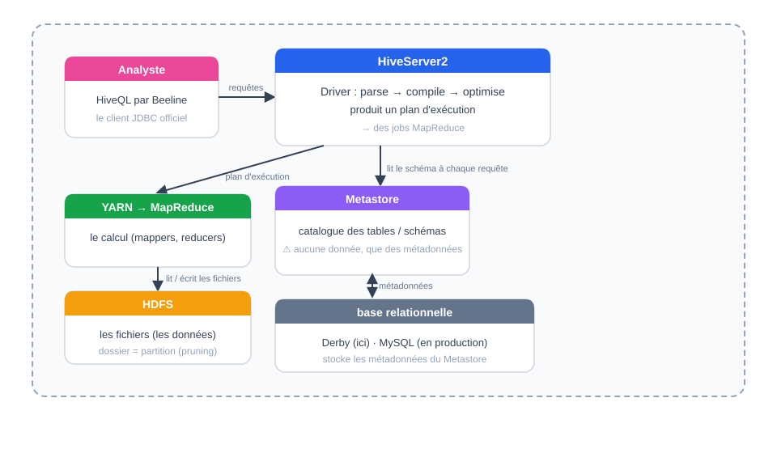

[← Chapitre précédent](04-mapreduce-et-yarn.md) · [Sommaire](Readme.md) · [Chapitre suivant →](06-hbase-et-zookeeper.md)

 

# 05 - Hive, l'entrepôt SQL sur Hadoop

> **Objectifs** : comprendre ce qu'apporte Hive par rapport à MapReduce · maîtriser l'architecture (HiveServer2, Metastore, driver) · distinguer tables externes et managées · écrire des requêtes SQL sur des données HDFS · relier SQL et MapReduce via EXPLAIN.

## Sommaire

- [I. Hive](#i-hive)
  - [A. Le problème : interroger sans programmer](#a-le-problème--interroger-sans-programmer)
  - [B. Présentation de Hive](#b-présentation-de-hive)
  - [C. Architecture de Hive](#c-architecture-de-hive)
  - [D. Le modèle de données](#d-le-modèle-de-données)
  - [E. Tables externes vs tables managées](#e-tables-externes-vs-tables-managées)
  - [F. SQL sur HDFS : la séparation calcul/stockage](#f-sql-sur-hdfs--la-séparation-calculstockage)
  - [G. Ce que compile Hive : le lien avec MapReduce](#g-ce-que-compile-hive--le-lien-avec-mapreduce)
  - [H. Premiers pas sur le cluster](#h-premiers-pas-sur-le-cluster)
  - [I. Hive en 2026 : datalake et lakehouse](#i-hive-en-2026--datalake-et-lakehouse)
  - [J. Hive, HBase, HDFS : quel stockage pour quel usage ?](#j-hive-hbase-hdfs--quel-stockage-pour-quel-usage-)
- [II. Exercices](#ii-exercices)
  - [A. Prise en main](#a-prise-en-main)
  - [B. Interroger en SQL](#b-interroger-en-sql)
  - [C. Exercices autonomes](#c-exercices-autonomes)
  - [Exercice 1 — Top 5 artistes par nombre de titres](#exercice-1--top-5-artistes-par-nombre-de-titres)
  - [Exercice 2 — Streams moyens par année de sortie](#exercice-2--streams-moyens-par-année-de-sortie)
  - [Exercice 3 — Quand Hive plutôt que MapReduce ?](#exercice-3--quand-hive-plutôt-que-mapreduce-)
  - [D. Pour aller plus loin](#d-pour-aller-plus-loin)
- [III. Vérifiez vos acquis](#iii-vérifiez-vos-acquis)

## I. Hive

### A. Le problème : interroger sans programmer

Après la séquence 04, vous savez écrire un job MapReduce en Python. Posez-vous maintenant la question du **quotidien d'une équipe data** :

- Le responsable marketing demande : _« Quels sont nos dix titres les plus streamés ? »_ → il faut écrire un mapper, un reducer, les tester, les lancer, récupérer la sortie.
- Une heure plus tard, il demande : _« Et la moyenne des streams par année de sortie ? »_ → nouveau mapper, nouveau reducer, nouveau cycle complet.
- Les analystes de l'équipe, eux, **ne connaissent ni Python ni Java** — et on ne peut pas leur demander d'apprendre MapReduce pour explorer des données.

MapReduce répond au **comment** exécuter un calcul distribué, pas au **quoi** calculer. Chaque question nouvelle impose un développement. Pour l'exploration de données — le cœur du travail analytique — il faut un langage **déclaratif** : on décrit le résultat voulu, la machine décide des étapes.

La solution historique de l'écosystème Hadoop pour ce problème : **Hive**, le SQL sur HDFS.

### B. Présentation de Hive

**Apache Hive** est un entrepôt de données (_data warehouse_) qui s'installe au-dessus de Hadoop et permet d'interroger les données stockées dans HDFS **avec un langage proche du SQL** : HiveQL.

Hive est né chez **Facebook en 2008**, avec exactement le problème décrit ci-dessus : des analystes qui savaient écrire du SQL, des données massives sur un cluster Hadoop, et aucun pont entre les deux. Facebook a donc écrit le traducteur : **du SQL vers des jobs MapReduce**. Le projet a rejoint Apache en 2009.

Concrètement, écrire :

```sql
SELECT artist_name, SUM(streams) AS total
FROM spotify
GROUP BY artist_name
ORDER BY total DESC
LIMIT 10;
```

...revient à lancer un job MapReduce complet — sans écrire une ligne de Python ni de Java. C'est la promesse de Hive : **le SQL des analystes, la puissance du cluster**.

> **Vocabulaire.** On dit que Hive est un _data warehouse_ (entrepôt de données) plutôt qu'une base de données : il ne stocke pas les données lui-même — elles restent des fichiers dans HDFS — et il est optimisé pour l'**analyse en batch** de gros volumes (OLAP), pas pour les transactions à la ligne (OLTP).

### C. Architecture de Hive



Trois briques à retenir :

* **HiveServer2** : le service qui reçoit les requêtes. On s'y connecte avec **Beeline** (client JDBC, interactif ou scripté). C'est lui qui héberge le **driver**. (Les vieilles CLI `hive` ont été retirées de Hive 4 — Beeline est le client officiel.)
* **Le driver** : le moteur de traduction. Il **parse** la requête, la **compile** en plan d'exécution (des jobs MapReduce — ou Tez), l'**optimise**, puis lance l'exécution sur **YARN**. C'est ici que le SQL devient du calcul distribué.
* **Le Metastore** : le **catalogue**. Il mémorise, dans une base relationnelle classique (Derby embarquée par défaut, MySQL en production) : _« la table `spotify` pointe vers ces fichiers HDFS, avec ces colonnes, ces types, ce format »_. **Point clé** : le Metastore ne contient **aucune donnée** — uniquement les métadonnées. Les données vivent dans HDFS.

> **Conséquence importante** : deux clients (Hive, mais aussi Spark SQL ou Trino s'ils sont configurés) peuvent interroger les **mêmes fichiers HDFS** via le même Metastore. Le stockage est partagé, seul le moteur de calcul change.

### D. Le modèle de données

Hive organise les données selon une hiérarchie familière pour qui connaît le SQL :

| Niveau | Rôle | Commande type |
|---|---|---|
| **Database** | espace de nommage logique | `CREATE DATABASE spotify_db;` |
| **Table** | schéma + localisation de fichiers | `CREATE EXTERNAL TABLE …` |
| **Partition** | sous-dossier = valeur d'une colonne | `PARTITIONED BY (released_year INT)` |
| **Bucket** | répartition en fichiers par hash | `CLUSTERED BY (artist) INTO 8 BUCKETS` |

* **Les partitions** traduisent une idée déjà vue en séquence 03 (l'arborescence HDFS) : partitioner par année de sortie revient à stocker `released_year=2015/`, `released_year=2022/`… Une requête filtrant sur une partition ne lit que le dossier concerné — c'est l'**élagage de partitions** (_partition pruning_), la première optimisation de Hive.
* **Les buckets** répartissent les lignes en un nombre fixé de fichiers selon le hash d'une colonne — utile pour jointures et échantillonnage.

**Point de vigilance** : Hive ne modifie pas les fichiers d'entrée. Il lit des fichiers **au format déclaré** (texte délimité, Parquet, ORC…) et suppose que la réalité correspond au schéma — il n'y a pas de contraintes d'intégrité comme dans MySQL. C'est à vous de garantir la cohérence entre le schéma déclaré et les données réelles.

### E. Tables externes vs tables managées

C'est **la** distinction à maîtriser — elle conditionne qui est maître des données.

| | Table **MANAGED** (managée) | Table **EXTERNAL** (externe) |
|---|---|---|
| Création | `CREATE TABLE …` | `CREATE EXTERNAL TABLE …` |
| Qui écrit les données | Hive (il les dépose dans HDFS) | **Vous** (n'importe quel outil : `hdfs dfs -put`, un job, NiFi…) |
| Cycle de vie | liée à Hive | liée à HDFS |
| `DROP TABLE` | supprime **les métadonnées ET les données HDFS** | supprime **uniquement les métadonnées** — les fichiers restent |

En pratique dans ce cours, nous utiliserons quasi exclusivement des **tables externes** : les données Spotify sont déposées dans HDFS (séquences 03-04), et Hive vient simplement déclarer un schéma **par-dessus**. HDFS reste le maître du stockage ; Hive n'est qu'une lentille de lecture.

```sql
-- Table externe : Hive ne "possède" rien
CREATE EXTERNAL TABLE spotify_clean (
  track_name STRING,
  artist_name STRING,
  streams BIGINT
  -- …
)
ROW FORMAT DELIMITED FIELDS TERMINATED BY '\t'
LOCATION '/user/root/spotify/clean';
```

> **Réflexe de survie** : avant tout `DROP TABLE`, demander — est-ce une EXTERNAL ou une MANAGED ? Sur une table managée, DROP détruit des heures de pipeline. Vous verrez cette manipulation contrôlée en EX ([section II — Exercices](#ii-exercices)).

### F. SQL sur HDFS : la séparation calcul/stockage

Reprenons le schéma de l'architecture : le Metastore sait _où_ sont les données (fichiers HDFS) et _comment_ les lire (schéma, format) ; YARN exécute le calcul. **Aucune donnée ne transite par Hive.**

Cette séparation est le concept le plus durable de l'écosystème — tous les moteurs modernes l'exploitent :

- Vous déposez un fichier dans HDFS avec `hdfs dfs -put` (séquence 03) ;
- Un job MapReduce en produit un autre (séquence 04) ;
- **Hive** interroge l'un ou l'autre en SQL (cette séquence) ;
- **Spark SQL** ou **Trino** pourraient interroger exactement les mêmes fichiers via le même Metastore — sans copie, sans conversion.

C'est la promesse du _lakehouse_ actuel : un stockage de fichiers ouvert (HDFS, puis S3, Iceberg), plusieurs moteurs de calcul à la demande.

### G. Ce que compile Hive : le lien avec MapReduce

Vous savez (séquence 04) ce qu'est un job MapReduce. Regardez maintenant ce que Hive fait de votre SQL — la boucle se referme :

```sql
EXPLAIN
SELECT artist_name, SUM(streams) AS total
FROM spotify_clean
GROUP BY artist_name;
```

La sortie du `EXPLAIN` décrit les phases du job généré, avec un vocabulaire qui doit vous être familier :

```
STAGE DEPENDENCIES:
  Stage-1 … (Map + Reduce)
  Stage-0 … (Fetch)
```

* Le **map** lit chaque ligne et émet une paire `(artiste, streams)` — exactement le mapper que vous avez écrit en Python à l'EX 04 ;
* le **shuffle** regroupe les paires de même clé — le travail du framework entre map et reduce (séquence 04) ;
* le **reduce** agrège — votre reducer.

**Une requête SQL de 6 lignes = un job MapReduce complet** (mapper, tri, reducer) que vous auriez écrit en une centaine de lignes de Python. C'est toute la valeur de Hive : pas un nouveau moteur de calcul, mais un **compilateur** qui génère du MapReduce pour vous.

> **Quand Hive, quand MapReduce à la main ?** Hive excelle pour l'**exploration ad-hoc** (question → requête) et les ETL déclaratifs. On retombe sur MapReduce (ou Spark) quand il faut un contrôle fin du traitement : logique métier complexe, formats exotiques, optimisations au niveau enregistrement. La séquence 04 vous a appris ce que fait le moteur ; Hive vous fait gagner le temps de l'écrire.

### H. Premiers pas sur le cluster

Hive **4.1.0** est installé dans l'image du cluster (`hadoop-cluster-base`) : HiveServer2 et le Metastore (Derby embarqué) sont préconfigurés — rien à installer. Son démarrage est un simple script dans le master :

```bash
./start-hive.sh     # lance HiveServer2 (port JDBC 10000) et attend qu'il réponde
```

Puis on s'y connecte avec **Beeline**, le client officiel (la CLI `hive` n'existe plus depuis Hive 4) :

```bash
beeline -u jdbc:hive2://localhost:10000
```

> La connexion affiche `0: jdbc:hive2://localhost:10000>` comme prompt — les requêtes qui suivent s'y saisissent (une par ligne, `;` pour terminer, `!quit` pour sortir).

```sql
SHOW DATABASES;
-- résultat attendu : default (+ vos bases créées)

CREATE DATABASE spotify_db;
USE spotify_db;

SHOW TABLES;
-- résultat attendu : vide — on créera la table Spotify à l'EX 05
```

> **Manipulations complètes** (création de la table Spotify, requêtes, EXPLAIN, DROP) : [section II — Exercices](#ii-exercices).

### I. Hive en 2026 : datalake et lakehouse

L'encart « écosystème historique » du cours 01 cite Hive parmi les briques toujours actives — le détail :

* **Hive 4.x** (4.0 en 2024, c'est la génération de notre cluster — 4.1.0) : intégration native d'**Apache Iceberg** (format de table lakehouse — transactions ACID, évolution de schéma, time travel), support d'**Apache Ranger** (sécurité fine), vues matérialisées améliorées, HiveServer2 consolidé.
* **Toujours massivement présent en entreprise** : les clusters on-premise legacy, Cloudera CDP, et les plateformes cloud qui en dérivent exécutent des quantités de SQL Hive en production chaque jour.
* **Concurrence** : pour le SQL interactif rapide, **Spark SQL** et **Trino/Presto** ont pris le dessus sur les nouveaux projets — mais ils partagent le même modèle (Metastore + fichiers) que Hive a popularisé. Apprendre Hive, c'est apprendre le modèle.

Positionnement dans notre cursus : Hive s'insère **entre MapReduce (04) et HBase (06)** — trois réponses à trois questions de stockage/interrogation sur le même HDFS.

### J. Hive, HBase, HDFS : quel stockage pour quel usage ?

Synthèse pour fixer les idées avant la séquence 06 :

| | HDFS (séq. 03) | Hive (cette séquence) | HBase (séq. 06) |
|---|---|---|---|
| **Nature** | système de fichiers distribué | entrepôt SQL par-dessus HDFS | base NoSQL orientée colonnes |
| **Accès** | commandes shell, MapReduce | SQL (HiveQL) | clé de ligne, scans (shell, API) |
| **Latence** | minutes (batch) | dizaines de secondes à minutes | **millisecondes** (temps réel) |
| **Modèle** | fichiers, blocs | tables, partitions | tables larges clairsemées |
| **Usage type** | stocker des archives, gros fichiers | analyser, agréger, explorer | servir des lectures/écritures à la ligne |

Les trois cohabitent sur le même cluster — et même sur les mêmes données, via les tables externes.

## II. Exercices

Cet exercice est la **contrepartie SQL** de l'EX 04 (MapReduce) : vous aviez écrit des jobs Python pour questionner les données Spotify, vous allez maintenant écrire des requêtes — et vérifier que les résultats correspondent.

_📌 Avant de commencer, relisez la section [« Premiers pas sur le cluster »](#h-premiers-pas-sur-le-cluster) du cours : le point de départ est identique._

### A. Prise en main

#### 1. Lancer Hive via Beeline

Dans le master (conteneur `hadoop-master`), démarrez d'abord HiveServer2 si ce n'est pas déjà fait :

```bash
./start-hive.sh
```

Puis connectez-vous avec **Beeline**, le seul client SQL de Hive 4 :

```bash
beeline -u jdbc:hive2://localhost:10000
```

> ⚠️ **Si `beeline: command not found`** : le `PATH` de l'image n'est exporté que pour certains types de shell. Deux sorties, au choix :
> `export PATH=$PATH:/opt/hive/bin` puis `which beeline`, ou le chemin complet `/opt/hive/bin/beeline -u jdbc:hive2://localhost:10000`.
>
> Et **lançez Beeline depuis `hadoop-master`** : le Metastore est une base Derby embarquée, attachée à ce conteneur. Depuis un esclave, l'URL `localhost:10000` ne désigne rien.
>
> **Et la commande `hive` ?** Le binaire existe encore et son `--help` liste même un service `cli` *par défaut* — mais ce n'est plus qu'un wrapper qui redirige vers Beeline. La CLI historique a bel et bien disparu : la classe `CliDriver` n'est dans aucun jar de Hive 4. En pratique, `hive -e "…"` se termine en code 1 sur `Cannot run commands specified using -e. No current connection`. Beeline est la seule voie — tapez-la directement.

**Résultat attendu** : le prompt `0: jdbc:hive2://localhost:10000>` remplace le prompt shell. La première connexion peut prendre quelques dizaines de secondes (initialisation du Metastore Derby). `!quit` pour sortir.

```sql
SHOW DATABASES;
```

**Résultat attendu** : au moins `default`.

#### 2. Créer la base de travail

```sql
CREATE DATABASE spotify_db;
USE spotify_db;
SHOW TABLES;
```

**Résultat attendu** : `OK` à chaque commande ; `SHOW TABLES` affiche vide (aucune table dans cette base).

#### 3. Préparer les données : du CSV au TSV

Le CSV Spotify contient des champs quotés avec virgules internes (`"Latto, Jung Kook"`) : un séparateur virgule casserait ces lignes. On prépare donc un **TSV** (tabulations) que Hive lira sans ambiguïté.

Sur votre machine locale (ou dans le conteneur, le script est fourni) :

```bash
python3 annexes/utils/7-prepare-spotify-tsv.py data/Spotify_Most_Streamed_Songs.csv spotify-clean.tsv
```

**Résultat attendu** : 954 lignes (header + 953 titres), 25 colonnes. Vérifiez :

```bash
wc -l spotify-clean.tsv
```

Puis poussez le fichier dans HDFS (cf. séquence 03) :

```bash
hdfs dfs -mkdir -p /user/root/spotify/clean
hdfs dfs -put spotify-clean.tsv /user/root/spotify/clean/
hdfs dfs -ls /user/root/spotify/clean
```

**Résultat attendu** : `spotify-clean.tsv` apparaît dans le listing HDFS.

#### 4. Déclarer la table externe

De retour dans Beeline :

```sql
USE spotify_db;

CREATE EXTERNAL TABLE spotify (
  track_name STRING,
  artist_name STRING,
  artist_count INT,
  released_year INT,
  released_month INT,
  released_day INT,
  in_spotify_playlists INT,
  in_spotify_charts INT,
  streams BIGINT,
  in_apple_playlists INT,
  in_apple_charts INT,
  in_deezer_playlists STRING,
  in_deezer_charts INT,
  in_shazam_charts STRING,
  bpm INT,
  `key` STRING,
  mode STRING,
  danceability_pct DOUBLE,
  valence_pct DOUBLE,
  energy_pct DOUBLE,
  acousticness_pct DOUBLE,
  instrumentalness_pct DOUBLE,
  liveness_pct DOUBLE,
  speechiness_pct DOUBLE,
  cover_url STRING
)
ROW FORMAT DELIMITED FIELDS TERMINATED BY '\t'
LOCATION '/user/root/spotify/clean';
```

> ⚠️ **Deux pièges de typage, mesurés sur ces données :**
>
> - `key` est un mot réservé SQL : backticks obligatoires. (`mode` **ne l'est pas** en Hive 4 — testé, la DDL passe sans backticks.)
> - `in_deezer_playlists` est **déclaré `STRING`** alors qu'il contient des nombres : **79 valeurs sont écrites `1,003`** (milliers séparés par une virgule, résidu d'un export tableur). Déclarée `INT`, la colonne aurait mis ces 79 valeurs à `NULL` **sans le moindre avertissement**, et `MAX(in_deezer_playlists)` aurait renvoyé `974` — un maximum **faux**, car les plus grandes valeurs sont justement parmi celles perdues. C'est le type de corruption silencieuse qu'aucun compteur ne signale.
> - `streams` est `BIGINT` : certaines valeurs dépassent INT (le maximum mesuré est 3 703 895 074).

#### 5. Contrôler que tout est en place

```sql
SELECT COUNT(*) FROM spotify;
```

**Résultat attendu** : **`954`** avec la DDL du A.4. Trois valeurs sont possibles, et c'est la question :

| Vous obtenez | Parce que |
|---|---|
| **954** | la DDL de l'EX 05, telle quelle : le fichier garde son en-tête et Hive ne le saute pas |
| **953** | vous avez ajouté `TBLPROPERTIES ('skip.header.line.count'='1')`, ou retiré l'en-tête du fichier |
| **952** | `COUNT(streams)` et non `COUNT(*)` : deux lignes ont un `streams` non numérique mis à `NULL` par Hive — l'en-tête (`streams='streams'`) et la ligne 576 du fichier source (champ corrompu) |

> 🤔 **Question de contrôle** : `wc -l` annonce 954 lignes et `COUNT(*)` renvoie aussi 954. D'habitude on promet 953 : « le compteur ne compte pas l'en-tête ». Pourquoi n'est-ce pas le cas ici, et qu'est-ce que ça change pour tout ce que vous allez compter ensuite ? _Réfléchissez avant de regarder le corrigé — la réponse tient en une ligne, et elle explique pourquoi Hive ne « plante » jamais sur un en-tête : il en fait une ligne de données._

<details>
<summary>Voir la correction</summary>

**A.5 — Pourquoi 954 lignes dans le fichier et 954 dans la table ?**

Le fichier TSV contient le header (`track_name\tartist_name\t...`). Sans `TBLPROPERTIES ('skip.header.line.count'='1')`, Hive lit le header comme une ligne de données normale : `released_year` vaut `'released_year'` (pas un INT, donc `NULL` dans une colonne typée), et `COUNT(*)` renvoie **954** (953 chansons + 1 en-tête compté comme donnée). **Hive ne plante pas** — il ne lève aucune exception, il incorpore silencieusement la première ligne.

Deux solutions propres :

```sql
-- à la création de la table :
CREATE EXTERNAL TABLE spotify (...)
ROW FORMAT DELIMITED FIELDS TERMINATED BY '\t'
LOCATION '/user/root/spotify/clean'
TBLPROPERTIES ('skip.header.line.count'='1');
```

ou retirer le header côté fichier avant le `put` (le `wc -l` passerait alors à 953).

> **Note pour l'animation** : avec la DDL de l'EX 05 (sans `skip.header.line.count`), `COUNT(*)` vaut **954** (l'en-tête est compté). Avec `skip.header.line.count=1`, il vaut **953**. Les deux sont « corrects » — c'est le mécanisme qui importe. Un `COUNT(streams)` donne **952** dans les deux cas (la ligne 576 a `streams` non numérique → `NULL`). L'écart entre ces valeurs est le point pédagogique de contrôle.

</details>

### B. Interroger en SQL

#### 1. Le top 10 — validation croisée avec MapReduce

```sql
SELECT artist_name, SUM(streams) AS total
FROM spotify
GROUP BY artist_name
ORDER BY total DESC
LIMIT 10;
```

**Résultat attendu** : une table de 10 lignes. Les six premières, mesurées, sont :

```
The Weeknd      14185552870
Taylor Swift    14053658300
Ed Sheeran      13908947204
Harry Styles    11608645649
Bad Bunny        9997799607
Olivia Rodrigo   7442148916
```

Total de la colonne `streams` de la table (952 valeurs, la ligne corrompue passée à `NULL`) : **489 458 828 542** streams.

> ⚠️ **Ces valeurs supposent la convention de l'exercice** : `GROUP BY artist_name` regroupe la colonne **telle quelle**, donc `"Latto, Jung Kook"` forme une clé unique et un duo ne contribue à aucun de ses deux interprètes solo. **Ce n'est pas la convention de l'EX 04** : là, c'est le *mapper* que vous avez écrit qui décide, et s'il éclate les duos le classement change — mesuré, The Weeknd passe à **23 929 760 757** et Bad Bunny à **23 813 527 270** (c'est par **nombre de titres** — 40 pour Bad Bunny, 38 pour Taylor Swift, 37 pour The Weeknd — que la version éclatée se distingue).
>
> 🤔 **Question de contrôle — la plus importante de la semaine** : la validation croisée MR ↔ Hive n'a de sens que si **les deux côtés appliquent la même convention**. Écrivez la requête Hive qui éclate les duos, et la requête MapReduce qui ne les éclate pas : vous devez retrouver, de part et d'autre, les deux classements ci-dessus. Si vos chiffres MR et Hive divergent, la première cause à écarter n'est pas un bug — c'est une divergence de convention.

> 🤔 **Validation croisée** : dans les [exercices du chapitre 04](04-mapreduce-et-yarn.md#iv-exercices), l'exercice 1 calculait les streams **par année de sortie**. La requête équivalente ici serait `GROUP BY released_year`. Lancez-la et comparez ligne à ligne avec votre sortie MapReduce : **ce sont exactement les mêmes chiffres** — c'est la preuve que Hive compile le SQL en MapReduce sous le capot.

**Résultat attendu** (extrait de trois années de contrôle) :

```
1975    4206105352
1984    3471625366
2023    25808484104
```

Ces trois valeurs ont été recalculées deux fois indépendamment (Python avec quoting CSV, puis `SUM()` dans Hive) et concordent. Si vous trouvez **exactement 4 206 105 352** pour 1975, votre pipeline est juste. Si vous trouvez un chiffre proche mais pas égal, comparez `COUNT(*)` et `COUNT(streams)` : la ligne corrompue du fichier source est probablement la seule cause, et c'est précisément ce que la question de contrôle cherche à vous faire découvrir.

#### 2. Moyenne de danceability par année

```sql
SELECT released_year, AVG(danceability_pct) AS dance_moyenne
FROM spotify
GROUP BY released_year
ORDER BY released_year;
```

**Résultat attendu** : une ligne par année, valeurs entre 0 et 100 (le champ est un pourcentage).

#### 3. Partitions logiques

Créez une table partitionnée, puis requêtez avec filtre de partition :

```sql
CREATE TABLE spotify_part (
  track_name STRING,
  artist_name STRING,
  streams BIGINT
  -- … schéma réduit pour l'exercice
)
PARTITIONED BY (released_year INT)
ROW FORMAT DELIMITED FIELDS TERMINATED BY '\t';

SET hive.exec.dynamic.partition = true;
SET hive.exec.dynamic.partition.mode = nonstrict;

INSERT OVERWRITE TABLE spotify_part PARTITION (released_year)
SELECT track_name, artist_name, streams, released_year
FROM spotify;
```

**Résultat attendu** : `SHOW PARTITIONS spotify_part;` liste **50 partitions, de 1930 à 2023** — pas « environ 1975 à 2023 ».

> 🤔 **Question de contrôle** : vous voyez peut-être **51** entrées, dont une `__HIVE_DEFAULT_PARTITION__`. Aucune donnée n'a d'année vide — le fichier compte bien 50 années distinctes. D'où vient donc cette 51ᵉ partition, et quel rapport avec le `COUNT(*)` du A.5 ? _Indice : regardez ce que vaut `released_year` pour la première ligne du fichier._

Si vous voulez 50 partitions et rien d'autre, excluez cette ligne de l'`INSERT` :

```sql
INSERT OVERWRITE TABLE spotify_part PARTITION (released_year)
SELECT track_name, artist_name, streams, released_year
FROM spotify
WHERE released_year IS NOT NULL;
```

Puis observez l'élagage de partitions sur le plan :

```sql
EXPLAIN
SELECT COUNT(*) FROM spotify_part WHERE released_year = 2022;
```

**Résultat attendu** : le plan ne mentionne **que** la partition `released_year=2022` — les autres dossiers ne sont pas lus.

#### 4. DROP TABLE — la leçon clé

Vérifiez d'abord le contenu HDFS, puis supprimez la table et regardez ce qui reste :

```bash
# dans le shell (sortez de Beeline avec !quit) :
hdfs dfs -ls /user/root/spotify/clean
```

```sql
-- dans Beeline :
DROP TABLE spotify;
```

```bash
# dans le shell :
hdfs dfs -ls /user/root/spotify/clean
```

**Résultat attendu** : le fichier `spotify-clean.tsv` **est toujours là**. La table externe est supprimée du Metastore (les métadonnées), mais HDFS reste maître de ses données. Recréez la table (commande du A.4) pour la suite de l'exercice.

#### 5. EXPLAIN — retrouver le MapReduce

```sql
EXPLAIN
SELECT artist_name, SUM(streams) AS total
FROM spotify
GROUP BY artist_name;
```

**Résultat attendu** : le plan affiche des **stages** (Map/Reduce) : le map lit les lignes, le shuffle regroupe par `artist_name`, le reduce agrège — le mapper et le reducer que vous écriviez en Python à l'EX 04, générés automatiquement.

<details>
<summary>Voir la correction</summary>

**B.1 — Validation croisée avec MapReduce.** La requête équivalente à l'exercice 3 de l'EX 04 :

```sql
SELECT released_year, SUM(streams) AS total
FROM spotify
GROUP BY released_year
ORDER BY released_year;
```

Les chiffres doivent être **identiques** à la sortie du job MapReduce (le corrigé MR : `04-mapreduce.md`, exercice 1). S'ils divergent : vérifiez le header (cf. A.5), la ligne 576 du CSV (`streams` non numérique, passée à `NULL` par le `try/except int()` du mapper), et le type BIGINT de `streams`. Attention : la ligne 576 a bien 25 champs comme les autres — le script `annexes/utils/7` ne l'écarte pas, c'est le mapper qui la neutralise.

**B.5 — Lecture de l'EXPLAIN.** Sur un GROUP BY, le plan montre typiquement :

```
Stage-1 : Map Operator (lignes lues, agrégation partielle)
          → Reduce Operator (groupage par clé, SUM finale)
Stage-0 : Fetch (retour du résultat)
```

Le map = votre mapper Python, le reduce = votre reducer. Faites le parallèle oral avec les phases de l'EX 04 : c'est le moment où le lien MapReduce/Hive devient tangible.

</details>

### C. Exercices autonomes

### Exercice 1 — Top 5 artistes par nombre de titres

Écrire la requête qui classe les artistes par nombre de titres présents dans le dataset (attention aux artistes multiples dans un champ : on reste au niveau simple — une ligne = un titre).

**Résultat attendu** : 5 lignes `artist_name  nombre_de_titres`. En comptant la colonne artiste **telle quelle** (une ligne = un titre, un duo = un « artiste ») :

```
Taylor Swift    34
The Weeknd      22
Bad Bunny       19
SZA             19
Harry Styles    17
```

> 🤔 **Question de contrôle** : refaites le comptage en **éclatant** les duos sur chaque artiste (`split` + `explode`, hors périmètre ici — mentionnez la méthode). Le classement change, et Bad Bunny passe en tête avec **40** titres. Pourquoi le même dataset et la même question donnent-ils deux réponses justes et différentes, et laquelle écririez-vous dans un rapport ?

<details>
<summary>Voir la correction</summary>

**Exercice 1 — Top 5 artistes par nombre de titres.**

```sql
SELECT artist_name, COUNT(*) AS nb_titres
FROM spotify
GROUP BY artist_name
ORDER BY nb_titres DESC
LIMIT 5;
```

> ⚠️ **Piège classique** : le champ `artist(s)_name` contient parfois plusieurs artistes séparés par des virgules (`"Latto, Jung Kook"`). Ici, on compte chaque ligne = un titre, groupée par le champ brut — les duos comptent comme un « artiste ». C'est une simplification assumée de l'exercice ; pour un comptage exact, il faudrait exploser les duos (fonction `split` + `explode` — hors périmètre, mentionnez-la en ouverture).

</details>

### Exercice 2 — Streams moyens par année de sortie

Moyenne de `streams` groupée par `released_year`, triée par année croissante.

**Résultat attendu** : une ligne par année `année  moyenne_streams`. C'est l'exercice 2 de l'EX 04 (MapReduce) en SQL : vous y accumuliez somme et compte, la moyenne se calcule à la fin de chaque groupe. Comparez les deux sorties — même plage 1930 → 2023, mêmes ordres de grandeur.

<details>
<summary>Voir la correction</summary>

**Exercice 2 — Streams moyens par année.**

```sql
SELECT released_year, AVG(streams) AS moyenne_streams
FROM spotify
GROUP BY released_year
ORDER BY released_year;
```

Comparaison avec l'EX 04 ex.1 : la **somme** y était calculée par MapReduce ; la moyenne en découle (somme / nombre de titres de l'année). Vérification rapide : pour 2023, moyenne ≈ somme(2023) / nb_titres(2023).

</details>

### Exercice 3 — Quand Hive plutôt que MapReduce ?

Question de réflexion, réponse en 3-5 lignes dans votre rapport de TP : votre équipe doit (a) explorer un dataset inconnu différent chaque semaine, (b) produire chaque nuit un rapport agrégé avec un SQL de 20 lignes déjà validé par le métier, (c) parser un format binaire propriétaire avec une machine à états de 300 lignes de logique. Pour chaque cas, Hive ou job MapReduce à la main ? Justifiez en une phrase par cas.

**Résultat attendu** : (a) Hive — l'exploration ad-hoc est le cœur du SQL ; (b) Hive aussi — un SQL de 20 lignes validé relance chaque nuit via `beeline -f rapport.sql` reste simple à maintenir ; le MapReduce à la main se justifie quand la logique métier est complexe (formats exotiques, enchaînements d'états, optimisations au niveau enregistrement).

<details>
<summary>Voir la correction</summary>

**Exercice 3 — Hive ou MapReduce à la main ? (réponses attendues)**

- **(a) Exploration d'un dataset inconnu chaque semaine** → **Hive**. L'exploration ad-hoc est exactement le cas d'usage du SQL : question → requête, itération immédiate, aucune infrastructure à maintenir.
- **(b) Rapport nocturne avec SQL validé de 20 lignes** → **Hive**. Un SQL déjà validé se relance chaque nuit via `beeline -f rapport.sql` ; la maintenance est triviale comparée à 20 lignes de pipeline Python à recouvrir.
- **(c) Format binaire propriétaire + machine à états de 300 lignes** → **MapReduce à la main** (séquence 04). La logique métier complexe, au niveau enregistrement, ne s'exprime pas en SQL — c'est le territoire du code.

**Synthèse à faire émerger** : Hive gagne dès que la question est déclarative (filtrer, agréger, joindre) ; le code gagne dès que la transformation est procédurale et fine. L'EX 04 vous a appris le moteur ; Hive vous fait économiser de l'écrire quand le problème s'exprime en SQL.

</details>

### D. Pour aller plus loin

- **Mode scripté** : Beeline sait exécuter un fichier de requêtes — `beeline -u jdbc:hive2://localhost:10000 -f rapport.sql` — l'équivalent du `hive -f` d'antan, pratique pour l'exercice 3.
- **UI HiveServer2** : l'interface web du service est sur le port 10002 (sessions ouvertes, requêtes en cours).
- **Lien avec la séquence 07 (NiFi)** : ce fichier TSV dans HDFS, c'est celui que le flux NiFi de l'EX 07 saura déposer automatiquement — la même transformation CSV→TSV réalisée en flux plutôt qu'en script.
- **Lien avec la séquence 06 (HBase)** : la table Hive et la table HBase de l'EX 06 peuvent référencer les mêmes données — comparez les modèles (colonnes larges SQL vs familles de colonnes clairsemées).

<details>
<summary>Pièges récurrents à anticiper (formateur)</summary>

1. **Header dans la table** : cf. A.5 — selon les promotions, la moitié de la classe aura 954 au COUNT. Faites chercher la cause avant de donner le `TBLPROPERTIES`.
2. **`key` mot réservé** : la colonne `key` du dataset exige des backticks — signalé dans l'EX 05, à rappeler à l'oral.
3. **Types** : `streams` en BIGINT (dépasse INT sur certains titres — cf. le même piège dans le corrigé MR 04), `in_shazam_charts` en STRING (valeurs non numériques / vides dans le dataset).
4. **Derby une session à la fois** : le Metastore embarqué (Derby, dans `/home/metastore_db`) n'accepte qu'une connexion à la fois — c'est le comportement normal de notre cluster mono-utilisateur. Si un apprenant double-connecte, message d'erreur de verrou : fermer l'autre session (`!quit`). Plusieurs sessions simultanées exigerait un vrai Metastore (MySQL) — hors périmètre.
5. **DROP sur MANAGED par erreur** : si un apprenant a créé une table interne (sans EXTERNAL) sur un dossier avec `LOCATION`, le DROP supprimerait les données — scenario rare ici (tables créées sans LOCATION déposeront dans l'entrepôt Hive, pas dans notre dossier), mais gardez le réflexe de le demander avant tout DROP.

</details>

## III. Vérifiez vos acquis

*Formatif, jamais noté. Répondez sans relire le chapitre. Les réponses se déplient juste après le séparateur : ce qui compte est de repérer où vous vacillez, pas de faire 5 sur 5.*

**1.** Que se passe-t-il quand vous lancez une requête SQL (Structured Query Language) dans Beeline ?

- A. HiveServer2 copie les données concernées dans son propre stockage, puis y applique le filtre et l'agrégation
- B. Le driver compile la requête en jobs MapReduce, que YARN exécute sur les fichiers déjà présents dans HDFS
- C. Le Metastore lit lui-même les fichiers HDFS et renvoie le résultat, ce qui dispense de moteur de calcul
- D. La requête est transmise telle quelle à HBase, qui la sert en millisecondes depuis ses tables orientées colonnes

**2.** Après un `DROP TABLE`, dans quel cas les fichiers disparaissent-ils d'HDFS ?

- A. Sur une table managée : `CREATE TABLE` lie les données à Hive, qui les dépose puis les retire d'HDFS
- B. Sur une table externe : `CREATE EXTERNAL TABLE` donne à Hive la maîtrise du stockage, il nettoie donc ses fichiers
- C. Dans les deux cas, dès lors qu'une clause `LOCATION` a été écrite à la création de la table
- D. Dans aucun cas : le Metastore ne contient que des métadonnées, aucun fichier HDFS n'est jamais supprimé

**3.** Pourquoi `COUNT(*)` renvoie-t-il `954` alors que le fichier TSV (valeurs séparées par des tabulations) compte 953 titres ?

- A. Parce que Hive double compte chaque ligne dont une colonne typée reçoit une valeur non numérique
- B. Parce que la ligne 576 du fichier source est lue une fois par le map, une fois par le reduce
- C. Parce que `COUNT(*)` additionne l'en-tête et les lignes de données, mais jamais les valeurs `NULL`
- D. Parce que l'en-tête devient une ligne de données : `skip.header.line.count` n'est pas déclaré

**4.** Il faut restituer la fiche d'un titre en quelques millisecondes, à la ligne. Quelle brique du cluster ?

- A. HDFS, avec `hdfs dfs -cat` sur le fichier TSV, suffit dès que le fichier reste de taille modeste
- B. Hive, avec une requête filtrée sur la partition `released_year`, répond pendant la phase de map
- C. HBase, base NoSQL orientée colonnes, conçue pour les lectures et écritures à la ligne en temps réel
- D. MapReduce, à condition de relancer le job à chaque demande : le shuffle trie les lignes et prépare la réponse

**5.** *Question ouverte (2-3 lignes).* Dans l'EX 05, `in_deezer_playlists` est déclaré `STRING` alors que 79 valeurs sont écrites `1,003`. Que se passerait-il si la colonne était déclarée `INT`, et pourquoi le problème ne remonte-t-il à l'utilisateur ?

---

<details>
<summary>Vérifier ses réponses</summary>

### Réponses

**1. B.** Le driver de HiveServer2 parse et compile la requête en plan d'exécution, et c'est YARN qui exécute les jobs sur les fichiers de HDFS.
**Pourquoi :** aucune donnée ne transite par Hive — le Metastore ne contient que les métadonnées, HDFS reste maître du stockage. C'est la séparation calcul/stockage qu'exploitent aussi Spark SQL et Trino.

**2. A.** Une table managée lie son cycle de vie à Hive : `DROP TABLE` emporte les métadonnées **et** les fichiers HDFS.
**Pourquoi :** une table externe ne fait que déclarer un schéma par-dessus des fichiers déposés ailleurs ; le `DROP` retire la ligne du Metastore et laisse le fichier en place, ce que l'EX 05 vérifie avec `hdfs dfs -ls` avant et après.

**3. D.** Sans `TBLPROPERTIES ('skip.header.line.count'='1')`, Hive lit l'en-tête du TSV comme une ligne de données : 953 titres + 1 en-tête = 954.
**Pourquoi :** Hive ne lève aucune exception quand une valeur ne colle pas au schéma — `released_year` vaut `'released_year'`, donc `NULL` dans la colonne typée. C'est aussi ce qui explique le `COUNT(streams)` à 952 : l'en-tête et la ligne 576 s'ajoutent aux pertes.

**4. C.** HBase est la brique du temps réel : des millisecondes à la ligne, là où Hive répond en dizaines de secondes et HDFS en minutes de batch.
**Pourquoi :** c'est la synthèse du tableau de la section J — les trois briques cohabitent sur le même cluster, chacune sur son profil de latence.

**5.** Attendu : déclarée `INT`, la colonne mettrait les 79 valeurs `1,003` à `NULL` sans le moindre avertissement, et `MAX(in_deezer_playlists)` renverrait `974` — un maximum faux, car les plus grandes valeurs sont justement parmi celles perdues.
**Pourquoi :** Hive ne vérifie pas les données contre le schéma déclaré, il les interprète au format déclaré ; il n'y a pas de contraintes d'intégrité comme dans MySQL, la cohérence schéma/données est à votre charge.

</details>

---

[← Chapitre précédent](04-mapreduce-et-yarn.md) · [Sommaire](Readme.md) · [Chapitre suivant →](06-hbase-et-zookeeper.md)
