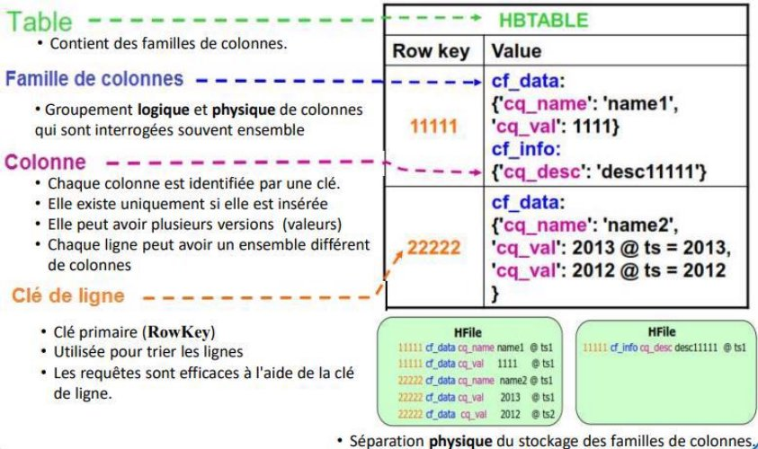
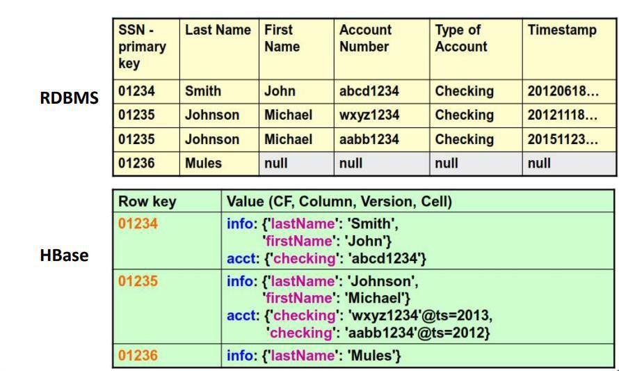
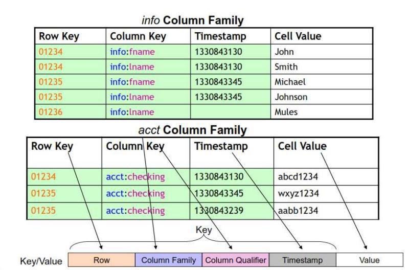
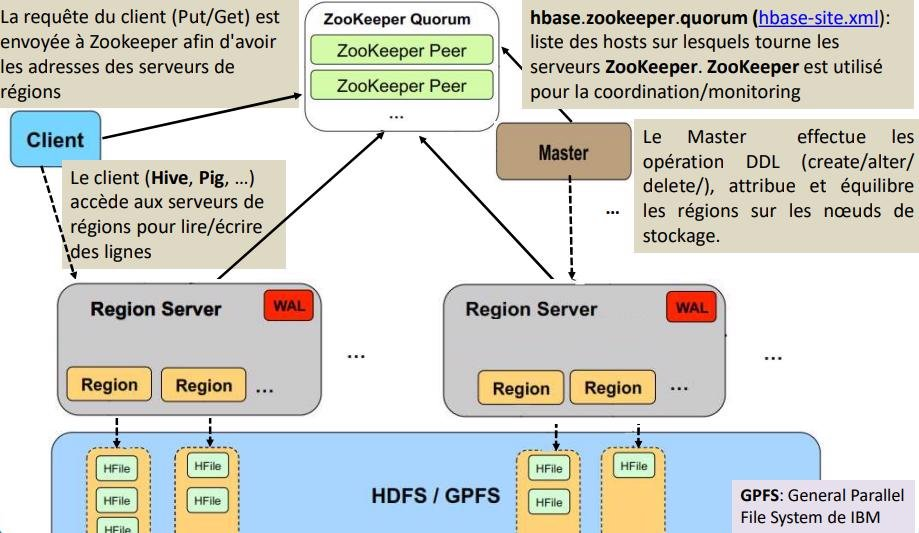
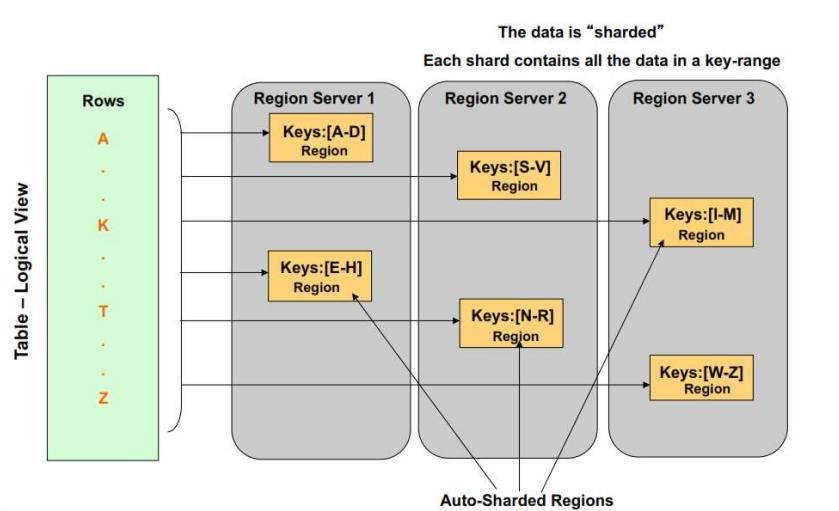

 

# **HBase**

> **Objectifs** : comprendre le modèle de données HBase et son architecture (régions, RegionServers, HMaster) · le rôle de ZooKeeper · manipuler HBase via le shell et HappyBase.
> **Prérequis** : séquences 01-04 (HDFS, MapReduce) · **Durée** : ~2 h · **Type** : cours + manipulations
> **Mise en pratique** : [exercices/06 — HBase](exercices/06-hbase.md)

## **Sommaire**

- [HBase Introduction](#introduction-à-hbase)
  - [Pourquoi utiliser HBase ?](#pourquoi-utiliser-hbase-)
  - [Caractéristiques principales de HBase](#caractéristiques-principales-de-hbase)
  - [Principe de fonctionnement](#principe-de-fonctionnement)
  - [HBase, un modèle de données souple](#hbase-un-modèle-de-données-souple)
- [HBase et le NoSQL dans l’écosystème Hadoop](#hbase-et-le-nosql-dans-lécosystème-hadoop)
  - [Limites du modèle Hadoop classique](#limites-du-modèle-hadoop-classique)
  - [Qu’est-ce que le NoSQL ?](#quest-ce-que-le-nosql-)
  - [Pourquoi utiliser des bases NoSQL ?](#pourquoi-utiliser-des-bases-nosql-)
- [HBase Modèle de Données](#hbase-modèle-de-données)
- [HBase Architecture](#hbase-architecture)
- [HBase et ZooKeeper](#hbase-et-zookeeper)
  - [Rôle de ZooKeeper dans HBase](#rôle-de-zookeeper-dans-hbase)
  - [Le rôle du HBase Master](#le-rôle-du-hbase-master)
  - [Le rôle des RegionServers](#le-rôle-des-regionservers)
  - [Le concept de Région](#le-concept-de-région)
- [HBase Stockage des tables](#hbase-stockage-des-tables)
- [HBase Namespaces](#hbase-namespaces)
- [HBase et Python : HappyBase](#hbase-et-python--happybase)
- [HBase Liens web sur les commandes](#hbase-liens-web-sur-les-commandes)
  - [Shell de HBase](#shell-de-hbase)
    - [General Commands](#general-commands)
    - [Data Definition Language](#data-definition-language)
    - [Data Manipulation Language](#data-manipulation-language)

---

## **Introduction à HBase**

---

### **Pourquoi utiliser HBase ?**

Les volumes de données actuels atteignent des échelles très élevées, allant du **téraoctet** au **pétaoctet**, voire au-delà. Si le **scaling out** (ajout de machines standards) permet de gérer cette croissance à moindre coût, certains cas d’usage dépassent les capacités d’Hadoop seul.

En particulier, Hadoop n’est pas adapté aux besoins nécessitant :
* des **écritures aléatoires fréquentes**,
* des **lectures aléatoires rapides**.

👉 Les bases de données relationnelles classiques ne sont donc plus suffisantes dans ces contextes.
**HBase répond à ces besoins en apportant un stockage distribué orienté accès temps quasi réel.**

### **Caractéristiques principales de HBase**

* une base de données **distribuée**, **orientée colonnes** et **multidimensionnelle** ;
* conçue pour la **haute disponibilité** et les **hautes performances** ;
* un **système de stockage** s’appuyant sur **HDFS**.

### **Principe de fonctionnement**

L’architecture HBase repose sur deux types de nœuds :
* **HBase Master** (actif à un instant donné) :
  * gère les opérations globales du cluster ;
  * répartit la charge, assigne les régions et supervise leur découpage ;
  * s’appuie sur **ZooKeeper** pour assurer la haute disponibilité.
* **RegionServers** :
  * hébergent les tables et leurs régions ;
  * exécutent les opérations de **lecture** et **écriture** ;
  * communiquent directement avec les clients.

### **HBase, un modèle de données souple**

* seules les **familles de colonnes** sont définies à l’avance ;
* les colonnes sont créées **dynamiquement lors de l’insertion** ;
* les valeurs non présentes ne sont **pas stockées** (pas de `NULL`) ;
* les données sont stockées sous forme de **`byte[]`** ;
* les lignes sont **triées par clé** et stockées séquentiellement ;
* les colonnes d’une même famille sont également **ordonnées**.

---

## **HBase et le NoSQL dans l’écosystème Hadoop**

---

### **Limites du modèle Hadoop classique**

Hadoop repose historiquement sur deux composants principaux :
* **HDFS** pour le stockage de grandes quantités de données ;
* **MapReduce** pour leur traitement distribué.

Ce modèle est particulièrement adapté au **traitement par lots (batch processing)**. Les données sont lues et écrites de manière **séquentielle**, sans interaction directe avec les utilisateurs.

Cependant, dans de nombreux cas :
* le traitement de fichiers volumineux produit à son tour d’autres fichiers volumineux ;
* ces fichiers doivent également être traités de façon séquentielle ;
* l’accès **aléatoire et rapide** aux données n’est pas possible.

👉 Une nouvelle approche est donc nécessaire pour stocker de très grands volumes de données tout en permettant des **lectures et écritures aléatoires efficaces**.

C’est dans ce contexte qu’apparaissent des solutions telles que **HBase, Cassandra, CouchDB, Dynamo ou MongoDB**, qui font partie des technologies de **bases de données NoSQL**.

### **Qu’est-ce que le NoSQL ?**

Le terme **NoSQL** (Not Only SQL) désigne un ensemble de technologies de bases de données conçues pour répondre aux contraintes du **Big Data** :
* données massives,
* données distribuées,
* structures hétérogènes et évolutives.

Contrairement aux bases relationnelles classiques, les bases NoSQL ne reposent pas sur un modèle relationnel strict et privilégient la **distribution**, la **scalabilité** et la **flexibilité**.

On distingue principalement **quatre grandes familles** de bases NoSQL :
* **Clé–valeur** : Redis, Memcached, Riak
* **Orientées graphe** : Neo4j, Sesame
* **Orientées colonnes** : HBase, Cassandra, SimpleDB
* **Orientées documents** : MongoDB, CouchDB

⚠️ Les technologies NoSQL **ne remplacent pas** les bases relationnelles ou les data warehouses, mais les **complètent** selon les cas d’usage.

---

### **Pourquoi utiliser des bases NoSQL ?**

Les bases NoSQL répondent à plusieurs besoins majeurs du Big Data :
* **Scalabilité horizontale** : ajout de machines plutôt qu’augmentation de la puissance d’un serveur ;
* **Coût maîtrisé** : utilisation de machines standards ;
* **Flexibilité** : modèle de données sans schéma strict ou à schéma évolutif ;
* **Haute disponibilité** : architectures distribuées et tolérantes aux pannes ;
* **Performances** : accès rapide à de grands volumes de données.

👉 **HBase** s’inscrit pleinement dans cette logique en apportant un stockage NoSQL distribué, intégré à Hadoop et capable de gérer des accès aléatoires à très grande échelle.

---

## **HBase Modèle de Données**

---



> **EXEMPLE : Comparaison HBase & RDBMS**



---

> **Plus spécifiquement, le modèle de données de HBase repose sur les concepts suivants :**

1. Les données sont stockées dans des tables HBase
2. Les tables contiennent des lignes et des colonnes
3. Chaque ligne est identifiée par une clé unique (RowKey)
4. Les colonnes sont regroupées dans des familles de colonnes (Column family)
5. Chacune des valeurs d'une cellule à une version désignée par un horodatage
6. Le schéma de table définit les familles de colonnes
    * On peut avoir un grand nombre variable de colonnes par ligne
    * (clé de ligne, clé de colonne, horodatage) -> valeur
    * Le tuple {ligne, colonne, version} spécifie exactement une cellule
7. Les lignes sont rangées dans l'ordre lexicographique (ordre binaire des octets) de clés de lignes
8. Il n'y a pas de schéma de table dans HBase
    * On doit préciser les familles de colonnes possibles.
    * Elles déterminent l'organisation du stockage physique sur disque.
    * Chaque ligne peut avoir différents ensembles de familles de colonnes.
9. HBase est décrit comme un entrepôt de type Clé-Valeur
10. Chaque clé-valeur a un horodatage qui désigne une version:
    * Modifier une colonne consiste à ajouter une nouvelle version

---

## **HBase Architecture**

---

- Vue Physique de cellules



- Architecture du Cluster



---

## **HBase et ZooKeeper**

---

### **Rôle de ZooKeeper dans HBase**

**Apache ZooKeeper** fournit un **service de coordination distribué** indispensable au fonctionnement de HBase. Il joue un rôle central dans la **gestion de l’état du cluster** et dans la **tolérance aux pannes**.

ZooKeeper est notamment responsable de :

* la gestion des **métadonnées de correspondance entre régions et RegionServers** ;
* la détection de l’état des RegionServers via des **pulsations (heartbeats)** ;
* l’élection et la garantie de l’**unicité du HBase Master actif** ;
* l’aide à la **localisation des RegionServers** par les clients.

👉 Les clients utilisent ZooKeeper pour **localiser les RegionServers**, puis communiquent **directement** avec eux pour les opérations de lecture et d’écriture.

ZooKeeper est un composant **critique** : il doit toujours être **démarré avant HBase**.

```bash
./start-zookeeper.sh          # depuis /home du master
jps | grep Quorum             # doit afficher QuorumPeerMain
```

> Sur ce cluster il n'y a **aucun service SysVinit** : `service zookeeper-server status` et `sudo` n'ont rien à faire ici — on est déjà root dans le conteneur, et ZooKeeper est lancé par le script du cours ci-dessus. Le process à reconnaître dans `jps` est `QuorumPeerMain`.

### **Le rôle du HBase Master**

Le **HBase Master** est responsable de la **gestion globale du cluster**.
Un seul Master est actif à un instant donné ; les autres restent en **veille (backup)**.

Ses principales responsabilités sont :
* surveiller l’état de l’ensemble des **RegionServers** ;
* gérer les **opérations d’administration** :
  * création et suppression de tables,
  * gestion des familles de colonnes,
  * modifications de schéma ;
* assigner les **régions** aux RegionServers ;
* équilibrer la charge du cluster en redistribuant les régions entre les serveurs.

Lors de leur démarrage, les Masters se connectent à **ZooKeeper** :
* le premier devient **Master actif** ;
* les autres restent **Masters passifs**, prêts à prendre le relais.

---

### **Le rôle des RegionServers**

Les **RegionServers** sont les nœuds chargés du **stockage effectif des données** et de l’**exécution des lectures et écritures**.

Leur fonctionnement repose sur les concepts suivants :
* chaque RegionServer héberge **plusieurs régions** ;
* une **région** correspond à une portion d’une table ;
* chaque région contient plusieurs **Stores** ;
* chaque Store correspond à une **famille de colonnes**.

Un Store est composé de :
* un **MemStore** : tampon d’écriture en mémoire ;
* un ensemble de **HFiles** : fichiers persistants stockés sur HDFS.

Pour garantir la durabilité des données :
* chaque RegionServer possède un **WAL (Write-Ahead Log)** ;
* toute écriture est d’abord enregistrée dans le WAL avant d’être stockée définitivement dans les HFiles.


### **Le concept de Région**

Une **région** est une **partition horizontale d’une table HBase**, définie par :
* une clé de ligne de début,
* une clé de ligne de fin.

Caractéristiques principales :
* taille maximale : **1 Go sur ce cluster** — `hbase-site.xml` y pose `hbase.hregion.max.filesize = 1073741824`. Ne pas confondre avec les **128 Mo** de `dfs.blocksize`, qui sont la taille d'un *bloc HDFS* : une région est stockée sur HDFS sous forme de plusieurs blocs, les deux grandeurs sont indépendantes et se règlent séparément. C'est précisément le chaînon entre la séquence 03 et celle-ci ;
* unité fondamentale de **distribution** et de **disponibilité** des données ;
* une région est **automatiquement découpée** lorsqu’elle dépasse sa taille maximale ;
* un **équilibreur de charge** redistribue régulièrement les régions dans le cluster ;
* en cas de panne d’un RegionServer, ses régions sont **réassignées automatiquement** à d’autres serveurs.

👉 Les régions permettent à HBase de **passer à l’échelle** et de rester **hautement disponible**.

---

## **HBase Stockage des tables**

---



## **HBase Namespaces**

---

- Un namespace est un groupement logique de tables similaire à une BD ou un schéma dans SGBDR.
- Il y a des namespace prédéfinis dans HBase:
  - HBase: c'est un namespace système contenant les tables internes (meta, namespace) de HBase utilisées pour stocker les métadonnées.
  - default: les tables créées sans préciser leur namespace, sont créées par défaut dans le namespace default.
- Commandes:
  - Pour avoir la liste des namespaces: `list_namespace`
  - Pour créer un nouveau namespace: `create_namespace 'nom_namespace'`
  - Pour avoir la description d’un namespace: `describe_namespace 'nom_namespace'`

**On doit supprimer toutes les tables du namespace avant de le supprimer.**

- Pour supprimer un namespace :
  `drop_namespace 'nom_namespace'`
- Créer une table dans un namespace
  `create 'nom_namespace:nom_table', 'cf1', 'cf2', …`
- Lister les tables d’un namespace :
  `list_namespace_tables 'nom_namespace'`

---

## **HBase et Python : HappyBase**

---

HBase fournit une API en Python : [HappyBase](https://happybase.readthedocs.io/en/latest/). HappyBase est une bibliothèque conviviale permettant d'interagir avec Apache HBase ; sous la surface, elle utilise la bibliothèque Python Thrift pour se connecter à HBase via sa passerelle Thrift.

Dans le contexte de HBase, Java est le seul langage qui peut accéder directement à HBase. L'interface Thrift agit comme un pont qui permet à d'autres langages d'accéder à HBase : un serveur Thrift interagit avec le client Java et expose une API réseau.


### **Installer et démarrer**

**Rien à installer** : `happybase` 1.3.0 est déjà présent dans l'image du cours (cf. séquence 02). Vérifiez plutôt :

```bash
python3 -c "import happybase; print(happybase.__version__)"   # 1.3.0
```

Un démon HBase **et son ThriftServer** doivent tourner pour que HappyBase puisse répondre — sans Thrift, la connexion échoue :

```bash
cd /home
./start-zookeeper.sh      # HBase exige ZooKeeper démarré avant lui
./start-hbase.sh
./start-thrift.sh
jps | grep Thrift         # doit afficher ThriftServer
```

> **Piège de `PATH`** : `/home` n'est **pas** dans le `PATH` du conteneur. Écrivez `./start-hbase.sh`, pas `start-hbase.sh` — sans le `./`, le shell trouve d'abord le script **d'HBase** (`/opt/hbase/bin/start-hbase.sh`), qui porte le même nom que celui du cours mais ne fait pas la même chose (vérifié par `command -v`). Le cas inverse existe aussi : `start-thrift.sh` n'existe **que** dans `/home`, donc sans `./` c'est `command not found`. Règle simple : **les scripts du cours se lancent toujours avec `./`**.


### **Connexion et manipulation**

Par défaut, le service thrift écoute sur le port **9090**. On se connecte depuis Python à la table déjà créée (ex. `store`, voir l'EX 06) :

```python
#!/usr/bin/env python

import happybase
connection = happybase.Connection('127.0.0.1', 9090)
connection.open()

table = connection.table('store')
print("La liste des tables sur HBase est : ")
print(connection.tables())
print(" nous avons aussi la table : ")
print(table)
connection.close()
```


> Depuis la machine hôte (hors conteneur), remplacer `127.0.0.1` par l'adresse de la machine qui héberge Docker — le port 9090 reste exposé tel quel.

**Syntaxes HappyBase :**

1. Création des tables :

   ```python
   connection.create_table(
      'mytable',
      {
         'cf1': dict(max_versions=10),
         'cf2': dict(max_versions=1, block_cache_enabled=False),
         'cf3': dict(),
      }
   )
   ```

2. Connexion à une table :

   ```python
   table = connection.table('mytable')
   ```

3. Récupération des données :

   ```python
   row = table.row('row-key')
   print(row[b'cf1:col1'])

   rows = table.rows(['row-key-1', 'row-key-2'])
   for key, data in rows:
      print(key, data)

   for key, data in table.scan():
      print(key, data)
   ```

   Toutes les lignes à partir de la ligne `aaa` jusqu'à la fin de la table :

   ```python
   for key, data in table.scan(row_start='aaa'):
      print(key, data)

   for key, data in table.scan(row_stop='xyz'):
      print(key, data)

   for key, data in table.scan(row_start='aaa', row_stop='xyz'):
      print(key, data)
   ```

4. Stockage des données :

   ```python
   table.put(
      'row-key',
      {
         b'cf:col1': b'value1',
         b'cf:col2': b'value2'
      }
   )
   ```

   ```python
   #!/usr/bin/env python

   import happybase
   connection = happybase.Connection('127.0.0.1', 9090)
   connection.open()
   print(connection.tables())
   table = connection.table('store')
   rows = table.rows(['1001', '1002'])
   for key, data in rows:
      print(key, data)
   connection.close()
   ```

5. Résultat :

 

---

## HBase Liens web sur les commandes

### **Shell de HBase**

#### General Commands

- `status` - Provides the status of HBase, for example, the number of servers.
- `version` - Provides the version of HBase being used.
- `table_help` - Provides help for table-reference commands.
- `whoami` - Provides information about the user.

#### Data Definition Language

- `create` - Creates a table.
- `list` - Lists all the tables in HBase.
- `disable` - Disables a table.
- `is_disabled` - Verifies whether a table is disabled.
- `enable` - Enables a table.
- `is_enabled` - Verifies whether a table is enabled.
- `describe` - Provides the description of a table.
- `exists` - Verifies whether a table exists.
- `drop` - Drops a table from HBase.
- `drop_all` - Drops the tables matching the ‘regex’ given in the command.

#### Data Manipulation Language

- `put` - Puts a cell value at a specified column in a specified row in a particular table.
- `get` - Fetches the contents of row or a cell.
- `delete` - Deletes a cell value in a table.
- `deleteall` - Deletes all the cells in a given row.
- `scan` - Scans and returns the table data.
- `count` - Counts and returns the number of rows in a table.

- **Tutorialspoint :**
  [HBase - Shell (tutorialspoint.com)](https://www.tutorialspoint.com/hbase/hbase_shell.htm)

- **Projet apache :**
  [Apache HBase – Apache HBase™ Home](https://hbase.apache.org/)
  [Apache HBase ™ Reference Guide](https://hbase.apache.org/book.html#_overriding_configuration_starting_the_hbase_shell)
