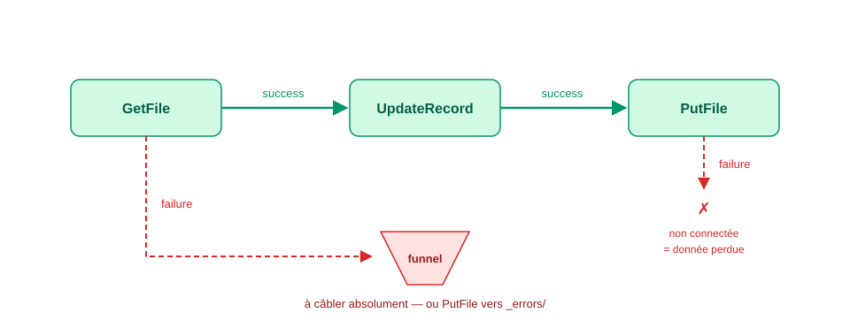
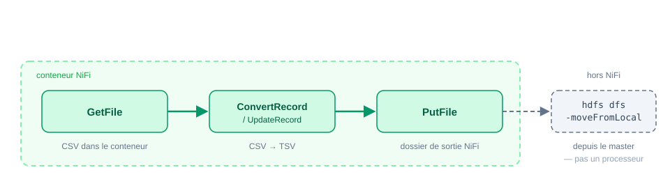
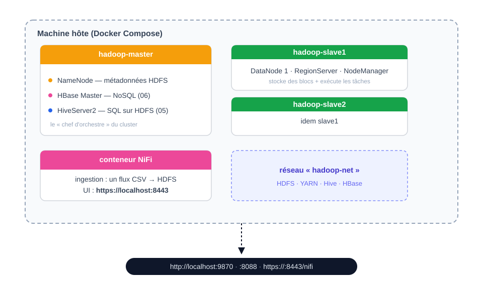
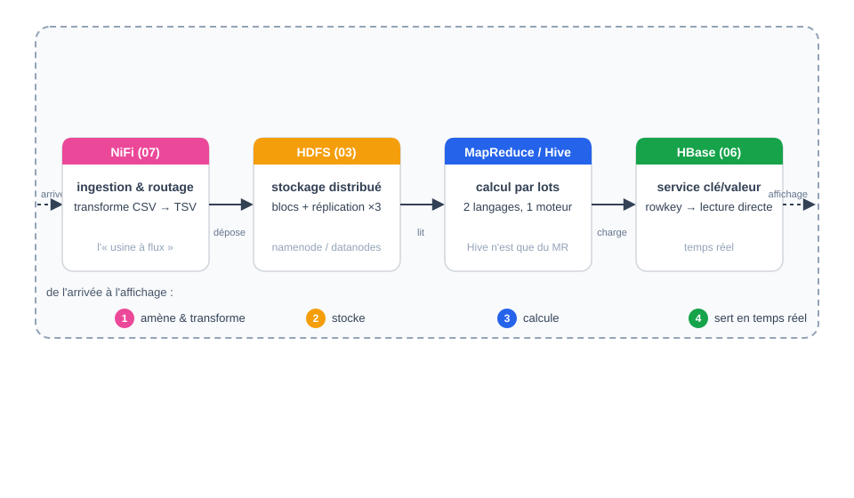

[← Chapitre précédent](06-hbase-et-zookeeper.md) · [Sommaire](Readme.md) · [Chapitre suivant →](A-Glossaire-et-ressources.md)

 

# 07 - NiFi, l'usine à flux de données

> **Objectifs** : comprendre le problème de l'ingestion de données · maîtriser le modèle dataflow de NiFi (FlowFile, processeurs, connections, back pressure) · découvrir l'interface et la Data Provenance · situer NiFi dans l'écosystème 2026.
> **Mise en pratique** : [Exercices](#ii-exercices)
## Sommaire

- [I. NiFi](#i-nifi)
  - [A. Le problème : amener les données jusqu'à Hadoop](#a-le-problème--amener-les-données-jusquà-hadoop)
  - [B. Présentation de NiFi](#b-présentation-de-nifi)
  - [C. Les concepts clés : FlowFile, processeur, connection](#c-les-concepts-clés--flowfile-processeur-connection)
  - [D. L'interface : construire un flux à la souris](#d-linterface--construire-un-flux-à-la-souris)
  - [E. Data Provenance : tracer chaque événement](#e-data-provenance--tracer-chaque-événement)
  - [F. Les processeurs clés pour notre cas d'usage](#f-les-processeurs-clés-pour-notre-cas-dusage)
  - [G. NiFi dans l'environnement du cours](#g-nifi-dans-lenvironnement-du-cours)
  - [H. NiFi en 2026 : 1.x, 2.x et le paysage de l'ingestion](#h-nifi-en-2026--1x-2x-et-le-paysage-de-lingestion)
  - [I. NiFi dans le cursus : la chaîne complète](#i-nifi-dans-le-cursus--la-chaîne-complète)
- [II. Exercices](#ii-exercices)
  - [A. Prise en main](#a-prise-en-main)
  - [B. Le flux Spotify → HDFS](#b-le-flux-spotify--hdfs)
  - [C. Exercices autonomes](#c-exercices-autonomes)
  - [Exercice 1 — Filtrage avant HDFS](#exercice-1--filtrage-avant-hdfs)
  - [Exercice 2 — Renommer et dater l'ingestion](#exercice-2--renommer-et-dater-lingestion)
  - [Exercice 3 — Pourquoi NiFi plutôt qu'un cron + hdfs dfs -put ?](#exercice-3--pourquoi-nifi-plutôt-quun-cron--hdfs-dfs--put-)
  - [D. Pour aller plus loin](#d-pour-aller-plus-loin)
  - [E. Annexe — Piloter le même flux par l'API REST (notes de déploiement)](#e-annexe--piloter-le-même-flux-par-lapi-rest-notes-de-déploiement)
  - [F. Pièges récurrents à anticiper](#f-pièges-récurrents-à-anticiper)
- [III. Vérifiez vos acquis](#iii-vérifiez-vos-acquis)

## I. NiFi

### A. Le problème : amener les données jusqu'à Hadoop

Depuis le début de ce cours, vos données arrivent dans HDFS par une seule porte : vous, et votre `hdfs dfs -put`. Réfléchissez à ce que ça donne en entreprise :

- Le CSV de la promotion arrive par mail le lundi, un autre le jeudi — quelqu'un doit le déposer **à la main**, au bon endroit, avec le bon nom.
- Une ingestion qui échoue à 3 h du matin (disque plein, fichier corrompu, réseau coupé) n'est **ni suivie, ni rejouée** : personne ne sait qu'elle a échoué.
- Rien ne trace **qui a déposé quoi, quand, depuis où** — pas d'historique, pas d'audit.
- Multiplier les sources (fichiers, API, flux, bases) multiplie les petits scripts maison, chacun avec ses défauts.

C'est le problème de l'**ingestion** : la porte d'entrée de la plateforme. L'encart « écosystème historique » du cours 01 mentionnait **Sqoop** pour le relationnel — supprimé du cours car désaffecté, remplacé en industrie par Spark JDBC / Kafka Connect. Mais pour l'ingestion de **fichiers** (CSV, logs, JSON), l'outil de référence reste **Apache NiFi**.

### B. Présentation de NiFi

**Apache NiFi** est une plateforme de routage et transformation de données visuelle : on construit des **flux de données** (_dataflows_) en assemblant des blocs à la souris, et NiFi garantit leur livraison.

L'outil a une origine peu banale : développé par la **NSA** (projet « Niagara Files »), open-sourcé en 2014, il rejoint Apache en **2015** sous le nom **NiFi**. Son ADN explique ses forces :

- **Guaranteed delivery** : chaque événement qui entre dans le flux est acké de bout en bout — un processeur en échec ne fait pas perdre la donnée (elle va sur la relation `failure`, pas à la poubelle) ;
- **Back pressure** : si un maillon consomme plus lentement, la pression remonte et le flux ralentit ou s'arrête proprement au lieu de déborder ;
- **Data Provenance** : historique complet et requêtable de chaque événement — à quelle heure, depuis où, par quels processeurs, avec quel contenu — c'est la traçabilité intégrale, clé pour l'audit.

Usages typiques : collecte de logs, ingestion de fichiers vers un datalake (notre cas : CSV → HDFS), synchronisation entre systèmes, ETL léger, IoT (sensor → plateforme).

### C. Les concepts clés : FlowFile, processeur, connection

Le modèle mental de NiFi tient en trois objets — le reste en découle :

**1. Le FlowFile** — l'unité de données en mouvement. Deux parties :

- le **contenu** (le fichier CSV, l'enregistrement JSON...) ;
- les **attributs** (clé/valeur : `filename`, `path`, et vos propres métadonnées — `ingestion_date`, `source`, etc.).

Un FlowFile traverse le flux en gardant son contenu, enrichi d'attributs à chaque étape. _Pensez : une enveloppe (contenu) avec une fiche de renseignement qui se complète en chemin (attributs)._

**2. Le processeur** — une brique de traitement. Il existe 300+ processeurs couvrant quatre familles :

| Famille | Rôle | Exemples |
|---|---|---|
| **Source (ingest)** | faire entrer des données | `GetFile`, `ListenHTTP`, `QueryDatabaseTable` |
| **Transformation** | modifier contenu/attributs | `UpdateRecord`, `ConvertRecord`, `UpdateAttribute` |
| **Routage** | orienter, filtrer | `RouteOnAttribute`, `QueryRecord` |
| **Destination (egress)** | faire sortir | `PutFile`, `PutS3Object`, `PutKafka` |

> Un **funnel** (entonnoir) n'appartient à aucune de ces familles : ce n'est **pas** un processeur. C'est un exutoire, une cible de connection qui accepte plusieurs flux entrants et les fusionne en une seule file — typiquement pour récolter les `failure` de toute une branche sans créer de processeur. Il se dépose depuis la palette comme les connections, et ne se configure pas.

Un processeur émet son résultat sur des **relationships** : `success` (traité) et `failure` (en échec) le plus souvent. **Une relationship non connectée est une erreur de conception** : elle signifie « si ça échoue, la donnée disparaît silencieusement ».

**3. La connection** — la file entre deux processeurs. C'est une vraie **queue** avec capacité limitée (back pressure : nombre d'objets / volume de données) ; si elle se remplit, le processeur amont est **arrêté** (stop and wait), pas submergé. La connection porte aussi le nom de la relationship (`success`, `failure`).



> **Le réflexe de conception** : chaque flux doit définir **que faire des échecs** — une relation `failure` vers un funnel ou un simple `PutFile` dans un dossier `_errors/`. C'est la différence entre un flux d'ingestion et un script fragile.

### D. L'interface : construire un flux à la souris

L'UI web de NiFi présente un **canvas** : on y glisse des processeurs depuis la palette, on les relie en tirant d'un carré de connection à l'autre, on configure chaque processeur via son panneau **Properties** (paramètres) / **Settings** (nom, auto-terminating relationships) / **Scheduling** (fréquence) / **comments**.

**Le cycle de vie d'un flux** :

1. **Conception** : déposer les processeurs, câbler les relations success **et** failure ;
2. **Configuration** : remplir les propriétés (chemins, formats, connexions HDFS) ;
3. **Démarrage** : sélectionner tout → ▶ Start — les processeurs passent au vert (run) ;
4. **Supervision** : surveiller les compteurs d'événements sur chaque connection (in/out, files/bytes), les badges rouges (erreurs) ;
5. **Itération** : arrêter, modifier une propriété, redémarrer — le design est vivant.

**La couleur des queues** résume l'état du flux : **vide** (fluide), **jaune** (remplissage — back pressure proche), **rouge** (back pressure atteinte — le flux est stoppé proprement en amont, un maillon consomme trop lentement).

### E. Data Provenance : tracer chaque événement

La fonctionnalité la plus impressionnante de NiFi pour un data engineer : cliquer sur un événement dans une queue → **View Data Provenance** : l'historique complet de ce FlowFile — heure d'entrée, processeurs traversés, attributs à chaque étape, **contenu avant/après chaque transformation** (visualisables et téléchargeables), durée de chaque saut.

Concrètement, quand la question arrive — _« Il manque les données du 12 mars, que s'est-il passé ? »_ — la réponse est à trois clics : chercher l'événement, voir où il s'est arrêté, **rejouer** (replay) la donnée depuis le point de l'échec. C'est cette garantie-là — reprise sur erreur avec traçabilité — qui justifie NiFi par rapport à un cron + `hdfs dfs -put`.

### F. Les processeurs clés pour notre cas d'usage

L'EX 07 construira ce flux :



| Processeur | Rôle dans notre flux |
|---|---|
| **GetFile** | scruter un répertoire local du conteneur NiFi ; tout fichier qui apparaît devient un FlowFile (puis le fichier source est supprimé ou archivé selon la config) |
| **ConvertRecord / UpdateRecord** | lire chaque ligne comme enregistrement, transformer (séparateur virgule → tabulation — la même transformation que le script `annexes/utils/7` de l'EX 05 (Hive), en flux) |
| **PutFile** | écrire le contenu du FlowFile sur le disque du conteneur NiFi (répertoire, nom de fichier, stratégie en cas de doublon) |
| *puis, à la main* `hdfs dfs -moveFromLocal` | le dernier pas entre NiFi et HDFS, fait depuis le master |

> ⚠️ **Pourquoi le dernier maillon n'est pas un processeur.** L'image NiFi du cours (`apache/nifi:2.11.0`, officielle) embarque **118 NAR, dont aucun NAR Hadoop** : les processeurs `PutHDFS`, `GetHDFSFile` et leur *controller service* de configuration Hadoop sont construits derrière un profil Maven optionnel (`include-hadoop`) que la distribution officielle désactive. Vous ne les trouverez pas dans la palette, et il n'y a rien à « ajouter » : la ressource n'est pas installée. Le montage `nifi/hadoop/` du `docker-compose.yml` reste utile pour `hdfs-site.xml` côté conteneur, mais il ne branchera aucun processeur.
>
> Ce n'est pas une perte pédagogique, c'est un gain : le passage par `PutFile` + `hdfs dfs -moveFromLocal` **vous fait faire le geste HDFS vous-même**, et il rend visible une frontière que NiFi a tendance à cacher — *où finit l'orchestrateur, où commence le système de fichiers*. En production on réintroduirait un connecteur HDFS (ou l'on ferait tourner NiFi sur les nœuds du cluster) ; à ce stade du cursus, savoir nommer cette frontière vaut mieux qu'un processeur de plus.

> **Lien pédagogique** : la transformation CSV→TSV que vous avez scriptée en Python à l'EX 05 (`annexes/utils/7`) existe ici en processeur — même logique, deux outils. L'EX 07 vous fera construire ce flux et déposer le TSV **exactement là où** la table externe Hive de l'EX 05 lit ses données.

### G. NiFi dans l'environnement du cours

NiFi n'est **pas** dans l'image du cluster Hadoop (le conteneur master embarque HDFS, YARN, HBase, Hive — pas d'usine à flux). Il tourne dans un **conteneur dédié** du même `docker-compose.yml` — image officielle `apache/nifi` branche **2.x** :



Deux points d'accès :

- **l'UI NiFi** : `https://localhost:8443/nifi` — NiFi 2.x impose le HTTPS. Le navigateur affiche d'abord un avertissement de certificat auto-signé : acceptez-le une fois. **Puis vient un écran de connexion**, et c'est normal : NiFi 2.x active par défaut un fournisseur d'identité *single-user* qui répond `401` à toute requête non authentifiée. Le couple est lu depuis `nifi/credentials.env` du projet de déploiement (`SINGLE_USER_CREDENTIALS_USERNAME` / `SINGLE_USER_CREDENTIALS_PASSWORD`) — demandez-le au formateur. Sans ce fichier, NiFi génère au démarrage un identifiant et un mot de passe **aléatoires**, visibles uniquement dans `docker logs hadoop-nifi`, et ils changent à chaque recréation du conteneur. **Même cause, effet identique** si le mot de passe fait moins de **12 caractères** : la variable est rejetée en silence (`ERROR: Password must be at least 12 characters`) et NiFi retombe sur le couple aléatoire — vérification faite sur `apache/nifi:2.11.0`.
- **les fichiers sources** : déposés dans le répertoire `nifi/input/` du projet de déploiement — monté dans le conteneur sur `/opt/nifi/input` (l'EX vous guide). La sortie du flux, `nifi/output/`, est montée au même endroit **dans le master** sous `/home/staging` : c'est ce qui permet d'enchaîner avec `hdfs dfs -moveFromLocal`.

> **Pourquoi la branche 2.x ?** Le cluster du cours est Hadoop **3.3.6** : NiFi 2.x (Java 21, client Hadoop 3.x) est le couple cohérent. Sur un vieux cluster Hadoop 2.x, on repartirait sur la branche 1.x (1.28.x, client Hadoop 2.x) — c'est la seule divergence qui impose un choix de version.

### H. NiFi en 2026 : 1.x, 2.x et le paysage de l'ingestion

- **NiFi 2.x** (depuis fin 2024) : UI repensée, Java 21 minimum, TLS 1.3, stratégies de load balancing des connections améliorées, support des nouveaux paramètres de sécurité. La branche **1.x est en fin de vie progressive** (1.28.x est la dernière, maintenance uniquement) — on ne la croise plus que sur les stacks Hadoop 2.x legacy.
- **Le paysage de l'ingestion 2026** : NiFi n'est pas seul. **Kafka Connect** domine quand la source est un flux Kafka ; **Airbyte** (open source) cible la sync API/SaaS → entrepôt ; **Spark JDBC** a remplacé Sqoop pour le relationnel. NiFi reste la référence pour le **routage et la transformation visuels** multi-sources, et l'IoT/edge (NiFi MiNiFi).
- **Concurrent historique** : Talend/Pentaho (ETL visuel commercial) — NiFi s'en distingue par son modèle FlowFile/queue orienté streaming continu, sa provenance et son prix (libre).

### I. NiFi dans le cursus : la chaîne complète

Avec NiFi, le cursus couvre la chaîne data de bout en bout :



- **07 (NiFi)** amène et transforme la donnée — c'est lui qui ouvre la chaîne ;
- **03 (HDFS)** stocke ;
- **04 (MapReduce) / 05 (Hive)** calculent — deux langages pour le même moteur ;
- **06 (HBase)** sert les accès temps réel par clé.

Le TP final vous proposera de rejouer l'ingestion d'un dataset par NiFi en ouverture de votre projet de synthèse.

## II. Exercices

Objectif de l'exercice : construire un **flux d'ingestion réel** — le CSV Spotify déposé dans un répertoire d'entrée est automatiquement transformé (CSV → TSV) puis écrit dans **HDFS**, à l'emplacement exact que lit la table externe Hive de l'EX 05. La même donnée, trois vues : **NiFi la déplace, Hive l'interroge, MapReduce la calcule**.

_📌 Pré-requis techniques : le conteneur NiFi (`hadoop-nifi`) est lancé avec le `docker compose up -d` de la section A des exercices du chapitre 02. Si l'UI ne répond pas (`docker compose ps`), prévenez le formateur avant de continuer._

### A. Prise en main

#### 1. Ouvrir l'interface

Depuis votre navigateur : `https://localhost:8443/nifi` (en session locale ; `https://<IP_du_serveur>:8443/nifi` si le cluster est hébergé à distance — même principe que les interfaces NameNode et YARN de l'EX 02). NiFi 2.x impose le HTTPS avec un certificat auto-signé : au premier accès, le navigateur propose « accepter le risque » — acceptez une seule fois pour la session.

**Il reste une deuxième porte** : NiFi 2.x n'a plus de mode anonyme. Après le certificat, un **écran de login** s'affiche — connectez-vous avec le couple remis par le formateur (`etudiant` par défaut). Si ce couple est refusé, voyez la note ci-dessous avant de chercher plus loin.

**Résultat attendu** : le canvas NiFi s'ouvre, vide, avec la palette de processeurs en haut à gauche. Le badge en haut à droite affiche `etudiant@…` et aucun flux actif.

> ⚠️ **Le login est refusé / change tout seul ?** Le couple est fixé dans `nifi/credentials.env` du projet de déploiement. Sans ce fichier, l'image NiFi en **négocie un aléatoire** et l'écrit dans les logs — il change à chaque recréation du conteneur :
>
> ```bash
> docker logs hadoop-nifi | grep -A1 "Generated Username"
> ```
>
> La cause la plus fréquente est un **mot de passe de moins de 12 caractères** : NiFi le rejette silencieusement et retombe sur le couple aléatoire. Vérifiez la longueur, puis `docker compose up -d --force-recreate nifi`.

#### 2. Premier processeur : GetFile

Glissez-déposez un processeur **GetFile** au centre du canvas :

- **Properties** :
  - `Input Directory` : `/opt/nifi/input` (le répertoire d'entrée du conteneur — c'est le montage du dossier `nifi/input/` du projet de déploiement)
  - `File Filter` : `.*\.csv`
  - `Keep Source File` : `false`
- **Scheduling** : `Run Schedule` = `5 sec`

> ⚠️ **Ne saisissez rien dans un champ `File Filter Regex`.** Le filtre qui existe sur GetFile s'appelle **`File Filter`**. « File Filter Regex » est une propriété *dynamique* : NiFi 2.11 l'accepte dans le formulaire mais n'a aucun validateur pour elle, et le processeur passe en **`Invalid`** avec, dans le bulletin :
>
> ```
> 'File Filter Regex' validated against '.*\.csv' is invalid because
> 'File Filter Regex' is not a supported property or has no Validator
> associated with it
> ```
>
> Un processeur `Invalid` **ne démarre pas** — le bouton Start refuse, sans message d'erreur dans le canvas. C'est l'un des deux ou trois cas où vous verrez NiFi refuser d'exécuter sans rien expliquer : prenez le réflexe d'ouvrir l'onglet *Information* (ou la cloche de bulletins) avant de chercher ailleurs.

- **Settings** : cochez `auto-terminate` sur **success**. Sans successeur **ni** auto-termination, NiFi marque le processeur `Invalid` et il ne démarre pas — un processeur isolé doit explicitement dire que sa sortie est une fin de course. (Dans un flux de production, cette case ne se coche qu'en dernier recours, jamais sur `failure` — voyez la section B.)

Déposez un petit fichier `test.csv` (quelques lignes suffisent) dans `nifi/input/` (sur la machine hôte — c'est `/opt/nifi/input` vu du conteneur), puis **démarrez le processeur** (clic droit → Start, ou sélection + ▶).

**Résultat attendu** : sur le processeur, le compteur **out** (Data processed) passe de `0` à `1` — un FlowFile a été créé. Le fichier source a disparu du répertoire d'entrée.

> 🤔 **Question de contrôle** : où est passé le FlowFile ? Il n'y a pas de queue en sortie... _Réfléchissez : que signifie `auto-terminate` sur toutes les relations d'un processeur sans successeur ?_ (Réponse dans la correction ci-dessous — retenez que dans un flux de production, on câble `failure` au lieu de l'auto-terminer : nous le faisons dans la section B.)

<details>
<summary>Voir la correction</summary>

`auto-terminate` signifie : _« le processeur considère son travail terminé et **supprime le FlowFile** après émission »_ — sans queue de sortie, l'événement est consigné dans la provenance mais la donnée s'arrête là. C'est exactement pourquoi un flux de production n'active **jamais** cette case sur `failure` sans l'avoir câblée : auto-terminer un échec = perdre la trace de la donnée.

Attention au piège symétrique, et il est plus fréquent que le précédent : **ne pas** cocher `auto-terminate` sur une relation sans successeur rend le processeur `Invalid` et le bouton Start refuse, sans rien afficher sur le canvas. Message relevé en préparant l'EX (sur PutFile, même mécanisme pour GetFile isolé) :

```
'Relationship success' is invalid because Relationship 'success' is not
connected to any component and is not auto-terminated
```

Une relation doit donc **toujours** avoir un successeur ou être auto-terminée : il n'y a pas de troisième choix.

> Cas fréquent de « ça ne démarre pas et NiFi ne dit rien » : une propriété **dynamique** mal nommée — par exemple `File Filter Regex` sur GetFile (la vraie propriété est `File Filter`). NiFi l'accepte dans le formulaire, marque le processeur `Invalid`, et le bouton Start refuse sans explication dans le canvas. Le message est dans l'onglet *Information* / les bulletins.

</details>

#### 3. Data Provenance

Arrêtez le processeur. Ouvrez le menu global (coin haut droit) → **Data Provenance** (icône horloge/terrain) :

**Résultat attendu** : l'événement `RECEIVE` de votre `test.csv`, horodaté. Cliquez dessus → **l'onglet Lineage** (graphe des processeurs traversés), **Content** (le contenu du FlowFile — téléchargeable pour vérifier qu'il est intact).

C'est l'audit trail de votre ingestion : qui, quand, quoi, où — sans avoir écrit une ligne de code.

### B. Le flux Spotify → HDFS

#### 1. Poser les trois processeurs

Ajoutez au canvas (GetFile peut être réutilisé ou recréé) :

| Processeur | Rôle |
|---|---|
| **GetFile** | scrute `/opt/nifi/input`, capture le CSV Spotify |
| **ConvertRecord** | lit le CSV (séparateur `,`, quotes `"`), réécrit en TSV (séparateur `\t`) |
| **PutFile** | écrit le FlowFile dans `/opt/nifi/output` — le répertoire que **partagent** les conteneurs NiFi et master |

Câblez : GetFile `success` → ConvertRecord → PutFile `success`, et **chaque failure** vers un processeur PutFile vers `/opt/nifi/errors`.

> ⚠️ **C'est le moment 'fil rouge' de l'exercice** : une relation `failure` non câblée = une donnée susceptible de disparaître silencieusement. Aucune flèche ne doit rester en pointillé rouge dans le panneau des relations d'un processeur.

> ℹ️ **Pourquoi `PutFile` et pas `PutHDFS` ?** L'image `apache/nifi` que nous utilisons n'embarque **aucun bundle Hadoop**. Vérifiable depuis le conteneur — cette commande compte les bundles chargés par l'instance et y cherche Hadoop ; elle renvoie `0` :
>
> ```bash
> docker exec hadoop-nifi sh -c "ls /opt/nifi/nifi-current/work/nar/extensions/ | grep -ci hdfs"
> ```
>
> `PutHDFS` n'est donc **pas connu de l'instance** : si vous essayez de l'ajouter depuis la palette, NiFi refuse et le processeur reste introuvable à la recherche. Plutôt que de faire installer un NAR à chaque apprenant, le flux s'arrête à `PutFile` et **c'est le terminal qui pousse le fichier dans HDFS**, avec `hdfs dfs -moveFromLocal` — la même idée que `-put` de l'EX 05, à la différence que le fichier source est enlevé du conteneur. Le découpage est le même, il manque juste le dernier saut automatique — et vous le voyez, ce qui est plus formateur. Ajouter le bundle pour automatiser ce saut : voir *Pour aller plus loin*.

#### 2. Configurer ConvertRecord

Dans les Properties de ConvertRecord, créez un controller service de lecture et un d'écriture (bouton **→** à droite de chaque propriété) — le pattern à retenir de NiFi : le processeur ne sait rien du format, ce sont les services qui le savent.

| Service | Propriété | Valeur | |
|---|---|---|---|
| **CSVReader** (le fichier source) | `Value Separator` | `,` | défaut : virgule |
| | `Quote Character` | `"` | |
| | `Treat First Line as Header` | **`true`** | ⚠ défaut : `false` |
| **CSVRecordSetWriter** (la sortie) | `Value Separator` | `\t` | ⚠ défaut : `,` |
| | `Include Header Line` | **`true`** | défaut : `true` |

Activez les deux controller services (bouton **Enable**) — ils sont partagés par tout le flux.

> ⚠️ **Les deux ⚠ ci-dessus ne sont pas décoratifs.** Par défaut, le reader **ne considère pas** la première ligne comme un en-tête : il la lit comme une chanson de plus, avec `released_year` = `'released_year'`. Le writer, lui, **écrit** bien un en-tête par défaut. Réglés comme dans le tableau, le fichier produit contient **une** ligne d'en-tête et **953** lignes de données :
>
> ```bash
> head -1 /home/staging/Spotify_Most_Streamed_Songs.csv   # un en-tete, pas une chanson
> wc -l   /home/staging/Spotify_Most_Streamed_Songs.csv   # 954 = 1 en-tete + 953 chansons
> ```
>
> Si vous lisez **955**, la première ligne du source a été comptée comme donnée *et* un en-tête a été réajouté ; si vous lisez **953**, il n'y a plus d'en-tête du tout. Ni l'un ni l'autre ne fait planter Hive : `COUNT(*)` compte juste faux, en silence — cf. piège n° 1 du corrigé 05.

> 💡 **Lien avec l'EX 05 (Hive).** Cette lecture CSV (quotes gérées) + réécriture TSV est la partie *mise en forme* de `annexes/utils/7-prepare-spotify-tsv.py`. Sur ce jeu de données le résultat est **au même nombre de lignes** (954 : 1 en-tête + 953 chansons) — vérifiez-le, c'est une bonne maîtrise d'œuvre. Mais « même nombre de lignes » ne veut pas dire « mêmes données » : NiFi ne filtre rien, il convertit. Le script, lui, écarte toute ligne dont le nombre de champs n'est pas 25. Conservez le fichier produit par le flux : on le confronte aux sorties Hive (`COUNT` 953/954) et au TD 05 (provenance de la ligne 576, que **ni le script ni NiFi** ne signalent explicitement).

#### 3. Configurer PutFile, puis pousser dans HDFS

**PutFile** — deux propriétés suffisent :

- `Directory` : `/opt/nifi/output`
- `Conflict Resolution Strategy` : **`replace`** (⚠ la valeur par défaut est `fail` : au deuxième dépôt d'un fichier de même nom, le FlowFile part en `failure` et rien n'est écrit. Réglez-le **avant** de démarrer.)

`Filename` peut rester à vide : PutFile utilise alors l'attribut `${filename}` du FlowFile, donc **le nom d'origine** — `Spotify_Most_Streamed_Songs.**csv**`, alors même que le contenu est devenu du TSV. Gardez-le tel quel : c'est un piège volontaire, voir la question de contrôle de la section B.5. (Renommer en `.tsv` via un `UpdateAttribute` est l'exercice 2 de la section C.)

Le répertoire `/opt/nifi/output` du conteneur NiFi et `/home/staging` du master sont **le même dossier** sur le disque. C'est ce qui permet de finir le travail dans le terminal, comme à l'EX 05 :

```bash
# depuis le master
docker exec -it hadoop-master bash
ls -l /home/staging                                   # le TSV vient d'apparaitre
hdfs dfs -moveFromLocal /home/staging/Spotify_Most_Streamed_Songs.csv \
                        /user/root/spotify/clean/
```

**Résultat attendu après démarrage du flux** :

1. Les compteurs in/out s'incrémentent sur chaque connection ;
2. `ls -l /home/staging` (master) montre le TSV juste produit ;
3. après le `moveFromLocal`, `hdfs dfs -ls /user/root/spotify/clean` affiche le fichier ;
4. `hdfs dfs -cat /user/root/spotify/clean/<fichier> | head -2` montre des **tabulations**, pas des virgules.

> 🤔 **Question de contrôle** : le flux s'arrête à `PutFile`, donc la dernière étape est humaine. Quel risque introduit ce saut manuel qu'un `PutHDFS` aurait câblé ? _Indice : qu'est-ce qui se passe si l'opérateur oublie la commande, ou la lance deux fois — et laquelle de ces deux erreurs est visible dans Data Provenance ?_

<details>
<summary>Voir la correction</summary>

Un `PutHDFS` câblé échoue **devant** NiFi et le consigne ; l'opérateur qui oublie le `moveFromLocal` ne laisse **aucune trace** — le fichier dort dans `/home/staging` et la table Hive reste silencieusement à J-1. Le `moveFromLocal` lancé deux fois, lui, est visible (la seconde échoue, `No such file or directory`). C'est la réponse attendue : le risque n'est pas la panne, c'est **l'oubli silencieux**. Mitigations à faire trouver : surveiller la taille de `/home/staging`, ou cron + verrou, ou le bundle NAR (voir « Pour aller plus loin »).

</details>

#### 4. Interroger depuis Hive

**D'abord, regardez ce que contient le répertoire** — la table externe de l'EX 05 pointe sur `LOCATION '/user/root/spotify/clean'`, un *répertoire* : Hive lit **tous** les fichiers qui s'y trouvent.

```bash
hdfs dfs -ls /user/root/spotify/clean
```

- **Un seul fichier** (vous avez déplacé ou écrasé celui de l'EX 05) → la table lit le fichier que NiFi vient de produire.
- **Deux fichiers** (le `spotify-clean.tsv` de l'EX 05 *et* le vôtre) → vous êtes en train de compter deux fois la même chanson. C'est l'objet de la question de contrôle ci-dessous, ne truquez pas le résultat.

```sql
SELECT COUNT(*) FROM spotify_db.spotify;
```

**Résultat attendu, fichier unique** : **953** si la table porte `TBLPROPERTIES ('skip.header.line.count'='1')`, **954** sinon (l'en-tête est alors compté comme une chanson — cf. corrigé 05, piège n° 1). Dans les deux cas c'est bien le fichier *de NiFi* que Hive est en train de lire : la chaîne ingestion → stockage → interrogation est complète.

> 🤔 **Question de contrôle** : remettez le fichier de l'EX 05 aux côtés du vôtre et relancez le `COUNT(*)`. Obtenez-vous **exactement 1 906** (= 2 × 953) ? Si vous trouvez plus, décomposez avec `SELECT released_year, COUNT(*) … GROUP BY` pour identifier combien d'en-têtes ont été comptés comme des chansons — c'est la seule façon de savoir si `skip.header.line.count` s'applique **par fichier** ou **une fois par table**. Notez votre mesure, nous la comparons en groupe.

#### 5. Étudier les échecs et la reprise

- Remettez `Conflict Resolution Strategy` de PutFile à **`fail`** (la valeur par défaut), puis déposez **deux fois de suite** le même CSV dans l'entrée. Le second dépôt ne produit rien de visible dans `/opt/nifi/output` — mais le FlowFile n'a pas disparu pour autant.
- Déposez un fichier volontairement corrompu (une ligne de texte quelconque renommée en `.csv`) dans l'entrée : il doit partir sur la relation `failure` et se retrouver dans `/opt/nifi/errors` — **pas disparaître**.
- Dans **Data Provenance**, retrouvez l'événement de ce fichier corrompu : le graphe de lineage montre le chemin `failure` — la preuve visuelle que la donnée n'est pas perdue.

> 🤔 **Question de contrôle** : avec `Conflict Resolution Strategy: fail`, que devient la queue entre ConvertRecord et PutFile si personne ne câble la relation `failure` ? _Indice : relisez la section back pressure du cours, puis regardez le compteur de la queue après plusieurs dépôts. Le flux ne tombe pas en erreur — il **s'arrête**, et c'est pire._

<details>
<summary>Voir la correction</summary>

Le second dépôt du même nom échoue sur PutFile (`fail` est la valeur **par défaut**), le FlowFile part sur `failure`. **Mais** observez la queue entre ConvertRecord et PutFile : l'échec répété + un `Run Schedule` de 5 sec la font grossir — et quand le *back pressure object threshold* est atteint, NiFi **arrête le flux en amont** plutôt que de laisser déborder : GetFile est stoppé. Aucun message d'erreur rouge, le flux est simplement figé. À montrer en live si le temps le permet — c'est la démonstration que la back pressure n'est pas un garde-fou optionnel mais le mécanisme de survie du flux.

</details>

> ⚠️ **Et le nom, dans tout ça ?** Le fichier déposé s'appelle `…Songs.**csv**` alors que son contenu est du TSV. Rien ne casse ici, parce que Hive se fiche de l'extension — mais envoyez ce fichier à un outil qui se fie à l'extension, et il le lira en CSV. C'est ce que règle l'exercice 2.

### C. Exercices autonomes

*Cherchez avant de regarder : la correction se déplie sous chaque exercice.*

### Exercice 1 — Filtrage avant HDFS

Ne faire entrer dans le flux que les CSV de plus de 100 Ko — les petits fichiers de test ne doivent pas arriver jusqu'à HDFS.

Deux chemins, du plus simple au plus général :

1. **`GetFile` → `Minimum File Size` = `100 KB`.** Aucun nouveau processeur : la propriété existe déjà, et un fichier trop petit n'est jamais lu. Vérifiez-la dans vos Properties : elle est à `0 B` par défaut.
2. **`RouteOnAttribute`** entre GetFile et ConvertRecord, avec une expression NiFi sur l'attribut de taille — parce que dans un vrai flux, le filtre arrive souvent *après* une transformation, là où GetFile n'a plus son mot à dire.

> ⚠️ **Sur le chemin 2, n'écrivez pas le nom de l'attribut de mémoire.** Déposez un fichier, ouvrez sa fiche **Data Provenance → Attributes** (ou le menu *i* du FlowFile) et **recopiez** le nom exact de la taille. NiFi fait la différence entre `fileSize` et `filesize`, et une expression qui ne matche aucun attribut ne lève **aucune erreur** : tous les FlowFiles partent en `unmatched`, le flux a l'air de fonctionner, et rien n'avance. C'est le piège silencieux le plus fréquent de NiFi.

**Résultat attendu** : un petit fichier test déposé dans l'entrée n'arrive pas jusqu'à `/opt/nifi/output` ; le CSV Spotify (plus lourd) y arrive. Si **rien** n'arrive, ouvrez la fiche du processeur de routage et regardez sur quelle relation sont partis vos FlowFiles.

<details>
<summary>Voir la correction</summary>

Chemin le plus court : `GetFile` → `Minimum File Size` = `100 KB`. Le fichier trop petit n'est jamais lu ; aucune logique de routage à écrire.

Chemin « production » : insérer un **RouteOnAttribute** entre GetFile et ConvertRecord.

- `Routing Strategy` : `Route to Property name` (c'est déjà la valeur par défaut — la vérifier ne coûte rien)
- Propriété dynamique : `big-file` = `${<attribut-de-taille>:gt(102400)}` — où `<attribut-de-taille>` est **recopié** depuis la fiche *Attributes* d'un FlowFile déposé
- Câbler `big-file` → ConvertRecord, et `unmatched` → auto-terminate (ou funnel).

**Le point à surveiller, et à faire chercher avant de le donner** : le nom de l'attribut de taille. Une expression qui ne résout aucun attribut ne lève **aucune erreur** — le test est faux, donc tous les FlowFiles partent en `unmatched`, et le flux paraît vivant alors qu'il ne traite plus rien. D'où la consigne de l'énoncé : recopier le nom depuis la fiche *Attributes* d'un FlowFile, jamais de mémoire. (Nous-mêmes n'avons pas tranché la graphie `fileSize`/`filesize` en 2.11 depuis les seuls fichiers du cours — c'est précisément la raison de la consigne.)

Alternative valable : **RouteOnContent**, ou UpdateAttribute + RouteOnAttribute en deux étapes — l'important est la **décision de routage sur attribut**, pas la solution exacte.

</details>

### Exercice 2 — Renommer et dater l'ingestion

Insérez un **UpdateAttribute** entre ConvertRecord et PutFile, pour obtenir un nom de fichier qui dit la vérité sur deux points : le **format** (le contenu est du TSV, le nom dit `.csv` — voir l'encadré de la section B.5) et la **date d'ingestion**.

Un `Filename` de la forme `spotify_${date:format('yyyy-MM-dd')}.tsv` suffit. Les expressions NiFi (`${now():toNumber():format(...)}`, `${date:format(...)}`) sont dans l'aide contextuelle du champ.

**Résultat attendu** : `/opt/nifi/output` contient un fichier au nom daté et en `.tsv` ; l'attribut est visible dans la fiche **Data Provenance → Attributes** du FlowFile. Si le fichier écrit garde l'ancien nom, vérifiez que PutFile n'a pas `Filename` figé à une valeur littérale.

<details>
<summary>Voir la correction</summary>

**UpdateAttribute** entre ConvertRecord et PutFile :

- `ingestion_date` = `${now():format("yyyy-MM-dd'T'HHmm")}`
- `Filename` (propriété de PutFile) = `spotify_${ingestion_date}.tsv`, ou laisser `Filename` vide et régler l'attribut `filename` dans UpdateAttribute

Le fichier écrit porte alors l'horodatage **et** l'extension du contenu réel. Vérification : fiche Data Provenance → Attributes montre `ingestion_date` ; `ls /opt/nifi/output` montre le nouveau nom. Si le nom ne change pas, c'est que `Filename` de PutFile est figé à une valeur littérale — PutFile ne suit l'attribut `filename` que si sa propriété `Filename` est vide ou en EL.

**Variante pour aller plus loin** : un UpdateRecord peut écrire l'horodatage **dans le contenu** (colonne supplémentaire) — distinguer attribut (métadonnée de transport) et contenu (donnée) : bon débat de fin de séance.

</details>

### Exercice 3 — Pourquoi NiFi plutôt qu'un cron + hdfs dfs -put ?

Question de réflexion (3-5 lignes dans votre rapport de TP) : votre collègue propose de remplacer tout votre flux NiFi par un cron `*/5 * * * * hdfs dfs -put /input/*.csv /user/root/spotify/clean` et un petit script Python pour le TSV. Quels arguments de data engineer opposez-vous ?

**Résultat attendu** : au moins trois des cinq arguments — **traçabilité** (provenance, audit), **reprise sur erreur** (failure câblée, replay), **back pressure** (pas de submersion), **visibilité opérationnelle** (compteurs, badges, UI), **cycle de vie** (modifier un flux à chaud vs redéployer un script).

<details>
<summary>Voir la correction</summary>

- **Traçabilité** : Data Provenance donne l'audit complet (qui/quoi/quand/où) — le cron ne trace que ses logs shell, sans lien avec la donnée.
- **Reprise sur erreur** : une `failure` câblée + replay point à point ; le cron échoue en silence (fichier restant dans /input, écrasements possibles).
- **Back pressure** : si HDFS ralentit, le flux s'arrête proprement en amont ; le cron continuerait de déposer (et de surcharger).
- **Visibilité opérationnelle** : compteurs temps réel, badges d'état, UI partagée ; le cron se supervise via crontab + grep dans les logs.
- **Cycle de vie** : modifier un flux = 2 minutes à la souris à chaud ; modifier le script = redéploiement, test, versionnage manuel.

**Synthèse à faire émerger** : le cron répond _« déplacer un fichier toutes les 5 minutes »_ ; NiFi répond _« exploiter une ingestion de données »_ — avec l'audit et la reprise comme différenciateurs, exactement ce que réclame la production (SLA, incidents, audit).

</details>

### D. Pour aller plus loin

- **Automatiser le dernier saut** : récupérer le bundle `nifi-hadoop-processors` compilé pour NiFi 2.11 et le déposer dans `nifi/nar_extensions/` du projet de déploiement — c'est le répertoire que l'image charge à chaud (`nifi.nar.library.autoload.directory=/opt/nifi/nifi-current/nar_extensions`, vérifiable dans `conf/nifi.properties`). Après redémarrage du conteneur, `PutHDFS` devient disponible, avec `Hadoop Configuration File Resources` pointé sur `/opt/nifi/hadoop/core-site.xml` (déjà monté). **C'est une dépendance externe au cours** — un NAR mal compilé peut empêcher NiFi de démarrer : à valider hors groupe avant de le montrer.
- **Paramétrer le flux** (Parameter Contexts) : externaliser le chemin HDFS et le répertoire d'entrée en paramètres pour passer d'un environnement à l'autre sans éditer les processeurs.
- **Registre de flux** (Flow Registry) : versionner le flux comme du code — hors périmètre du cours, mais mentionné dans le cours 07.
- **Lien TP final** : votre projet de synthèse peut ouvrir sur une ingestion NiFi du dataset — c'est un argument de rapport.

### E. Annexe — Piloter le même flux par l'API REST (notes de déploiement)

Le flux des sections A et B se construit aussi par requêtes HTTP sur `https://localhost:8443/nifi-api` — utile pour provisionner le canvas sans cliquer, ou pour reproduire l'exercice sur un cluster de réserve. Retours d'expérience du déploiement de référence (NiFi 2.11) :

- **Auth** : l'API n'accepte pas le couple Basic (`-u`). Il faut d'abord demander un jeton, puis le passer en `Authorization: Bearer` :
  `curl -k -X POST -H 'Content-Type: application/x-www-form-urlencoded' -d 'username=etudiant&password=…' https://localhost:8443/nifi-api/access/token`
- **Noms de propriétés** : dans le JSON `PUT /processors/{id}`, les propriétés s'écrivent **avec les espaces de l'UI** — `Record Reader`, `Record Writer`, `Include Zero Record FlowFiles` (attention à la casse : `FlowFiles`, pas `Flowfiles`). Le nom « canonique » vu nulle part dans le canvas (ex. `record-reader`) ne matche aucun validateur.
- **Mise à jour d'une config processor** : le `PUT` **fusionne** les propriétés — un champ à `""` vide **ne supprime pas** la valeur précédente ; pour vider une propriété boguée, il faut transmettre du `null` JSON sur cette clé.
- **Suppression d'une connexion** : elle exige la **queue vidée** et les processeurs **STOPPED**, sinon l'API répond `409`.
- **Scheduling** : NiFi 2.11 n'a **plus de mode `EVENT_DRIVEN`** (déprécié) — ne l'utilisez jamais dans un script REST, ce processeur restera `DISABLED` ou passera `Invalid`. Utilisez `TIMER_DRIVEN` (5 s), comme dans l'UI.
- **Provenance** : la requête minimale `POST /nifi-api/provenance` avec `{"provenance":{"request":{"maxResults":N}}}` suffit ; certains serveurs rejettent les `/startDate` au format `MM/dd/yyyy HH:mm:ss.fff` par un `Message body is malformed` — laissez-les de côté, le tri par horodatage suffit.

> Ces points sont intégrés au flux de référence du déploiement : scripts PowerShell `nifi-*.ps1` du dossier `VALIDATION/` du dépôt [Hadoop](https://github.com/robinhotton/Hadoop) (jouables contre l'API).

### F. Pièges récurrents à anticiper

<details>
<summary>Voir les pièges récurrents</summary>

1. **Controller services non activés** : après création du CSVReader/Writer, il faut les **Enable** — sinon ConvertRecord reste en erreur au démarrage (badge rouge). Premier réflexe de classe à couvrir.
2. **Processeur `Invalid` sans message** : le canvas n'explique pas pourquoi Start refuse. Ouvrir l'onglet *Information* du processeur ou la cloche à bulletins. Deux causes reviennent : propriété dynamique mal nommée (`File Filter Regex` au lieu de `File Filter`) et relation non câblée non auto-terminée (`'Relationship success' is invalid because … not connected to any component and is not auto-terminated`).
3. **Deux fichiers dans le `LOCATION`** : la table Hive de l'EX 05 lit un **répertoire**. Si `spotify-clean.tsv` (EX 05) et le fichier de NiFi coexistent dans `/user/root/spotify/clean`, le `COUNT(*)` compte les deux — et `skip.header.line.count` est un nombre de lignes **par fichier**, donc l'en-tête du second peut passer. Faire mesurer (question de contrôle B.4) plutôt que corriger.
4. **En-tête : les deux défauts jouent l'un contre l'autre** — `Treat First Line as Header` est à `false` sur le reader (la 1ʳᵉ ligne du source devient une chanson) alors que `Include Header Line` est à `true` sur le writer (un en-tête est quand même écrit). Bien régler les deux, sinon `wc -l` donne 955 ou 953 au lieu de 954.
5. **GetFile garde ou supprime la source** : `Keep Source File = false` supprime le fichier d'entrée après capture — si on redémarre le flux pour une démo, le CSV est déjà parti. Prévoir une copie de secours **hors de** `nifi/input/`.
6. **`Conflict Resolution Strategy` par défaut = `fail`** sur PutFile : au deuxième dépôt du même nom, plus rien n'est écrit dans `output` et le FlowFile s'accumule côté `failure`. Régler sur `replace` à l'EX, et s'en servir pour la démo back pressure (B.5).
7. **Back pressure surprise** : avec un `Run Schedule` court et une `failure` non câblée, la queue rouge apparaît vite en démo. C'est une fonctionnalité à montrer, pas un bug.
8. **Le dépôt manuel** : `/home/staging` (master) = `/opt/nifi/output` (NiFi). Oublier le `moveFromLocal` ne lève **aucune** erreur et Hive reste silencieux à J-1 — surveiller la taille du répertoire, ou l'ajouter au rituel de fin d'exercice.

</details>

## III. Vérifiez vos acquis

*Formatif, jamais noté. Répondez sans relire le chapitre. Les réponses se déplient juste après le séparateur : ce qui compte est de repérer où vous vacillez, pas de faire 5 sur 5.*

**1.** Un maillon du flux consomme plus lentement que ses amont, et la connection qui le précède atteint sa capacité de back pressure. Que fait NiFi ?

- A. Il redémarre le processeur le plus lent pour lui allouer davantage de threads, le flux reprenant une fois la queue vidée
- B. La queue déborde et NiFi écrit les FlowFiles en attente sur le disque du conteneur, dans un dossier tampon
- C. Le processeur amont est arrêté (stop and wait) : la pression remonte, le flux ralentit puis s'arrête proprement
- D. Les FlowFiles sans place sont dirigés vers la relation failure du processeur amont, et le flux repart à pleine vitesse

**2.** Pourquoi le chapitre qualifie-t-il une relation `failure` non connectée d'erreur de conception ?

- A. Parce que NiFi impose le funnel comme seul destinataire possible d'une relation failure et refuse tout autre composant
- B. Parce que la connection amont cesse de compter ses événements, ce qui rend la supervision du flux aveugle
- C. Parce qu'une relation failure non câblée force NiFi à relire le fichier source depuis le début à chaque dépôt
- D. Parce que le flux doit dire d'avance ce qu'il fait de ses échecs : failure vers un funnel ou un dossier d'erreurs

**3.** Dans l'environnement du cours (image `apache/nifi:2.11.0`), pourquoi le flux de l'atelier s'arrête-t-il à `PutFile` suivi d'un `hdfs dfs -moveFromLocal` manuel vers HDFS (Hadoop Distributed File System) ?

- A. Parce que l'image embarque 118 NAR (les bundles de processeurs) et aucun NAR Hadoop : `PutHDFS` est absent de la palette
- B. Parce que `PutHDFS` exige un cluster en Hadoop 2.x, alors que le cours tourne sous Hadoop 3.3.6 : le processeur refuserait de s'exécuter
- C. Parce que le conteneur NiFi n'a aucun accès réseau vers le NameNode et que seul le master peut écrire dans HDFS
- D. Parce que `PutHDFS` a disparu de NiFi 2.x au profit d'un connecteur payant et ne subsiste que dans la branche 1.28.x

**4.** Qu'est-ce qui, dans le chapitre, justifie NiFi par rapport à un cron + `hdfs dfs -put` ?

- A. La vitesse d'ingestion : un flux NiFi lit les fichiers plus vite qu'un script, ce qui fait la différence sur les gros volumes
- B. La reprise sur erreur avec traçabilité : chaque événement est acké, horodaté, et rejouable depuis le point d'échec
- C. Le format des données : NiFi convertit le CSV en TSV, ce que la commande `hdfs dfs -put` est bien incapable de faire
- D. La consommation de ressources : NiFi tourne dans un conteneur dédié, là où un cron partage celui du master

**5.** *Question ouverte (2-3 lignes).* Le fichier écrit par le flux s'appelle `Spotify_Most_Streamed_Songs.csv` alors que son contenu est devenu du TSV. Pourquoi est-ce un problème, et pourquoi rien ne casse dans l'atelier ?

---

<details>
<summary>Vérifier ses réponses</summary>

### Réponses

**1. C.** Le processeur amont est arrêté — « stop and wait », pas submergé : la pression remonte le long du flux, qui ralentit puis s'arrête proprement au lieu de déborder.
**Pourquoi :** une connection est une vraie queue à capacité limitée (nombre d'objets, volume de données) ; la queue rouge dans l'interface signale justement cet arrêt, pas une panne.

**2. D.** Un flux doit définir d'avance le sort de ses échecs : une relation `failure` vers un funnel ou vers un `PutFile` qui écrit dans un dossier d'erreurs.
**Pourquoi :** sans destination, « si ça échoue, la donnée disparaît silencieusement » — c'est cette garantie qui distingue un flux d'ingestion d'un script fragile.

**3. A.** Aucun NAR Hadoop n'est installé dans l'image officielle : les processeurs `PutHDFS` et `GetHDFSFile` ne sont pas dans la palette, et il n'y a rien à « ajouter ».
**Pourquoi :** ils sont construits derrière un profil Maven optionnel (`include-hadoop`) que la distribution officielle désactive ; le montage `nifi/hadoop/` du `docker-compose.yml` ne sert qu'à `hdfs-site.xml` côté conteneur.

**4. B.** C'est la reprise sur erreur avec traçabilité qui tranche : ack de bout en bout, historique requêtable de chaque événement, replay depuis le point d'échec.
**Pourquoi :** le chapitre ferme la section Data Provenance sur cette garantie — « il manque les données du 12 mars » se traite en trois clics, là où un cron échoue sans que personne le sache.

**5.** Attendu : le nom ment sur le format, donc un outil qui se fie à l'extension relira ce TSV comme du CSV et mal parsera les champs ; rien ne casse ici parce que Hive ne regarde pas l'extension mais le `LOCATION` et le séparateur déclarés dans la table.
**Pourquoi :** c'est un piège volontaire de l'atelier — la frontière entre nom, contenu et déclaration de schéma ; l'exercice 2 la corrige avec un `UpdateAttribute` qui écrit `.tsv`.

</details>

---

[← Chapitre précédent](06-hbase-et-zookeeper.md) · [Sommaire](Readme.md) · [Chapitre suivant →](A-Glossaire-et-ressources.md)
