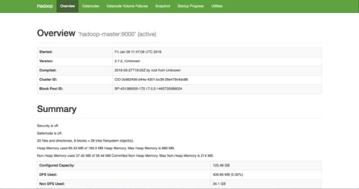
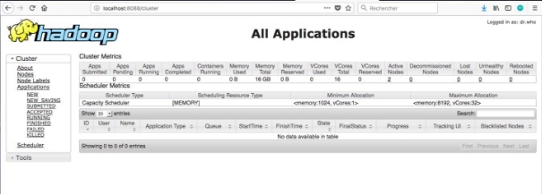

 

# **Exercice 02 : Lancement de Hadoop**

> **Type** : exercice guidé · **Prérequis** : séquence 02 · **Durée** : ~1 h
> **Objectifs** : démarrer le cluster de conteneurs, lancer les services Hadoop, accéder aux interfaces web, transférer des fichiers.
> **Lien cours** : [`../02 — Présentation de l'environnement Hadoop`](../02-presentation-env-hadoop.md)

Pour réaliser cet exercice, vous aurez besoin de la machine hôte du cluster (la vôtre en session locale, ou la VM fournie par votre formateur en session distante — cf. [cours 02, section « Accéder à l'environnement à distance »](../02-presentation-env-hadoop.md#accéder-à-lenvironnement-à-distance)).

## **Sommaire**

- **[Partie 1 – Démarrer les conteneurs](#partie-1--démarrer-les-conteneurs)**
- **[Partie 2 – Lancer les services Hadoop](#partie-2--lancer-les-services-hadoop)**
- **[Partie 3 – Accéder aux interfaces web](#partie-3--accéder-aux-interfaces-web)**
- **[Partie 4 – Transférer un fichier vers HDFS](#partie-4--transférer-un-fichier-vers-hdfs)**

---

## **Partie 1 – Démarrer les conteneurs**

Dans un terminal de la machine hôte (le projet de déploiement est fourni avec le cours) :

```bash
docker compose up -d
docker compose ps
```

**Résultat attendu** : quatre conteneurs `Up` — `hadoop-master`, `hadoop-slave1`, `hadoop-slave2` et `hadoop-nifi`.

> Les conteneurs démarrent **froids** : seuls SSH et l'entrypoint tournent. Aucun service Hadoop n'est encore actif — c'est l'objet de la partie 2.

Entrez dans le conteneur master :

```bash
./bash_hadoop_master.sh
# ou : docker exec -it hadoop-master bash
```

✅ Vous devez obtenir un terminal bash dans `hadoop-master` (prompt et `/home` comme répertoire de travail).

## **Partie 2 – Lancer les services Hadoop**

### **A. Démarrer les services**

Depuis le master, dans `/home` :

```bash
./start-all.sh
```

Ce script lance les services **dans l'ordre des dépendances** : ZooKeeper → HDFS → YARN → JobHistory → HBase → Thrift → REST → Hive. Vous pouvez aussi les lancer un à un (`./start-zookeeper.sh`, `./start-dfs.sh`, `./start-yarn.sh`, …) — c'est même recommandé la première fois, pour voir ce que fait chaque script (cattez-les !).

### **B. Vérifier que les services sont actifs**

```bash
jps
```

Résultat attendu dans le master :

```text
NameNode            # HDFS
SecondaryNameNode   # HDFS (checkpoint)
ResourceManager     # YARN
JobHistoryServer    # MapReduce (historique des jobs)
HMaster             # HBase
ThriftServer        # HBase (API Thrift)
RESTServer          # HBase (API REST)
RunJar              # HiveServer2 (apparaît comme RunJar)
QuorumPeerMain      # ZooKeeper
```

> ⚠️ **`QuorumPeerMain` (et non `HQuorumPeer`)** : c'est le vrai nom du process ZooKeeper dans cette distribution. `HQuorumPeer` était le ZooKeeper *embarqué* de HBase dans des versions plus anciennes — si une vieille doc le mentionne, ignorez-la.
> Les `DataNode` et `NodeManager` ne s'affichent **pas** dans le master : ils tournent sur les slaves (voir ci-dessous). `JobHistoryServer` et `RESTServer` sont bien lancés par `start-all.sh` et doivent apparaître dans la liste.

> Si vous faites `jps` dans un slave (`docker exec -it hadoop-slave1 jps`), vous aurez :
> ```text
> DataNode        # HDFS
> NodeManager     # YARN
> HRegionServer   # HBase
> ```

> Les services HBase/Hive/HBase-Thrift peuvent mettre quelques dizaines de secondes à apparaître après leur script — relancez `jps` si la liste semble incomplète.

---

## **Partie 3 – Accéder aux interfaces web**

Depuis votre navigateur (sur la machine hôte : `localhost` ; en session distante : l'adresse communiquée par votre formateur) :

1. **Interface web du NameNode (HDFS)** : <http://localhost:9870>
 

2. **Interface web du ResourceManager (YARN)** : <http://localhost:8088>
 

> Hadoop 3.x : l'UI du NameNode vit sur le port **9870** (c'était 50070 en 2.x — si vous voyez ce port dans une vieille doc, c'est qu'elle date d'Hadoop 2).

3. Retrouvez les configurations des fichiers XML vus précédemment dans l'interface web du NameNode (9870, onglet **Utilities** → **Browse the file system** ou **Configs**) :
    - **core-site.xml**
    - **hdfs-site.xml**
    - **yarn-site.xml**
    - **mapred-site.xml**

> En session locale, remplacez `localhost` par l'adresse de la machine qui héberge le cluster si ce n'est pas la vôtre.

---

## **Partie 4 – Transférer un fichier vers HDFS**

Pour boucler la boucle avec la séquence 03 : déposez un petit fichier dans HDFS depuis le master.

1. Depuis votre machine locale, copiez un fichier `test.txt` dans le master (option A : `docker cp test.txt hadoop-master:/home/` — option B en session distante : `scp test.txt utilisateur@<IP_VM>:~/` puis `docker cp` vers le conteneur) ;
2. Dans le master :

```bash
hdfs dfs -mkdir -p /user/root
hdfs dfs -put /home/test.txt /user/root/
hdfs dfs -ls /user/root
```

**Résultat attendu** : `test.txt` apparaît dans le listing HDFS — et aussi dans l'UI du NameNode (9870 → Utilities → Browse the file system).

C'est exactement le point de départ des exercices MapReduce (EX 04) : vos données sont désormais **dans le cluster**.
