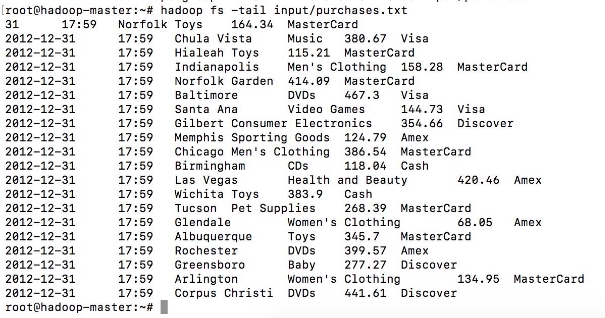

 

# **Exercice 03 : HDFS**

> **Type** : mémo + mini-exercices · **Prérequis** : séquence 03 (HDFS) · **Durée** : ~1 h
> **Objectifs** : mémoriser les commandes HDFS essentielles et vérifier leur effet sur le cluster.
> **Lien cours** : [`../03 — HDFS`](../03-hdfs.md)

## **Sommaire**

- [I. Mémo des commandes HDFS](#i-mémo-des-commandes-hdfs)
- [II. Suite de l'exercice : Manipulation des commandes HDFS](#ii-manipulation-des-commandes-hdfs)

---

## **I. Mémo des commandes HDFS**

---

Pour ces commandes, il existe 2 syntaxes possibles:
- Avec hadoop: avec une syntaxe du type `hadoop fs <commande>`,
- Avec hdfs: la syntaxe est `hdfs dfs <commande>`.

Ces commandes sont proche de celles utilisées par le Shell linux comme ls, mkdir, rm, cat, etc…

> **1. Lister le contenu d’un répertoire**

* Pattern : `hdfs dfs -ls <chemin du répertoire>`
* Exemple: `hdfs dfs -ls /user`

> **2. Afficher le contenu d’un fichier**

* Pattern : `hdfs dfs -cat <chemin_src>`
* Exemple : `hdfs dfs -cat /user/135-0.txt`

> **3. Créer un répertoire**

* Pattern : `hdfs dfs -mkdir <chemin_src>`
* Exemple: `hdfs dfs -mkdir /user/output`

> **4. Envoyer un fichier sur HDFS**

* Pattern : `hdfs dfs -put <chemin_src> <chemin_dest_HDFS>`
* Exemple: `hdfs dfs -put TextFile.txt /user`

> **5. Copier un fichier de HDFS sur HDFS**

* Pattern : `hdfs dfs -cp <chemin_src> <chemin_dest_HDFS>`
* Exemple: `hdfs dfs -cp ./TextFile.txt /user/output`

> **6. Récupérer un fichier de HDFS**

* Pattern : `hdfs dfs -get <chemin_dest_HDFS> <chemin_src>`
* Exemple: `hdfs dfs -get /user/HdfsTextFile2.txt ./LocalTextFile2.txt`

> **7. Supprimer un fichier**

* Pattern : `hdfs dfs -rm <chemin_dest_HDFS>`
* Exemple: `hdfs dfs -rm /user/TextFile2.txt`

> **8. Supprimer un répertoire**

* Pattern : `hdfs dfs -rmdir <chemin_dir_empty>` ou `hdfs dfs -rm -r <chemin_dir>`
* Exemple:
   - `hdfs dfs -rmdir /user/output2`
   - `hdfs dfs -rm -r /user/output`

---

## **II. Manipulation des commandes HDFS**

Nous allons utiliser **`Spotify_Most_Streamed_Songs.csv`** comme entrée pour tous les traitements MapReduce du cursus. C'est le seul jeu de données fourni avec le cours (`data/`), et **les EX 04 à 07 ne travaillent que sur lui** — gardez-le.

> ⚠️ **Le fichier n'est pas dans le conteneur.** `data/` vit sur *votre* machine ; le master HDFS ne le voit pas encore. Toutes les sessions du cursus partent d'une copie faite **une fois pour toutes** :
>
> ```bash
> # depuis la machine où tourne Docker, pas depuis le conteneur
> docker cp ../data/Spotify_Most_Streamed_Songs.csv hadoop-master:/home/
> # puis, dans le conteneur :
> docker exec -it hadoop-master bash
> ls -l /home/Spotify_Most_Streamed_Songs.csv   # 156547 octets
> ```
>
> Si le `ls -l` suivant affiche `No such file`, c'est que le `docker cp` n'a pas été fait depuis le répertoire du cours.

1. Créer un répertoire `input` dans HDFS.

   ```bash
   hdfs dfs -mkdir -p input
   ```

   **Résultat attendu** : aucune sortie. `hdfs dfs -ls input` liste ensuite le répertoire (vide, sans erreur).

2. Charger le fichier dans le répertoire `input` de HDFS.

   ```bash
   hdfs dfs -put Spotify_Most_Streamed_Songs.csv input/
   ```

   **Résultat attendu** : aucune sortie ; c'est la question 3 qui confirme.

3. Afficher le contenu du répertoire input.

   ```bash
   hdfs dfs -ls input
   ```

   **Résultat attendu** (mesuré) :
   ```
   Found 1 items
   -rw-r--r--   1 root supergroup    156547 2026-09-11 18:33 /user/root/input/Spotify_Most_Streamed_Songs.csv
   ```

   Trois choses à lire dans cette ligne, toutes vérifiables :
   - le **premier chiffre après les droits est 1**, pas 3 : c'est le facteur de réplication, et le cluster du cours est configuré à `dfs.replication=1`. Un `3` signifierait que vous avez monté un autre cluster ;
   - la taille est **156 547 octets** exactement — le même nombre qu'en local : personne n'a transformé le fichier ;
   - le chemin absolu est `/user/root/input/…` : `input`, sans `/`, est relatif à votre répertoire utilisateur HDFS.

4. Afficher les 10 dernières lignes du fichier stocké dans HDFS.

   ```bash
   hdfs dfs -cat input/Spotify_Most_Streamed_Songs.csv | tail -10
   ```

   **Résultat attendu** : 10 lignes de 25 champs séparés par des virgules, dont certaines entre guillemets parce qu'elles contiennent des virgules — `"Feid, Paulo Londra"`, `"Marília Mendonça, Hugo & G"`. La toute dernière est `Alone,Burna Boy,…`. C'est le **même contenu** que le fichier local : vérifiez en comparant.



> **INFO :** `-p` dans `hdfs dfs -mkdir -p input` crée les répertoires parents manquants, comme `mkdir -p` en shell.
>
> **INFO — `hdfs dfs -tail` est un piège, et votre cours vous y envoyait.** `-tail` relit **les derniers 1024 octets** du fichier, sans égard pour les fins de ligne. Mesuré sur ce fichier, il affiche **7 lignes dont la première est coupée en plein milieu d'un champ** :
>
> ```
> 022,11,4,1060,0,106249219,3,8,5,0,0,120,D,Major,64,11,53,1,0,25,27,…
> ```
>
> Ce n'est pas un accident de ce fichier : `-tail` ne sait pas où commence une ligne, il ne sait que seek à `taille − 1024`. Pour « les N dernières lignes » sur HDFS, l'outil est `hdfs dfs -cat … | tail -N`. Gardez `-tail` pour *surveiller un fichier en cours d'écriture* (un log, un `part-*` qui grossit), usage pour lequel il est conçu.
