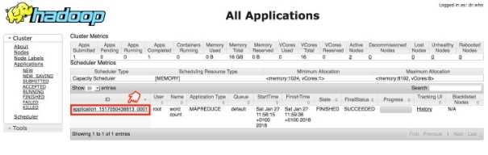
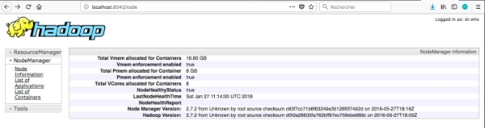

 

# **Exercice 04 : MapReduce & YARN**

> **Type** : prise en main guidée (partie I) + exercices autonomes (partie II)
> **Prérequis** : séquence 03 (HDFS), lancement de l'environnement (02)
> **Durée estimée** : 2 h (partie I) + 1 h à 2 h (partie II)
> **Lien cours** : [`../04 — MapReduce et YARN`](../04-mapreduce-et-yarn.md)

## **Table des matières**

- [I. Map Reduce](#i-map-reduce)
  - [A. Présentation](#a-présentation)
  - [B. Wordcount](#b-wordcount)
    - [1. Création du projet en Python](#1-création-du-projet-en-python)
    - [2. Test local avant le cluster](#2-test-local-avant-le-cluster)
    - [3. Utilisation de notre Map-Reduce dans Hadoop](#3-utilisation-de-notre-map-reduce-dans-hadoop)
    - [4. Vérification par les outils Web d’Hadoop](#4-vérification-par-les-outils-web-dhadoop)
- [II. Exercices — dataset Spotify](#ii-exercices--dataset-spotify)
  - [Exercice 1 : total des streams par artiste](#exercice-1--total-des-streams-par-artiste)
  - [Exercice 2 : moyenne des streams par année de sortie](#exercice-2--moyenne-des-streams-par-année-de-sortie)
  - [Exercice 3 : nombre total de streams par année de sortie](#exercice-3--nombre-total-de-streams-par-année-de-sortie)
  - [Exercice 4 : nombre moyen de playlists Spotify par année](#exercice-4--nombre-moyen-de-playlists-spotify-par-année)
  - [Exercice 5 : statistiques visuelles des streams par année](#exercice-5--statistiques-visuelles-des-streams-par-année)


## **I. Map Reduce**


### **A. Présentation**

Un Job Map-Reduce se compose principalement de deux types de programmes:
- **Mappers :** permettent d’extraire les données nécessaires sous forme de clef/valeur, pour pouvoir ensuite les trier selon la clef
- **Reducers :** prennent un ensemble de données triées selon leur clef, et effectuent le traitement nécessaire sur ces données (somme, moyenne, total...)

### **B. Wordcount**

Nous allons tester un programme **MapReduce** grâce à un exemple très simple, le **WordCount**, l'équivalent du **Hello World!** pour les applications de traitement de données. Le **WordCount permet de calculer le nombre de mots dans un fichier donné**, en décomposant le calcul en deux étapes:
- L'étape de **Mapping**, qui permet de **découper le texte** en mots et de délivrer en sortie un flux textuel, où chaque ligne contient le mot trouvé, suivi de la valeur 1 (pour dire que le mot a été trouvé une fois)
- L'étape de **Reducing**, qui permet de faire la somme des 1 pour chaque mot, pour **trouver le nombre total d'occurrences** de ce mot dans le texte.

#### 1. Création du projet en Python

> *vi mapper.py*

```python
import sys

# Lecture de l'entrée standard, une ligne à la fois
for line in sys.stdin:
    words: list[str] = line.strip().split(" ")  # séparateur 'espace' à changer
    for word in words:
        if word:  # mot non vide
            print(f"{word.lower()}\t1")  # clé\valeur
```

> 🔎 Le `print` émet **une ligne = une paire** `mot\t1` — le contrat clé/valeur d'Hadoop Streaming est un flux texte, rien de plus.


> *vi reducer.py*

```python
import sys

current_word: str | None = None
current_count: int = 0

for line in sys.stdin:
    parts = line.strip().split("\t", 1)
    if len(parts) < 2:  # ligne mal formée : on l'ignore
        continue
    word, count_str = parts

    try:
        count = int(count_str)
    except ValueError:
        continue  # valeur non numérique : on l'ignore

    # Les clés arrivent groupées et triées (le shuffle s'en charge)
    if current_word == word:
        current_count += count
    else:
        if current_word is not None:  # ne pas imprimer la première ligne
            print(f"{current_word}\t{current_count}")
        current_count = count
        current_word = word

if current_word is not None:  # le dernier mot comptabilisé
    print(f"{current_word}\t{current_count}")
```

#### 2. Test local avant le cluster

Avant de lancer un job sur le cluster, **testez toujours votre code en local** : plus rapide, pas de ressources consommées, erreurs détectées immédiatement.

Mapper, Sort et Reducer

`echo "bonjour bonsoir bonjour bonsoir" | python mapper.py | sort | python reducer.py`


**Note:** N’oubliez pas qu'on doit **sort** entre le map et reduce car Hadoop envoie les données triées au reducer (l'étape de *shuffle* regroupe et trie les clés pour vous).

#### 3. Utilisation de notre Map-Reduce dans Hadoop

- Lancer les services Hadoop (dans le master) : **./start-dfs.sh** puis **./start-yarn.sh** (ou **./start-all.sh**)
- Vérifier si le fichier **hadoop-streaming-\*.jar** existe bien dans le dossier (sur le cluster du cours, Hadoop 3.3.6) :
`ls $HADOOP_HOME/share/hadoop/tools/lib`
- Vérifier que le CSV Spotify est dans HDFS (chargé à l'EX 03) :

  `hdfs dfs -ls input`

  _Si le listing est vide, refaites le chargement : `hdfs dfs -mkdir -p input` puis `hdfs dfs -put Spotify_Most_Streamed_Songs.csv input`._
- Créer le répertoire de sortie :

  `hdfs dfs -mkdir output`

  _Crée le dossier `/user/root/output`, le répertoire de sortie du job. Il ne doit pas exister au lancement du job, sinon Hadoop refuse (le script `../annexes/utils/0-job.sh` le supprime avant chaque run)._
- Lancer le mapper et le reducer sur Hadoop avec le CSV Spotify :
```bash
hadoop jar $HADOOP_HOME/share/hadoop/tools/lib/hadoop-streaming-*.jar \
-file mapper.py -mapper "python3 mapper.py" \
-file reducer.py -reducer "python3 reducer.py" \
-input input/Spotify_Most_Streamed_Songs.csv \
-output output/wordcount
```

> **ATTENTION:** Nom mapper & reducer doivent être pareil entre le `-file`, le `-mapper` et le `-reducer`.

- Afficher le résultat stocké sur HDFS: `hadoop fs -tail output/wordcount/part-00000`

#### 4. Vérification par les outils Web d’Hadoop

Il vous est possible de monitorer vos Jobs Map Reduce, en allant à la page: **<http://localhost:8088>**. Vous trouverez votre Job dans la liste des applications comme suit:




Il est également possible de voir le comportement des noeuds esclaves, en allant à l'adresse: **<http://localhost:8041>** pour **slave1**, et **<http://localhost:8042>** pour **slave2**. Vous obtiendrez ce qui suit:




## II. Exercices — dataset Spotify

Les exercices suivants approfondissent MapReduce avec des **données réelles** issues de Spotify (nombre de streams, playlists, artistes…) — le même fichier `../data/Spotify_Most_Streamed_Songs.csv` que partout dans le cours.

Pour réaliser ces questions, vous utiliserez le comportement MapReduce de Hadoop grâce à deux fichiers :
- le **mapper**, pour filtrer les données
- le **reducer**, pour agréger et exporter les données

**Aides fournies** : des squelettes et scripts de référence sont disponibles dans [`../annexes/utils/`](../annexes/utils/) :
- `1-structure-mapper.py` / `2-structure-reducer.py` — structure minimale d'un mapper/reducer
- `3-mapper-txt.py` — mapper sur fichier texte
- `4-mapper-csv-reader.py` — mapper lisant un CSV (gère les virgules quotées)
- `0-job.sh` — script d'automatisation d'un job complet (démarrage, put, lancement, résultat)

### Exercice 1 : total des streams par artiste

- Écrire un Job **Map Reduce** permettant, à partir du **CSV Spotify**, de déterminer le **total des streams par artiste**.

Repérez d'abord les colonnes dans le fichier (`head -1` en local) — le CSV a 25 champs, en voici les repères utiles pour cet exercice :

| index | 0 | 1 | 2 | ... | 8 |
| --- | --- | --- | --- | --- | --- |
| champ | `track_name` | `artist(s)_name` | `artist_count` | ... | `streams` |

**Mapper** : extraire le champ artiste (index 1) et `streams` (index 8).

> ⚠️ **`csv.reader`, pas `split(',')`.** Le champ artiste contient des virgules **dans les champs quotés** (`"Latto, Jung Kook"`). Un `split(',')` naïf décale toutes les colonnes qui suivent. Passez par `csv.reader(sys.stdin, delimiter=',')`, qui respecte les guillemets CSV.

**Reducer** : agréger la somme des streams par artiste (même structure que le reducer du WordCount).

**Résultat attendu** (valeurs mesurées — convention : la colonne artiste **telle quelle**, un duo = une clé unique) : **644 artistes**, dont en tête :

```
The Weeknd	14185552870
Taylor Swift	14053658300
Ed Sheeran	13908947204
Harry Styles	11608645649
Bad Bunny	9997799607
Olivia Rodrigo	7442148916
```

> 🤔 **Question de contrôle — les conventions.** Éclatez les duos (chaque membre se voit créditer du total du titre) et le classement change de tête : **The Weeknd 23 929 760 757**, **Bad Bunny 23 813 527 270**, Ed Sheeran 15 316 587 718, Taylor Swift 14 630 378 183. Deux réponses justes à la même question — **la vôtre dépend du mapper, et c'est vous qui l'écrivez**. Indiquez votre convention dans votre rapport. La séquence 05 (Hive) refait ce calcul en SQL : la validation croisée n'a de sens que si les deux côtés appliquent la même convention.

### Exercice 2 : moyenne des streams par année de sortie

- Écrire un Job **Map Reduce** permettant de déterminer la **moyenne des streams par année de sortie**.

**Mapper** : extraire `released_year` (index 3) et `streams` (index 8).

**Reducer** : accumuler **la somme et le nombre d'occurrences** par année, et émettre la moyenne en fin de groupe — même mécanique que la somme de l'exercice 1, avec deux accumulateurs au lieu d'un. Format de sortie : `année\tmoyenne`.

**Résultat attendu** : une ligne par année de sortie. Vérification de plausibilité : les années s'étendent de **1930 à 2023** (50 années), la plupart des moyennes autour de quelques centaines de millions de streams.

> ⚠️ **Le combiner ne sait pas moyenner.** Une moyenne ne se combine pas : la moyenne des moyennes de deux groupes n'est pas la moyenne globale. Sur ce job, n'utilisez **pas** de combiner — ou alors un combiner « somme + compte » dont le reducer redescend la vraie moyenne. Le cours (séquence 04) développe ce piège.

> ✨ **Lien avec la séquence 05** : l'EX 05 (Hive) demande exactement ce calcul en SQL (`AVG(streams) … GROUP BY released_year`). Vous pourrez confronter vos deux chiffres ligne à ligne.

### Exercice 3 : nombre total de streams par année de sortie

**Objectif** : Calculer le nombre total de streams par année.

- **Mapper** : Lire le fichier CSV, extraire l'année de sortie (`released_year`) et le nombre de streams (`streams`).
- **Reducer** : Agréger le nombre total de streams par année.

**Résultat attendu** : une ligne par année `année\ttotal_streams`, triée par année croissante. Extrait (valeurs **mesurées** — deux recalculs indépendants sur le CSV réel) :

```
1975	4206105352
1984	3471625366
...
2023	25808484104
```

> ⚠️ Le nombre de streams est un très grand entier (le maximum mesuré dépasse 3,7 milliards) — attention aux conversions de type et aux valeurs aberrantes de certaines lignes du CSV. La ligne 576 a un champ `streams` corrompu : votre `int()` doit être protégé, sinon le job échoue.

### Exercice 4 : nombre moyen de playlists Spotify par année

**Objectif** : Calculer la moyenne du nombre de playlists Spotify contenant des chansons, regroupées par année de sortie.

- **Mapper** : Extraire l'année de sortie (`released_year`) et le nombre de playlists Spotify (`in_spotify_playlists`).
- **Reducer** : Calculer la moyenne du nombre de playlists par année.

**Résultat attendu** : une ligne par année `année\tmoyenne_playlists`. Contrairement à l'exercice 3, votre reducer doit accumuler **à la fois** la somme et le nombre d'occurrences pour calculer la moyenne — même structure que l'exercice 2, reformatée sur une autre colonne.

### Exercice 5 : statistiques visuelles des streams par année

**Objectif** : Créer un graphique des streams par année, exporté en PDF.

- **Mapper** : Comme dans l'exercice 3, extraire l'année de sortie (`released_year`) et le nombre de streams (`streams`).
- **Reducer** : Agréger le nombre total de streams par année, créer un graphique matplotlib (pie) pour visualiser les tendances et enfin, l'exporter en PDF.

**Résultat attendu** : un fichier PDF contenant le camembert des streams par année, à côté de la sortie standard agrégée. Référence : [`../annexes/utils/6-reducer-matplotlib-pdf.py`](../annexes/utils/6-reducer-matplotlib-pdf.py).