<!-- _class: lead -->

# Jour 1 — Les fondations d'Hadoop

## Pourquoi Hadoop ? L'environnement de TP · HDFS

---

# 🗓️ Agenda du jour 1

<div class="cols-2">

<div class="card card-blue">
<div class="card-title">🌅 Matin</div>

- **Ouverture** — tour de table, fil rouge
- **I. Pourquoi Hadoop ?** — la genèse, l'écosystème
- **II. L'environnement de TP** — le cluster Docker

</div>

<div class="card card-pink">
<div class="card-title">🌇 Après-midi</div>

- **III. HDFS** — blocs, réplication, commandes
- **EX/02** — lancer le cluster
- **EX/03** — HDFS
- **TD-01** — MapReduce en local, avant le cluster (premier temps en autonomie)

</div>

</div>

**Objectif du jour** — comprendre d'où vient Hadoop, démarrer son cluster et poser les premières données dans HDFS.

<!-- Accueillir le groupe, présenter le déroulé et le fil rouge de la semaine (le CSV Spotify + le TP final). Annoncer le ratio cours/exercices. -->

---

# 🌍 Qui êtes-vous ?

<div class="card card-green">
<div class="card-title">Pour bien calibrer la journée</div>

- Qui a déjà utilisé **Linux** (terminal, commandes) ?
- Qui a déjà joué avec **Docker** ?
- Qui a déjà écrit du **SQL** ? Du **Python** ?
- Comment définiriez-vous **Hadoop**, en une phrase ?
- Qu'attendez-vous de cette semaine ?

</div>

<!-- Tour de table rapide (~5 min). Noter les attentes au tableau pour y revenir en conclusion. Adapter le niveau de rappel shell/linux. -->

---

<!-- _class: statement -->

# 🤔 D'après vous…

**Vous avez une base MySQL classique. On lui injecte 10 To de logs par jour.**

Que se passe-t-il ? Elle tient le coup ? Pourquoi ?

<!-- Laisser réfléchir 45 s à 1 min. Recueillir 2-3 réponses sans valider. Amorcer : "on va voir que le problème n'est pas la base, mais l'architecture". -->

---

# 💡 Réponse : ça coince vite

<div class="cols-2">

<div class="card card-pink">
<div class="card-title">Ce qui se passe vraiment</div>

- Le stockage **explose** : ~300 To / mois
- Les requêtes **ramentent**, les sauvegardes deviennent impossibles
- Le serveur **sature** → on ne peut pas le "grossir" indéfiniment (**scale-up** limité)

</div>

<div class="card card-green">
<div class="card-title">La solution historique de Google</div>

- Puisque les machines standard **coûtent moins cher**, on en prend **plusieurs**
- On **distribue** le stockage et le **parallélise** le calcul
- C'est exactement ce que fait **Hadoop**

</div>

</div>

<div class="flex justify-center">
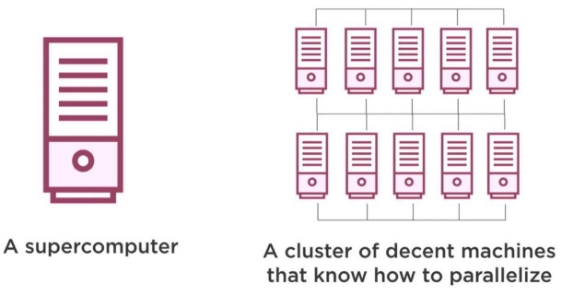
</div>

---

# 🎬 Le fil rouge de la semaine

<div class="card card-blue">
<div class="card-title">Un fil rouge, quatre jours</div>

- Une **donnée réelle et modeste** pour éprouver toute la pipeline
- Elle arrivera en **EX/03** et circulera dans les EX 04 à 07 — le **TP final** de vendredi enchaînera la même chaîne sur un autre jeu (les ventes `dataw_fro03`)
- Objectif d'ici vendredi : la faire traverser **HDFS → MapReduce → Hive → HBase → NiFi**

</div>

---

<!-- _class: section -->

# I. Pourquoi Hadoop ?

## Le contexte, la genèse, l'écosystème

---

<!-- _class: statement -->

# 🤔 D'après vous…

**En 2003, Google a publié un article décrivant son « Google File System ».**

Qu'est-ce qui pousse une entreprise web à concevoir son **propre système de fichiers**, sur des **milliers de machines** ?

<!-- Laisser 30-45 s. Recueillir 2-3 réponses. Relancer si la salle est muette : "vous stockeriez 300 To/mois sur le disque C: ". Amorcer vers le scale-out. -->

---

# 💡 Réponse : scale-out, pas scale-up

<div class="card card-green">
<div class="card-title">Google ne pouvait pas tout mettre sur un disque</div>

- Le web crawlé : des **centaines de To**, aucun **disque unique** ne suit
- La machine « toujours plus grosse » (**upsizing**) coûte de plus en plus cher
- La parade : des **milliers de machines standard** qui partagent le stockage — le **scale-out**
- La **panne d'un disque est la norme** : le **Google File System** (2003) **réplique** les blocs et **agrège** la bande passante

</div>

> Ce scénario, Hadoop le généralisera : stocker de façon sûre sur du matériel bon marché, et traiter **là où sont les données**.

---

# 🎯 Objectifs du chapitre

<div class="card card-blue">
<div class="card-title">À la fin de ce chapitre, vous saurez…</div>

- ✅ Définir Hadoop et le situer dans l'histoire du Big Data
- ✅ Expliquer la limite du client/serveur et de l'upsizing
- ✅ Citer les composants de l'écosystème (HDFS, YARN, MapReduce, Hive, HBase, NiFi, ZooKeeper)
- ✅ Situer les briques historiques en 2026 (Sqoop, Oozie, Pig)

</div>

---

# 📦 Définition

<div class="card card-blue">
<div class="card-title">Hadoop en une phrase</div>

**Framework Java open-source** (Apache) pour le **stockage et le traitement distribué** de **volumes massifs de données** sur des **clusters** de serveurs.

</div>

<div class="card card-yellow">
<div class="card-title">Pourquoi Python dans ce cours ?</div>

Hadoop peut s'utiliser avec plusieurs langages. **Python** s'impose en Big Data pour sa **simplicité** et sa **richesse en bibliothèques** (NumPy, Matplotlib, pandas, happybase…).

</div>

---

# 🏛️ Origines : de l'upsizing au cluster

<div class="card card-pink">
<div class="card-title">L'ancien monde</div>

- **Client/serveur** : un serveur central puissant + un SGBDR
- Face à la croissance, on fait de **l'upsizing** (grossir le serveur)
- Limites : la croissance dépasse les capacités centralisées, le matériel a des limites **physiques**

</div>

<div class="card card-green">
<div class="card-title">La rupture de Google</div>

- Baisse du coût des ordinateurs standards
- **Cluster de machines standards** : stockage **distribué**, traitement **parallélisé**
- Hadoop = l'implémentation la plus mature de cette stratégie

</div>

<div class="flex justify-center">

</div>

---

# 🗄️ Où stocker les données ?

<div class="card card-blue">
<div class="card-title">Le stockage doit suivre le calcul</div>

- De même que le calcul est réparti, le **stockage est distribué**
- Les SGBDR classiques, conçus pour **un serveur unique**, atteignent leurs limites (capacité, performance)
- Le **scaling out** : augmenter capacité et tolérance aux pannes en **ajoutant des nœuds**

</div>

<div class="flex justify-center">
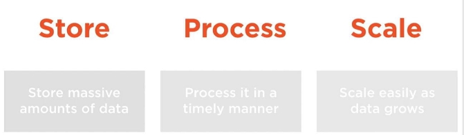
</div>

---

# 🗃️ Comment Hadoop stocke ?

<div class="card card-green">
<div class="card-title">Chaque nœud participe au stockage… et au calcul</div>

Selon les besoins, Hadoop s'appuie sur :

- **HDFS** — système de **fichiers distribué**, pour les fichiers volumineux
- **Hive** — interface **SQL** sur HDFS, qui expose les fichiers en **tables**
- **HBase** — base **NoSQL distribuée** orientée accès rapide (séquence 06)

</div>

<!-- Faire le lien : "stockage + calcul sur les mêmes nœuds = c'est ce qui permet de traiter là où sont les données". -->

---

# 🧱 L'architecture en 4 acteurs

<div class="flex justify-center">
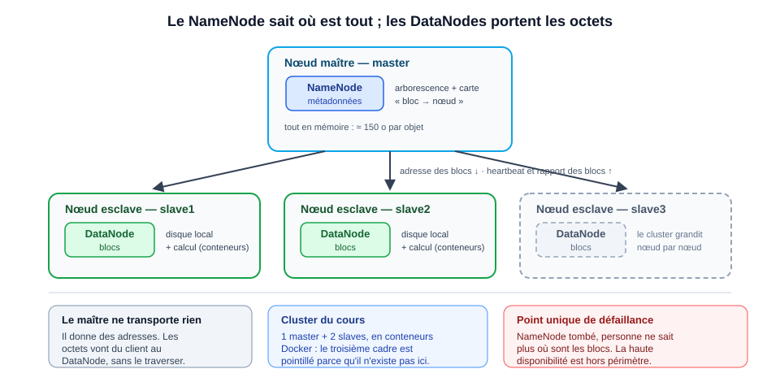
</div>

<div class="cols-2">

<div class="card card-blue">
<div class="card-title">MasterNode — le coordinateur</div>

- **NameNode** : gère les **métadonnées** HDFS (fichiers, blocs, réplication)
- Coordination globale du cluster

</div>

<div class="card card-yellow">
<div class="card-title">SlaveNodes — les ouvriers</div>

- **DataNode** : stocke les **blocs** de données
- Exécute les traitements distribués

</div>

</div>

---

# 🧩 L'écosystème Hadoop

<div class="flex justify-center">
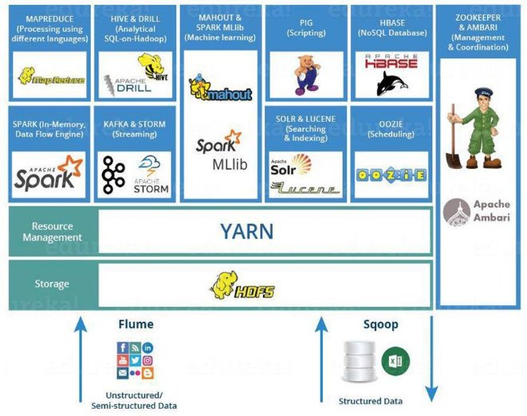
</div>

<div class="card card-blue">
<div class="card-title">Les 7 briques du cours</div>

**HDFS** (stockage) · **YARN** (ressources) · **MapReduce** (calcul) · **ZooKeeper** (coordination) · **Hive** (SQL) · **HBase** (NoSQL colonnes) · **NiFi** (ingestion)

</div>

---

# 📜 L'écosystème historique — statut 2026

<div class="card card-pink">
<div class="card-title">Retirés du périmètre (plus maintenus)</div>

- **Sqoop** (vers les bases SQL) : à l'Attic depuis 2021 → **Spark JDBC, Kafka Connect**
- **Oozie** (ordonnanceur) : en maintenance depuis 2018 → **Airflow / Dagster / Prefect**
- **Pig** (flux SQL-like) : supplanté par Spark et Hive

</div>

<div class="card card-green">
<div class="card-title">Toujours actifs — et couverts par le cours</div>

- **Hive (4.x)** : évolue vers le **lakehouse** (Iceberg), toujours très déployé
- **NiFi** : la référence de l'ingestion visuelle multi-sources

</div>

> Les concepts survivent : Spark s'exécute sur YARN, le shuffle est partout.

---

# ⚙️ Les fichiers de configuration

<div class="card card-yellow">
<div class="card-title">5 fichiers pour faire communiquer les composants</div>

```bash
ls -l $HADOOP_HOME/etc/hadoop
# hadoop-env.sh · core-site.xml · hdfs-site.xml · mapred-site.xml · yarn-site.xml
```

</div>

<div class="cols-3" style="align-items: start;">

<div class="card card-blue">
<div class="card-title">`core-site.xml`</div>

Cœur de Hadoop : **emplacement du NameNode**

```xml
<property>
  <name>fs.defaultFS</name>
  <value>hdfs://hadoop-master:9000</value>
</property>
```

</div>

<div class="card card-green">
<div class="card-title">`hdfs-site.xml`</div>

Emplacements NameNode/DataNode + **réplication**

```xml
<property>
  <name>dfs.replication</name>
  <value>1</value>
</property>
```

</div>

<div class="card card-pink">
<div class="card-title">`mapred-site.xml`</div>

Le framework de calcul

```xml
<property>
  <name>mapreduce.framework.name</name>
  <value>yarn</value>
</property>
```

</div>

</div>

> ⚠️ `dfs.replication=1` ici — chaque bloc a **une seule copie** (pas le ratio 3 de la doc historique).

---

# 📊 Positionnement & marché

<div class="cols-2">

<div class="card card-blue">
<div class="card-title">Hadoop, une compétence recherchée</div>

- Le socle **on-premise** du Big Data classique
- La compétence de base recherchée par les équipes data
- Les distributions : **Cloudera**, **Amazon EMR**, **Google Cloud**, **Azure HDInsight**

</div>

<div class="card card-yellow">
<div class="card-title">Compétences visées cette semaine</div>

Le langage commun des data engineers : tant qu'on maîtrise HDFS, le shuffle, les conteneurs, on déchiffre n'importe quelle stack moderne.

</div>

</div>

<div class="flex justify-center" style="gap: 1rem;">


</div>

---

# 🧠 À retenir — Pourquoi Hadoop ?

<div class="card card-pink">

- ✅ Le **scale-out** remplace l'upsizing : des machines standards, du stockage distribué
- ✅ **HDFS** stocke, **MapReduce** calcule, **YARN** orchestre
- ✅ L'écosystème : Hive (SQL), HBase (NoSQL), ZooKeeper (coordination), NiFi (ingestion)
- ✅ Sqoop/Oozie/Pig sont **désaffectés** ; Spark/Kafka/Airflow leur ont succédé

</div>

---

<!-- _class: section -->

# II. L'environnement de TP

## Un vrai cluster Docker à l'échelle d'un portable

---

<!-- _class: statement -->

# 🤔 D'après vous…

**Comment installerait-on un mini-cluster Hadoop pour une formation ?**

Une machine unique ? Plusieurs machines virtuelles ? Docker ? Et pourquoi ?

<!-- Laisser 30-45 s. Attendre : un seul PC ne suffit pas, plusieurs VMs sont lourdes. Enchaîner : Docker = 4 conteneurs légers qui partagent le kernel. -->

---

# 💡 Réponse : un vrai cluster, à l'échelle d'un portable

<div class="cols-3" style="align-items: start;">

<div class="card card-pink">
<div class="card-title">1 machine unique</div>

Hadoop est un système **distribué** (NameNode, DataNodes…). Une machine seule n'a **rien à distribuer** : ni pannes, ni réseau, ni coordination du réel.

</div>

<div class="card card-yellow">
<div class="card-title">Plusieurs VMs</div>

**Gourmandes** : chaque VM embarque son propre OS (RAM et CPU). Pour simuler 3-4 nœuds, il faut déjà un poste costaud, et le démarrage est lent.

</div>

<div class="card card-green">
<div class="card-title">Docker ✅</div>

4 **conteneurs légers** qui partagent le kernel de l'hôte : 1 master + 3 esclaves, reproductibles, démarrés en quelques secondes.

</div>

</div>

> C'est l'objet de la **deuxième partie** de la journée : ce mini-cluster, vous allez l'allumer vous-mêmes.

---

# 🎯 Objectifs du chapitre

<div class="card card-blue">
<div class="card-title">À la fin du chapitre + EX/02, vous saurez…</div>

- ✅ Décrire l'architecture de l'environnement (4 conteneurs, services)
- ✅ Démarrer les conteneurs et lancer les services Hadoop
- ✅ Vérifier avec `jps` ce qui tourne
- ✅ Accéder aux interfaces web et déposer un premier fichier HDFS

</div>

---

# 🐳 Un cluster Docker local

<div class="flex justify-center">
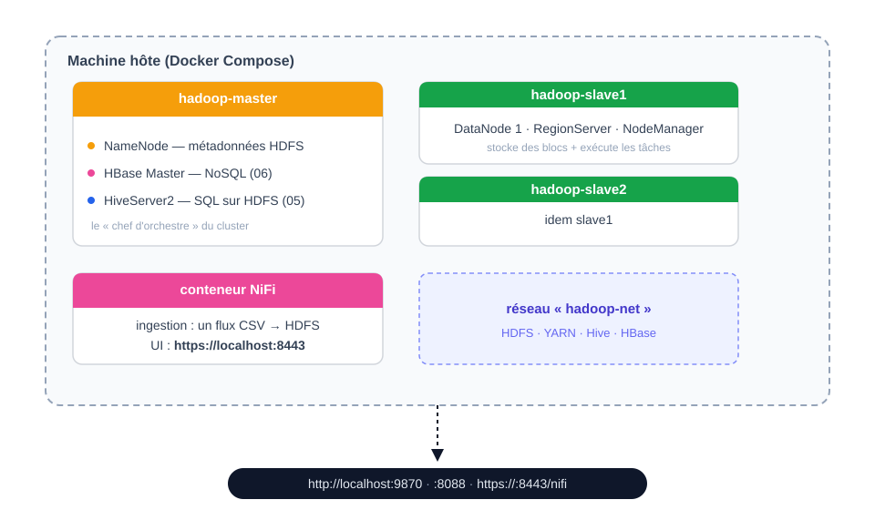
</div>

---

# 📦 Versions installées

| Composant | Version | Rôle |
|---|---|---|
| **Hadoop** | 3.3.6 | HDFS + YARN + MapReduce |
| **HBase** | 2.5.15 | NoSQL colonnes (séquence 06) |
| **Hive** | 4.1.0 | SQL sur HDFS (séquence 05) |
| **ZooKeeper** | 3.8.6 | coordination HBase |
| **Java** | OpenJDK 17 | tous les services |
| **Python** | 3.11 | mappers/reducers, HappyBase, pandas |
| **NiFi** | 2.x | ingestion (conteneur dédié) |

> ⚠️ **Ports 3.x** : l'UI du NameNode est sur **9870** (50070 en 2.x). Les cours utilisent partout les ports 3.x.

---

# 🐍 Python préinstallé

<div class="card card-green">
<div class="card-title">Les bibliothèques utiles sont déjà là</div>

| Bibliothèque | Usage |
|---|---|
| `happybase` | interagir avec HBase depuis Python |
| `matplotlib` | visualisation, export PDF |
| `pandas` | manipulation de données |
| `thriftpy2` | support Thrift pour happybase |

</div>

> Python **3.11** supporte les syntaxes modernes (f-strings y compris).

---

# 🖥️ Les scripts : deux familles

<div class="cols-2">

<div class="card card-blue">
<div class="card-title">Sur la machine hôte (Docker)</div>

| Commande | Rôle |
|---|---|
| `docker compose up -d` | démarre les 4 conteneurs |
| `docker compose down` | arrête (les volumes persistent) |
| `./bash_hadoop_master.sh` | terminal bash dans le master |

</div>

<div class="card card-pink">
<div class="card-title">Dans le conteneur master (`/home`)</div>

| Script | Rôle |
|---|---|
| `./start-all.sh` | tout, dans l'ordre des dépendances |
| `./start-dfs.sh` | HDFS (NameNode + DataNodes) |
| `./start-yarn.sh` | YARN (RM + NodeManagers) |
| `./start-hive.sh` | HiveServer2 (JDBC 10000) |
| `./start-hbase.sh` / `./start-thrift.sh` | HBase + Thrift (9090) |

</div>

</div>
---

# 🔍 `jps` : vérifier ce qui tourne

> Les conteneurs démarrent **froids** : aucun service n'est lancé — c'est voulu, vous apprenez à les démarrer à l'EX/02.

<div class="card card-yellow">
<div class="card-title">Dans le master</div>

```text
NameNode · SecondaryNameNode · ResourceManager
JobHistoryServer · HMaster · ThriftServer
RESTServer · RunJar (HiveServer2) · QuorumPeerMain (ZooKeeper)
```

</div>

<div class="card card-green">
<div class="card-title">Dans un slave</div>

```text
DataNode · NodeManager · HRegionServer
```

</div>

> ⚠️ `QuorumPeerMain` = le vrai ZooKeeper de cette distribution (pas `HQuorumPeer`). Les DataNodes/NodeManagers ne s'affichent **pas** dans le master — ils tournent sur les slaves.

---

# 🌐 Les interfaces web

<div class="cols-2">

<div class="card card-blue">
<div class="card-title">HDFS (NameNode)</div>

- <http://localhost:9870>
- Parcourir le filesystem, configs XML
- Port **9870** en Hadoop 3.x

</div>

<div class="card card-pink">
<div class="card-title">YARN (ResourceManager)</div>

- <http://localhost:8088>
- Suivi des applications/jobs
- Logs depuis 8041 (slave1) / 8042 (slave2)

</div>

</div>

<div class="flex justify-center" style="gap: 1rem;">
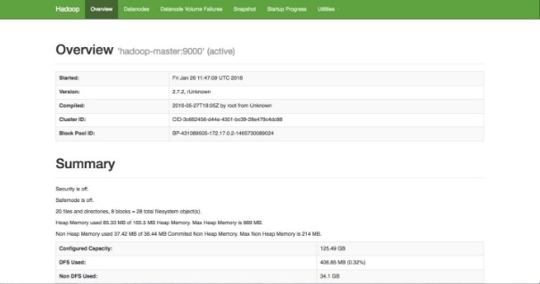
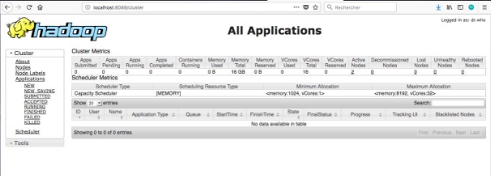
</div>

---

# 🎬 Démo — démarrer l'environnement

<div class="card card-green">
<div class="card-title">L'enchaînement complet</div>

```bash
# machine hôte
docker compose up -d
./bash_hadoop_master.sh  # docker exec -it hadoop-master bash

# dans le master
./start-all.sh        # ZK → HDFS → YARN → JobHistory → HBase → Thrift → REST → Hive
jps                   # vérifier que tout est up
```

</div>

> ⚠️ Les scripts du cours se lancent **avec `./`** (`/home` n'est pas dans le PATH). `start-hbase.sh` existe aussi dans `/opt/hbase/bin` et ne fait **pas** la même chose.

<!-- Démo live : docker compose up -d, bash_hadoop_master.sh, start-all.sh, jps. Montrer l'ordre des dépendances affiché par start-all.sh (cat). -->

---

<!-- _class: exercise -->
<!-- Repère formateur : exercices/02-lancement-de-hadoop.md — Parties 1 à 4 -->

# ✏️ Exercice 02 — Lancer Hadoop

**Démarrez le cluster et déposez votre premier fichier HDFS.**

1. **Partie 1** — `docker compose up -d` → 4 conteneurs `Up`
2. **Partie 2** — `./start-all.sh` puis `jps` (services attendus dans le master)
3. **Partie 3** — interfaces web : `9870` (HDFS), `8088` (YARN) + configs XML
4. **Partie 4** — `hdfs dfs -mkdir -p /user/root` et `hdfs dfs -put test.txt`

> Astuce : ouvrez `start-all.sh` et regardez les **vraies commandes** lancées, dans l'ordre des dépendances.

<!-- Laisser ~45 min. Passer sur les postes pour vérifier jps et les interfaces web. Noter la latence de démarrage des services HBase/Hive (dizaines de secondes après les scripts). -->

---

<!-- _class: section -->

# III. HDFS

## Le système de fichiers distribué de Hadoop

---

<!-- _class: statement -->

# 🤔 D'après vous…

**Un fichier de données pèse plusieurs To, mais chaque disque du cluster fait 1 To.**

Comment le stocker ? Et comment savoir, à tout moment, où se trouve chaque morceau ?

<!-- Laisser 30-45 s. Attendre l'idée de découpage ; insister sur l'« annuaire » central pour introduire le NameNode. -->

---

# 🎯 Objectifs du chapitre

<div class="card card-blue">
<div class="card-title">À la fin de ce chapitre + EX/03, vous saurez…</div>

- ✅ Expliquer pourquoi HDFS et comment il stocke (blocs, réplication)
- ✅ Décrire l'architecture NameNode / DataNode / Secondary NameNode
- ✅ Maîtriser les commandes : `ls`, `cat`, `mkdir`, `put`, `get`, `rm`
- ✅ Lire les métadonnées d'un fichier (réplication, taille)

</div>

---

# 💡 Pourquoi HDFS ?

<div class="cols-2">

<div class="card card-blue">
<div class="card-title">Distribué</div>

Un système de fichiers réparti sur des **centaines / milliers de serveurs**

</div>

<div class="card card-green">
<div class="card-title">Répliqué</div>

Chaque donnée stockée à **plusieurs emplacements** pour éviter les pertes

</div>

<div class="card card-blue">
<div class="card-title">Big Data</div>

Des dizaines de **millions de fichiers** supportés, avec **cohérence** et **intégrité**

</div>

<div class="card card-green">
<div class="card-title">Portable</div>

Fonctionne sur du **commodity hardware** (serveurs standards)

</div>

</div>

<div class="card card-yellow">
<div class="card-title">⚠️ HDFS n'est pas une base de données</div>

On n'interroge **pas** HDFS en direct : **MapReduce** le lit, **Hive** le requête en SQL (séquence 05)

</div>

---

# 🔁 La réplication par blocs

<div class="card card-blue">
<div class="card-title">Ce sont les blocs qui sont répliqués, pas les fichiers</div>

- **Réplication** = la même donnée disponible à plusieurs endroits simultanément
- La réplication se fait **par bloc**, pas par fichier
- Les dossiers n'existent que dans **l'index** (le NameNode)

</div>

<div class="card card-yellow">
<div class="card-title">Défaut 3, mais pas ici</div>

- La **documentation** dit : ratio 3 par défaut
- **Notre cluster : `dfs.replication=1`** (configuré dans `hdfs-site.xml`) → l'économie de place au prix de la redondance
- Ajustable par fichier/répertoire avec `hdfs dfs -setrep`

</div>

> 📌 On verra à l'EX/03/`fsck` : la réplication se lit dans le listing HDFS (**le `1` après les droits**).

---

# 📐 Taille des blocs

<div class="cols-2">

<div class="card card-blue">
<div class="card-title">Le block size</div>

- **128 Mio** par défaut (configurable dans `hdfs-site.xml`, dérogable par fichier)
- Gros blocs → adaptés aux **gros fichiers peu nombreux**
- Petits blocs → adaptés aux **petits fichiers nombreux** (moins de surcoût)

</div>

<div class="card card-yellow">
<div class="card-title">Compression</div>

- Codecs : **Gzip, Bzip2, Snappy, LZO** (à la volée)
- ✅ Moins d'espace, transferts plus rapides
- ⚠️ Charge CPU + certaines compressions **empêchent le split**

</div>

</div>

<div class="flex justify-center">
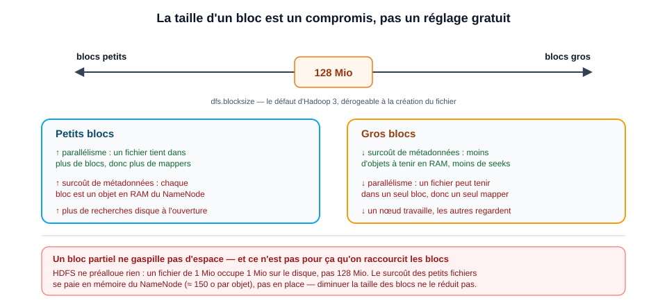
</div>

---

<!-- _class: statement -->

# 🤔 D'après vous…

**Un fichier de 400 Mio est déposé dans HDFS (blocs de 128 Mio).**

**Combien de blocs occupe-t-il ?**

*Comment le savez-vous sans compter ?*

<!-- Laisser réfléchir 30-45 s. Réponses possibles : 4 (400/128 = 3,1 arrondi), puis amener la commande fsck comme preuve ("on lira, on ne devinera pas"). -->

---

# 💡 Réponse : 4 blocs — et ça se lit

<div class="card card-green">
<div class="card-title">On lit, on ne devine pas</div>

- 400 / 128 = 3,125 → **4 blocs** (seul le dernier peut être partiellement vide)
- La commande de preuve :

```bash
hdfs fsck /user/root/input/Spotify_Most_Streamed_Songs.csv -files -blocks
```

- Le block size **par défaut** ne s'applique qu'aux fichiers créés sans valeur explicite → il n'est **pas** "le même pour tous les fichiers"

</div>

> Le réflexe de toute la semaine : **le nombre de blocs se lit dans `fsck`**, on ne le calcule pas de tête.

---

# 🧠 NameNode — l'annuaire

<div class="card card-blue">
<div class="card-title">Le cerveau de HDFS</div>

- Connaît **l'index des fichiers** (`/totaux.txt` = blocs A, B, C, D), la hiérarchie des répertoires
- Sait **quel bloc est sur quel serveur** (bloc A sur DataNode 1 et 2, etc.)
- Métadonnées stockées sur disque dans deux fichiers : **`edits_xxx`** (journal) et **`fsimage_xxx`** (image)
- ≈ **150 octets en mémoire** par objet (fichier, répertoire, bloc)

</div>

<div class="flex justify-center">
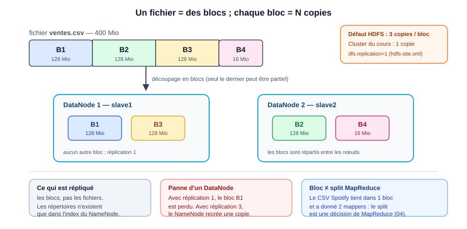
</div>

---

# 🛡️ SafeMode & le Secondary NameNode

<div class="cols-2">

<div class="card card-yellow">
<div class="card-title">SafeMode</div>

- Mode **lecture seule**, au démarrage ou à la demande de l'admin
- Le NameNode **charge** `edits` + `fsimage` et **attend le retour** des DataNodes sur la position des blocs
- ⚠️ **bloque l'écriture** sur HDFS

</div>

<div class="card card-pink">
<div class="card-title">Secondary NameNode ≠ secours !</div>

- C'est un **checkpoint** : il fusionne `edits` dans `fsimage`, allégeant le journal
- ⚠️ **Il ne prend PAS la place** du NameNode en cas de panne — la HA passe par le failover ZooKeeper (hors périmètre ici)

</div>

</div>

<div class="flex justify-center">
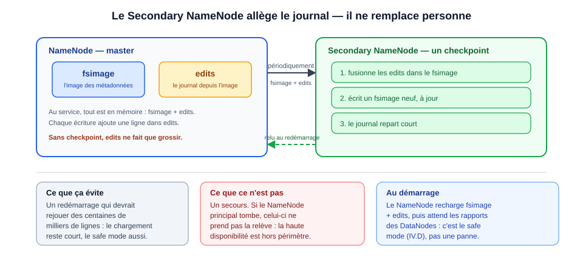
</div>

---

# 🛠️ DataNode — les ouvriers

<div class="card card-green">
<div class="card-title">Les Workers</div>

- Contient les **blocs de données**
- Sous les ordres du NameNode :
  - **Lecture** : transmettent les blocs au client
  - **Écriture** : retournent l'emplacement des blocs fraîchement créés
  - **Périodiquement** : remontent la liste des blocs stockés

</div>

<!-- Insister : la communication permanente DataNodes ↔ NameNode est ce qui reconstruit l'état après un redémarrage (safe mode). -->

---

# 🔁 Une requête : qui parle à qui ?

**Le NameNode indique l'adresse (un annuaire), les DataNodes transportent les données — la donnée ne passe jamais par le NameNode.**

<figure class="flex justify-center">
  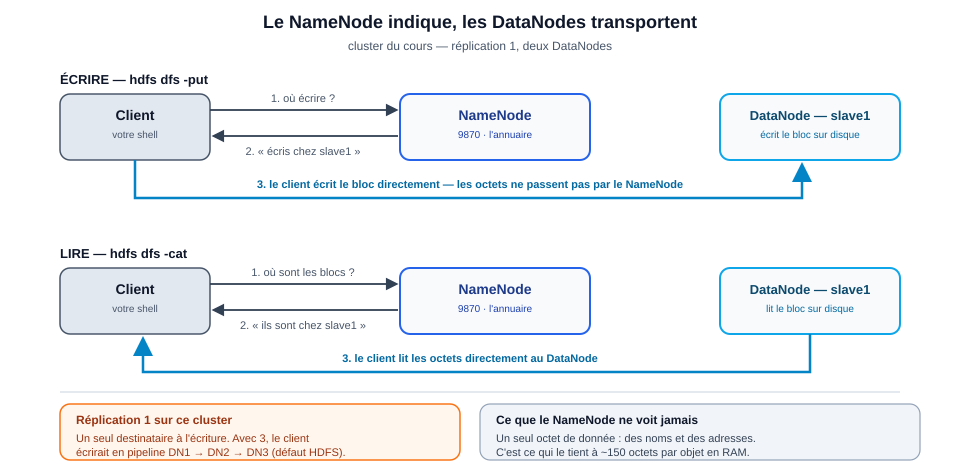
  <figcaption style="font-size: 14px; margin-top: 4px;">Dessin maison, sur <b>notre</b> cluster : réplication 1, deux DataNodes</figcaption>
</figure>

---

# ⌨️ Les commandes HDFS

| Commande | Rôle |
|---|---|
| `hdfs dfs -ls <dir>` | lister un répertoire |
| `hdfs dfs -mkdir -p <dir>` | créer un répertoire (parents inclus) |
| `hdfs dfs -put <src> <dest>` | déposer un fichier local sur HDFS |
| `hdfs dfs -cat <fichier>` | afficher le contenu |
| `hdfs dfs -get <hdfs> <local>` | récupérer depuis HDFS |
| `hdfs dfs -rm -r <dir>` | supprimer (récursif) |

> **2 syntaxes équivalentes** : `hadoop fs` ou `hdfs dfs` — très proches du shell Linux.
> ⚠️ **Piège : `-tail`** relit les **derniers 1024 octets** sans égard aux fins de ligne → il coupe une ligne en plein milieu ! Pour "les N dernières lignes" : `hdfs dfs -cat … | tail -N`.

---

# 🎵 Notre donnée : le CSV Spotify

<div class="card card-blue">
<div class="card-title">Une seule donnée, toute la chaîne</div>

- `data/Spotify_Most_Streamed_Songs.csv` — **155 593 octets**, **954 lignes** (1 en-tête + 953 titres), **25 colonnes**
- Ça restera la **seule donnée** des EX 04 à 07 (le TP final travaillera, lui, sur les ventes `dataw_fro03`)
- Colonnes utiles : `track_name (0)`, `artist(s)_name (1)`, `released_year (3)`, `streams (8)`

</div>

<div class="card card-yellow">
<div class="card-title">⚠️ Deux pièges connus à l'avance</div>

- La ligne **576** a un champ `streams` corrompu — on le retrouvera souvent
- Des artistes en duo avec des **virgules dans les champs quotés** (`"Latto, Jung Kook"`)

</div>

> Saisissez le fichier tel quel dans HDFS : on découvrira ses pièges en les croisant dans les exercices.

---

<!-- _class: exercise -->
<!-- Repère formateur : 03-hdfs.md — III.B le mémo, III.E la manipulation -->

# ✏️ Exercice 03 — HDFS

**Déposez le CSV Spotify dans HDFS et vérifiez chaque étape.**

1. `docker cp data/Spotify_Most_Streamed_Songs.csv hadoop-master:/home/` (machine hôte)
2. `hdfs dfs -mkdir -p input` puis `hdfs dfs -put Spotify_Most_Streamed_Songs.csv input/`
3. `hdfs dfs -ls input` → **155 593 octets, réplication `1`**
4. `hdfs dfs -cat input/… | tail -10` → les vraies dernières lignes (dernière : `Alone,Burna Boy,…`)

> À repérer dans le `ls` : la réplication **1**, la taille **identique** au fichier local, le chemin absolu `/user/root/input/…`.

<!-- Laisser ~40 min. Surveiller le docker cp depuis le bon répertoire (erreur classique : "No such file"). Démo finale du -tail piège. -->

---

<!-- _class: exercise -->
<!-- Repère formateur : td/TD01.md — Tempo A — départ lancé -->

# 🏋️ TD-01 — MapReduce en local, avant le cluster (Tempo A)

**~30 min guidées — créez les deux squelettes, lancez les trois variants de pipe.**

1. Écrire `mapper.py` (découpe les mots, émet `mot\t1`) et `reducer.py` (additionne les clés **regroupées**)
2. `echo "bonjour bonsoir bonjour bonsoir" | python3 mapper.py` — sortie brute : une paire par mot
3. `… | mapper.py | reducer.py` **sans tri** — sort **comme le mapper** : clés non regroupées, comptage faux
4. `… | mapper.py | sort | reducer.py` — le `sort` **simule le shuffle** : `bonjour\t2, bonsoir\t2`

> ⚠️ **La règle sonnante** : si ça marche avec `| sort |` en local, ça marchera sur le cluster. Un pipe sans tri cache un shuffle maladroit.
> Windows : `python` (pas `python3`) — `echo` ajoute des guillemets au texte, préférez `type fichier`.

<!-- Tempo A guidé : on bloque jusqu'à ce que chaque finisher valide le variant 3. Les tempos B (questions) et Pour aller plus loin (CSV Spotify) partent ensuite en autonomie. Circuler. -->

---

<!-- _class: correction -->
<!-- Repère formateur : td/TD01.md — Tempo A — correction -->

# ✅ TD-01 — Correction & pièges

<div class="cols-2">

<div class="card card-green">
<div class="card-title">Le variant 2 ment en silence</div>

- `mapper | reducer` **sans tri** : les clés n'arrivent jamais deux fois d'affilée (`bonjour, bonsoir, bonjour, bonsoir`)
- Le reducer imprime chaque ligne au **premier changement de mot** → il recrache le mapper
- Le programme ne plante pas : il rend un résultat faux, **plausible** si on n'a pas la réponse attendue

</div>

<div class="card card-pink">
<div class="card-title">Le variant 3 = la simulation du shuffle</div>

- `sort` → regroupe les clés → le reducer additionne : `bonjour\t2, bonsoir\t2`
- Sur le cluster, c'est Hadoop (shuffle + sort) qui fait exactement ça
- **Règle** : `| sort |` OK en local ⇒ job OK sur le cluster
- Question B : le reducer doit voir **chaque clé en un seul bloc** — jamais le contraire

</div>

</div>

> **Pour aller plus loin** : mapper Spotify (`released_year`, colonne 3 / `streams`, colonne 8) — ⚠️ **en-tête** à écarter par la valeur (`row[0] == 'track_name'`), ⚠️ **ligne 576** (`streams` corrompu) à protéger : c'est le debug local qui fait voir la panne **avant** le cluster. 50 années mesurées, total 489 458 828 542, sortie triée par année.

<!-- Correction tempo B (variant 2 = clés non regroupées) et Pour aller plus loin (ligne 576 + en-tête). Le même geste se revoit au TD-02 (Hive), où la même requête passe en SQL. -->

---

<!-- _class: statement -->

# 🎯 Quiz éclair

**Vrai ou Faux ?**

1. `hdfs dfs -tail fichier` affiche les dernières **lignes** d'un fichier.
2. Le bloc HDFS par défaut fait 128 **Mio** sur ce cluster.
3. `dfs.replication` vaut **3** sur le cluster du cours.
4. Le **Secondary NameNode** remplace le NameNode en cas de panne.

---

💡 **Réponse**

1. ❌ **Faux** — `-tail` renvoie les **1024 derniers octets**, il coupe parfois une ligne en plein milieu.
2. ✅ **Vrai** — le défaut 128 Mio (configurable par cluster).
3. ❌ **Faux** — sur ce cluster elle vaut **1** (preuve : `hdfs getconf -confKey dfs.replication`).
4. ❌ **Faux** — c'est un **checkpoint** (fusion `edits`/`fsimage`), jamais un secours.

<!-- Rythme : un clic par énoncé, laisser répondre à l'oral, puis cliquer pour révéler la correction. -->

---

# 🧠 Récap du jour 1

<div class="card card-pink">
<div class="card-title">Ce qu'il faut retenir</div>

- ✅ Hadoop = **scale-out** : stockage distribué, traitement parallèle sur des machines standards
- ✅ 7 briques du cours : **HDFS, YARN, MapReduce, ZooKeeper, Hive, HBase, NiFi**
- ✅ L'environnement : 4 conteneurs Docker, scripts `./start-*.sh`, `jps`, UI 9870/8088/8443
- ✅ **HDFS** : blocs 128 Mio, réplication **1** ici, NameNode (métadonnées) + DataNodes (blocs)
- ✅ Commandes : `ls`, `mkdir`, `put`, `cat`, `get`, `rm` — et le piège `-tail`
- ✅ TD-01 : le **pipe local** mapper `|` sort `|` reducer — le `| sort |` **simule le shuffle**, et le CSV Spotify se débogue à la maison (en-tête, **ligne 576**)

</div>

> 📅 **Demain** : on rentre dans le vif — le **modèle MapReduce** : comment Hadoop calcule sur les blocs que vous venez de déposer.

---

<!-- _class: lead -->

# Merci !

## Rendez-vous demain pour le modèle MapReduce

---

<!-- _class: lead -->

# Jour 2 — Le modèle MapReduce

## Le modèle d'abord, le geste ensuite · Hadoop Streaming

---

# 🗓️ Programme du jour 2

<div class="card card-blue">
<div class="card-title">🌅 Matin</div>

- **Retour J1** — les points de vigilance (TD-01 fait la veille)
- **I. Le modèle** — du bloc au résultat, l'anatomie d'un MapReduce

</div>

<div class="card card-pink">
<div class="card-title">🌇 Après-midi</div>

- **II. Le contrat d'exécution** — ce que le modèle suppose
- **III. Le geste** — Hadoop Streaming avec Python, EX/04 partie I
- **TD-02** — premier contact Hive : la question remplace le traitement

</div>

> Objectif : être capable d'**expliquer** MapReduce puis de **lancer** un premier job — dans cet ordre ("la vérité vient de la mesure").

<!-- Servir de fil d'Ariane : le jour est conçu comme "comprendre puis faire". Insister sur le fait que le geste (Hadoop Streaming) est trivial une fois le contrat compris. -->

---

# 🔁 Retour sur J1 — les points de vigilance

<div class="card card-yellow">
<div class="card-title">Ce qui doit être acquis — le TD-01 de la veille</div>

- Le pair mapper / reducer : le mapper émet `mot\t1`, le reducer **suppose que les clés arrivent regroupées**
- Sans tri, le reducer **recrache** le mapper (comptage faux, silencieux) — le couplage mapper → reducer suppose le **shuffle**
- `| sort |` en local **= le shuffle du cluster** : si le pipe marche, le job marchera
- **Debug local** : le CSV Spotify se teste à la maison avant le cluster — ⚠️ en-tête à écarter, ⚠️ **ligne 576** (`streams` corrompu) à protéger

</div>

---


# 🧠 L'idée : comment calculer sur 954 lignes ?

<div class="cols-2">

<div class="card card-blue">
<div class="card-title">Le constat</div>

- Le CSV tient dans un fichier HDFS, découpé en **blocs** de 128 Mio
- Un simple programme **séquentiel** sur le cluster : pourquoi faire ?
- Le **bloc** du cours : 155 593 octets → **1 seul bloc**

</div>

<div class="card card-green">
<div class="card-title">La question</div>

**Comment calculer en parallèle sur des données qui ne tiennent pas dans la RAM d'une seule machine ?**

> Réponse : distribuer le **code** là où sont les **données** (map sur chaque bloc), puis **fusionner** les résultats partiels (reduce).

</div>

</div>

---

<!-- _class: section -->

# I. Le modèle MapReduce

## De la donnée blocs à un résultat calibré

---

<!-- _class: statement -->

# 🤔 D'après vous…

**Un livre de 10 Go est découpé en blocs, dispersés sur 50 machines du cluster.**

Comment compter, sans tout rapatrier, les occurrences de chaque mot ?

<!-- Laisser 30-45 s. Attendre un début d'idée de distance pour l'idée "traiter sur place", et amorcer map/split. -->

---

# 💡 Réponse : traiter là où sont les données

<div class="card card-green">
<div class="card-title">Le programme va aux données, pas l'inverse</div>

- On **ne rapatrie rien** : chaque fragment de fichier compte « ses » mots **sur son propre nœud** — c'est la phase **map**
- Pour totaliser *par mot*, ces comptes partiels et éparpillés doivent se **regrouper** : le **shuffle** rassemble les valeurs d'une même clé — c'est la phase **reduce**
- Résultat : le calcul est **parallèle** (un fragment par tâche) et seule la **réponse**, petite, traverse le réseau

</div>

> Ce principe se nomme **MapReduce** — c'est tout le jour 2.

---

# 🎯 Objectifs du chapitre

<div class="card card-blue">
<div class="card-title">À la fin, vous saurez…</div>

- ✅ Décrire la **pipeline complète** d'un MapReduce (map → partition/shuffle/sort → reduce)
- ✅ Expliquer la notion de **split** et comment il découpe le fichier
- ✅ Raconter le **tri lexicographique** des clés intermédiaires
- ✅ Expliquer ce que produisent les **partitions** (`part-00000`…)

</div>

---

# 📦 MapReduce en une phrase

<div class="card card-blue">
<div class="card-title">Le pattern qui a industrialisé le traitement de masse</div>

Un **modèle de programmation** (Google, 2004) où un **job** est découpé en deux fonctions :

- **map(k1, v1) → list(k2, v2)** — on projette : chaque donnée produit des paires intermédiaires
- **reduce(k2, list(v2)) → list(v3)** — on agrège : toutes les valeurs d'une clé sont regroupées

</div>

<div class="card card-yellow">
<div class="card-title">Dans Hadoop</div>

Hadoop = l'**implémentation libre** du modèle (MapReduce 1.0) exécutée par **YARN**. Le framework gère tout : découpage, distribution, tri, reprise sur erreur.

</div>

---

# 🎢 La pipeline complète

<div class="flex justify-center">
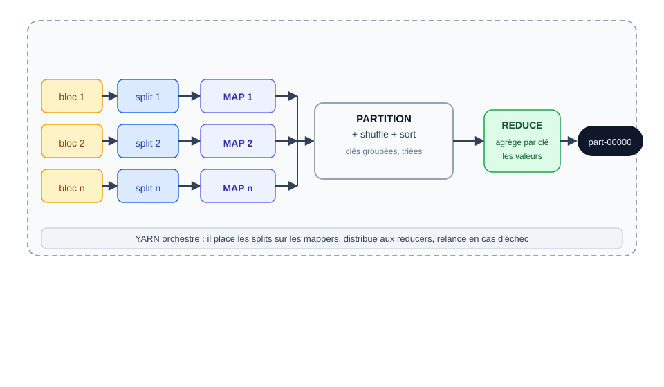
</div>

> Chaque étape est orchestrée par **YARN** sur l'un des nœuds du cluster.

---

# 📦 La sortie : `part-00000` et `_SUCCESS`

<div class="card card-green">
<div class="card-title">Ce que produit le reducer</div>

```text
found 2 items
-rw-r--r-- ... /user/root/output_wc/part-00000    155 b  ... Spotify ...
-rw-r--r-- ... /user/root/output_wc/_SUCCESS       0 b    ... Spotify ...
```

- **`part-00000`** (le N = le numéro de partition) : le **fichier de résultats**
- **`_SUCCESS`** : le **marqueur de fin** (fichier vide, créé si le job s'est bien terminé)
- Le nombre de `part-` = le nombre de **reducers** (y compris si un mapper n'a rien produit)

</div>

> 💡 Vérifier qu'un job a réussi : `hdfs dfs -ls output_wc` doit montrer `part-00000` **ET** `_SUCCESS`.

---

# 🧠 À retenir — le modèle

<div class="card card-pink">

- ✅ **map** : projette chaque ligne en `clé\tvaleur` ; **reduce** : fusionne par clé
- ✅ Le framework assure **partition, shuffle, tri** : on n'écrit que les deux fonctions
- ✅ **splits ≥ blocs** ; un mini fichier fait ≥ 2 splits → ≥ 2 mappers
- ✅ La sortie est toujours **triée**, signée par `_SUCCESS` et découpée en `part-*`

</div>

> ⚠️ Un **échec `_SUCCESS` absent** ? Le job a échoué (tâche en erreur). Toute la suite, on va mesurer ce qui s'est passé.

---

<!-- _class: section -->

# II. Le contrat d'exécution

## Ce que MapReduce suppose vraiment

---

<!-- _class: statement -->

# 🤔 D'après vous…

**Votre job tourne depuis 3 minutes quand une des 50 machines du cluster tombe en panne.**

Que se passe-t-il ? Le job recommence-t-il de zéro ?

<!-- Laisser 30-45 s. Attendre l'idée de souplesse/retry ; l'échec d'une tâche ≠ échec du job. -->

---

# 💡 Réponse : une tâche échoue, pas le job

<div class="card card-green">
<div class="card-title">La panne est prévue au contrat</div>

- Un job = des **milliers de petites tâches indépendantes** (maps, reduces) : la panne d'une machine ne tue **pas** le job
- L'**ApplicationMaster** détecte la tâche perdue et la **relance ailleurs** (une partie des « retries » vus dans les logs, c'est souvent ça)
- À la différence du **pipeline séquentiel** classique qui s'arrête net, MapReduce est conçu pour que **l'échec d'une tâche reste local** — et dans le résultat, il est invisible

</div>

> La souplesse : un job qui « a perdu 2 machines » donne **exactement le même résultat**. On verra où le lire (logs `8088`, `yarn logs`).

---

# 🎯 Objectifs

<div class="card card-blue">
<div class="card-title">Ce qui se joue sous le capot</div>

- ✅ Un processus **par tâche** (map ou reduce), jamais partagé
- ✅ L'**en-tête** vit dans le **premier split** seulement
- ✅ Combien de **reducers** par défaut, et pourquoi le **combiner** ne moyennera jamais
- ✅ Où diagnostiquer une **tâche en échec** (`INFO MapReduce_Job` / job 8088)

</div>

---

# 🔒 Un processus par tâche

<div class="cols-2">

<div class="card card-yellow">
<div class="card-title">La contrainte clé du modèle</div>

- Chaque **map** et chaque **reduce** = un **processus séparé** lancé par YARN
- Rien n'est **partagé** entre deux tâches (pas de mémoire commune, pas d'état global)
- Conséquence pratique : **inutile de s'appuyer sur des variables globales** entre tâches — tout passe par le **flux clé/valeur**

</div>

<div class="card card-blue">
<div class="card-title">Et donc…</div>

- Le **coder côté task** qui ouvre un fichier NFS partagé, c'est de l'anti-pattern
- Toute communication passe par **stdin/stdout** du mapper et du reducer
- Si une tâche **crash**, YARN la **relance** (nombre de tentatives `mapreduce.map.maxattempts`, défaut 4)

</div>

</div>

---

# 🧾 L'en-tête n'existe que dans le premier split

<div class="cols-2">

<div class="card card-pink">
<div class="card-title">Un des pièges les plus rentables du cours</div>

- `pandas.read_csv()` saute l'en-tête de lui-même… **mais MapReduce ne sait pas ce qu'est un en-tête**
- Le fichier est découpé en splits **sans se soucier des lignes CSV** : seul le split 1 voit l'en-tête
- Conséquence : les **map** qui reçoivent les lignes 2…n traiteraient cet en-tête comme une **donnée** si on ne le gère pas

</div>

<div class="card card-green">
<div class="card-title">Conclusion</div>

- **On ne supprime pas** l'en-tête — il est de toute façon déjà l'affaire des splits
- Quand l'en-tête n'est pas un nombre, on **ignore** la ligne 1 du mapper : `if line.startswith("track_name"): continue`
- À l'EX/04 partie II, la **ligne 576** montre exactement ce qui arrive avec `int()` sur une chaîne

</div>

</div>

---

# ♻️ Combien de reducers ? 1 par défaut

<div class="cols-2">

<div class="card card-blue">
<div class="card-title">Le mapper en phase, tout passe par un seul reducer</div>

- Le **nombre de reducers** est **configurable** (`-D mapreduce.job.reduces=N`)
- **Par défaut : 1** → un seul fichier `part-00000`
- **Tout le shuffle converge sur un nœud** — sur un vrai cluster, on monte à N

</div>

<div class="card card-yellow">
<div class="card-title">⚠️ Combiner : le piège</div>

- Le **combiner** pré-agrège **côté map**, avant le shuffle : moins de volume sur le réseau
- Contrainte : il doit être **associatif et commutatif**
- Conséquence : un reducer « moyenne » **ne peut pas** être un combiner — moyenne(moyennes) ≠ moyenne

</div>

</div>

<div class="flex justify-center">

</div>

---

# 🩺 Diagnostiquer une tâche en échec

<div class="card card-pink">
<div class="card-title">On lit le compte rendu, pas la vue d'archive</div>

- YARN écrit un **log du job** quand l'application se termine :
  ```text
  20/05/13 10:47:24 INFO client.RMProxy: Connecting to ResourceManager ...
  20/05/13 10:47:24 INFO mapreduce.Job: Running job: job_1705417740450_0001
  20/05/13 10:47:24 INFO mapreduce.Job: Job job_1705417740450_0001 running in uber mode : false
  ```
- La **liste des tentatives** + le nombre d'**attempts** (défaut 4) conditionnent la fiabilité

</div>

<div class="card card-green">
<div class="card-title">Le lieu de diagnostic</div>

- Ports **8041** (slave1) / **8042** (slave2) : logs du **NodeManager**
- **8088** : la vue YARN des applications
- On verra au J3 `yarn logs -applicationId`

</div>

<!-- Point important : "uber mode" = tâches exécutées AM côté client (ici false). Le debug le plus rapide reste le test local en pipeline (section III). -->

---

<!-- _class: section -->

# III. Le geste — Hadoop Streaming

## Un mapper, un reducer, deux pipes

---

<!-- _class: statement -->

# 🤔 D'après vous…

**Vous devez écrire le mapper/reducer qui compte les mots.**

En quel langage ? Et comment Hadoop fera-t-il tourner votre programme sur le cluster ?

<!-- Laisser 30-45 s. Attendre : n'importe quel langage ; insister sur l'interface standard (stdin/stdout) plutôt que le langage. -->

---

# 💡 Réponse : n'importe quel langage, un seul contrat

<div class="card card-green">
<div class="card-title">Python ici, mais pas seulement</div>

- Le mapper/reducer ne connaît qu'une **interface standard** : lire **stdin**, écrire **stdout** — du Python, du shell, de l'awk, du Java… tout convient
- Hadoop (via **Hadoop Streaming**) lance votre **commande**, une fois par tâche — pas votre code en librairie
- Ce qui fait foi, c'est le **contrat clé/valeur** (`clé<TAB>valeur`), pas le langage de la fonction

</div>

> L'écosystème a ensuite abstrait ce contrat : Hive compilera du SQL en MapReduce (jour 3).

---

# 🎯 Objectifs

<div class="card card-blue">
<div class="card-title">À la fin + EX/04 partie I, vous saurez…</div>

- ✅ Écrire un **mapper** et un **reducer** respectant le contrat clé/valeur
- ✅ **Tester localement** avant le cluster
- ✅ **Lancer** un job Hadoop Streaming sur YARN
- ✅ Lire les **résultats** et le **compte rendu** (`_SUCCESS`, log des compteurs)

</div>

---

# 🤝 Le contrat clé/valeur

<div class="card card-blue">
<div class="card-title">3 règles à ne jamais oublier</div>

1. **stdin → stdout** : on lit stdin (ou le shuffle), on écrit sur stdout
2. **Une tabulation sépare clé et valeur** : `clé\tvaleur`
3. **La sortie du reducer** est l'**une seule** clé/valeur par ligne

</div>

<div class="card card-yellow">
<div class="card-title">Ce que ça produit dessous</div>

```text
input (lignes CSV)
    │  MAP (cat stdin → écrire clé\tvaleur)
    ▼
shuffle/tri (Hadoop garantit le tri et le groupage)
    │  REDUCE (pour chaque clé groupée, stdout)
    ▼
part-00000 (trié)
```

</div>

---

# 🧪 Tester en local avant le cluster

<div class="card card-green">
<div class="card-title">Le pipeline de test — le réflexe systématique</div>

```bash
cat Spotify_Most_Streamed_Songs.csv | python3 mapper.py | sort | python3 reducer.py
```

- On **simule le shuffle** Hadoop : le `sort` fait le tri
- **Vérifie** le contrat : stdin/stdout tabulé, pas de `print` parasite
- Débugue sur le poste, pas en attendant un job de 40 s (latence : page suivante)

</div>

<div class="card card-pink">
<div class="card-title">⚠️ Limites du test local</div>

- Test sur la **machine locale**, pas le cluster : mémoire et parallélisme différents
- Le `sort` GNU n'est pas le tri YARN (encodage, séparateur `\t`)
- Conclusion : test local **pré-requis mais insuffisant** → on valide toujours sur le cluster

</div>

---

# 🚀 Lancer un job — la commande

<div class="card card-blue">
<div class="card-title">Hadoop Streaming, le contrat respecté</div>

```bash
hadoop jar /opt/hadoop/share/hadoop/tools/lib/hadoop-streaming-3.3.6.jar \
  -input input/Spotify_Most_Streamed_Songs.csv \
  -mapper "python3 identifies_top_artists_mapper.py" \
  -file identifies_top_artists_mapper.py \
  -reducer "python3 identifies_top_artists_reducer.py" \
  -file identifies_top_artists_reducer.py \
  -output output_wc
```

</div>

<div class="card card-yellow">
<div class="card-title">Les 5 paramètres</div>

- `-input` / `-output` : HDFS d'entrée / **sortie (à ne PAS exister !)**
- `-mapper` / `-reducer` : la commande exécutée par chaque tâche
- `-file` : envoie le **script local** dans chaque conteneur (sinon « file not found »)

</div>

> ⚠️ **Sortie déjà existante** → le job **échoue** : changez le nom avant de relancer.

---

# 📖 Lire les résultats

<div class="card card-green">
<div class="card-title">Le mot du compte rendu</div>

```bash
hdfs dfs -cat output_wc/part-00000
hdfs dfs -ls output_wc        # part-00000 + _SUCCESS
cat hadoop.log | grep -i ERROR   # le log côté client à scruter
```

</div>

<div class="card card-pink">
<div class="card-title">Anticipation des questions</div>

- Le `part-00000` commence par la plus petite clé selon le **tri lexicographique** (attention aux minuscules)
- Les **années** arrivent **triées comme des chaînes**
- Si le job part en erreurs → relire le **mapper** (une tabulation, pas d'espace)

</div>

---

# 📊 La chaîne des interfaces 8088

<div class="card card-yellow">
<div class="card-title">Le trajet du job sur YARN</div>

<div class="flex justify-center">

</div>

```text
8088 (RM UI) → cliquer l'application → onglet 'Logs'
  → 8041 (slave1) / 8042 (slave2) : état du NodeManager (rapide)
  → `yarn logs -applicationId` en CLI (précis)
```

</div>

> La **vue des tentative attempts** dans la UI 8088 renseigne sur le **succès/échec** de chaque tâche — pas juste le résultat final.

---

# ⏱️ La latence réelle : ~35 s à 1 min

<div class="card card-blue">
<div class="card-title">La mesure, encore</div>

- Sur ce cluster Docker, un job WordCount sur 1 petit fichier prend **35 s à ~1 min** (2 mappers, 1 reducer)
- Pourquoi si "lent" ? **Coût de démarrage** : YARN (ResourceManager), AM, demandes de conteneurs, dispatch des tâches

</div>

<div class="card card-green">
<div class="card-title">Ce que ça implique pour le TP</div>

- **On réfléchit avant de lancer** — un job coûte 1 min même pour un micro-résultat
- On **teste en local** (pipeline `cat | sort`) pour ne pas saturer le cluster partagé
- NB. sur un vrai cluster, la fraction « calcul » devient vite dominante devant cette latence

</div>

---

<!-- _class: exercise -->
<!-- Repère formateur : exercices/04-mapreduce.md — Partie I — WordCount guidé (A-E) -->

# ✏️ EX/04 — Premier job : WordCount

**Le fil conducteur partie I (A→E, ~1 h) :**

1. **A** — créer le répertoire `ex4`, copier le CSV, l'en-tête à gérer
2. **B/C** — mapper **artistes** + reducer **comptage** (`current_key`)
3. **D** — test local : `cat | mapper | sort | reducer`
4. **E** — lancer le job YARN + lire `part-00000`

> ⚠️ **Astuce clé** : `yarn application -list` avant de reprendre un job pour voir la **latence réelle** (ici ~**35 s à 1 min**).
> ⚠️ Un `print` de debug dans le mapper **fausse** le flux clé/valeur.

<!-- Laisser ~1 h. Passer sur les postes pour vérifier le test local (D) avant le job (E). Noter les temps d'exécution → les rapporter au bilan. -->

---

# 🧠 Récap du jour 2

<div class="card card-pink">
<div class="card-title">Les 5 pierres du jour</div>

- ✅ **Modèle** : map (clé\tvaleur) → partition/shuffle/sort → reduce (il regroupe par clé)
- ✅ **Mesure** : 1 fichier → **2 splits**, 954 lignes lues, tri lexicographique de la sortie
- ✅ **Contrat** : 1 processus/tâche, l'en-tête dans le 1er split, en-tête ≠ donnée, `int()` à protéger
- ✅ **Geste** : `cat | mapper | sort | reducer` en local, puis `hadoop jar … -file`
- ✅ **Sortie** : `part-00000` (trié) + `_SUCCESS`, logs YARN 8088

</div>

> 📅 **Demain** : YARN en détail (qui orchestre la mémoire), puis surtout **Hive** — le SQL sur vos données HDFS (les exercices EX/04 partie II restent en autonomie, cf. `EX/04-mapreduce.md`).

---

<!-- _class: exercise -->
<!-- Repère formateur : td/TD02.md — Tempo A — guide -->

# 🏋️ TD-02 — Premier contact Hive (Tempo A, ~40 min)

**La question remplace le traitement : on n'écrit plus de mapper/reducer, on pose une requête.**

1. **Connectez-vous** : `./start-hive.sh` puis `beeline -u jdbc:hive2://localhost:10000`
2. **La donnée** : `python3 ANNEXES/utils/7-prepare-spotify-tsv.py …` → TSV, `wc -l` = **954**, puis `hdfs dfs -put` dans `/user/root/spotify/clean`
3. **La DDL fournie** : `CREATE EXTERNAL TABLE spotify …` (recopiez telle quelle — c'est votre « mapper », décrire l'entrée pas l'algorithme)
4. Les comptages : `SELECT COUNT(*)` = **954**, `SELECT COUNT(streams)` = **952**
5. La question du TD01 : `SELECT released_year, SUM(streams) GROUP BY released_year` — **à comparer ligne à ligne avec vos pipes**
6. Le top des artistes : comparez aux six clés de tête de votre `part-00000` de l'EX 04

> ⚠️ Personne ne prévient : Hive met `NULL` en silence (en-tête + ligne 576). La preuve que la requête « marche » = la **concordance avec vos commandes d'hier**, pas le confort du SQL.

<!-- Tempo A guidé ~30 min : on bloque sur le COUNT(*) 954/952, puis le GROUP BY et sa comparaison aux pipes du TD01. Tempo B et Pour aller plus loin partent ensuite en autonomie. Circuler. -->

---

<!-- _class: correction -->
<!-- Repère formateur : td/TD02.md — Tempo A — correction -->

# ✅ TD-02 — Correction & pièges

<div class="cols-2">

<div class="card card-green">
<div class="card-title">Les chiffres parlent</div>

- `COUNT(*)` = **954** : l'en-tête du TSV est **compté comme une chanson** — Hive ne saute rien
- `COUNT(streams)` = **952** : `streams` non numérique (en-tête + **ligne 576**) → `NULL` **en silence**
- Le `GROUP BY released_year` retombe **exactement** sur vos pipes du TD01 — c'est le sort du pipeline, écrit par le moteur

</div>

<div class="card card-pink">
<div class="card-title">Les pièges</div>

1. **Beeline ~30 s au premier contact** (Metastore Derby) — ne pas abandonner
2. **51 groupes** (pas 50) : l'en-tête a « travaillé » une année `NULL` de plus
3. **Top artistes** : conventions de duos → comparer **chiffre pour chiffre**, pas la tête seule
4. **Aucun avertissement** : c'est la comparaison Hive ↔ pipes qui détecte l'anomalie

</div>

</div>

> **Pour aller plus loin** : `EXPLAIN SELECT … GROUP BY artist_name` — vous y verrez les **stages Map/Reduce** : le moteur a écrit le mapper et le reducer à votre place.

<!-- La suite se poursuit demain (séquence 05) : Hive compile la requête en job MapReduce ; EX 05 reprend ces requêtes pour les maîtriser. -->

---

<!-- _class: lead -->

# Merci !

## Rendez-vous demain pour YARN, la pratique et Hive

---

<!-- _class: lead -->

# Jour 3 — YARN et le SQL de l'écosystème

## Orchestrer, agréger, interroger · Hive

---

# 🗓️ Programme du jour 3

<div class="card card-blue">
<div class="card-title">🌅 Matin</div>

- **Retour J2** : TD-02 (Hive) bouclé hier — les chiffres le prouvent
- **YARN** — l'orchestrateur de la mémoire et des tâches

</div>

<div class="card card-pink">
<div class="card-title">🌇 Après-midi</div>

- **II. Hive** — le SQL sur HDFS, tables externes, EXPLAIN (la séquence que TD-02 a fait tourner à l'aveugle)
- **EX/05** — les 954 lignes passent à la moulinette SQL
- **TD-03** — premier contact HBase : une table triée avant d'être interrogée

</div>

---

# 🔁 Retour J2 — les chiffres de TD-02

<div class="card card-yellow">

1. **954 lignes, 952 streams** : `COUNT(*)` ≠ `COUNT(streams)` — pourquoi ?
2. **50 années** : votre `GROUP BY released_year` en Hive collait-il aux pipes du TD01 ?
3. **Les conventions de duos** : le top artistes Hive ≈ votre `part-00000` ?

</div>

> Ces trois questions mesurent la **validation croisée** : Hive ne prouve rien seul — c'est la comparaison avec vos commandes d'hier qui marche. Le cours d'après-midi formalise *pourquoi* le SQL MapReduce compile du SQL.

<!-- Faire répondre à voix haute (2 min). Reconnecter la "vérité vient de la mesure" : on compare, on ne croit pas. Le comptage 954/953/952 est LE fil des 2 prochains blocks. -->

---

<!-- _class: section -->

# I. YARN — l'orchestrateur

## Qui décide de la mémoire et des tâches

---

<!-- _class: statement -->

# 🤔 D'après vous…

**Deux collègues lancent des jobs en même temps sur le même cluster. Lequel passe en premier ?**

Qui décide, dans un cluster, quelle tâche tourne **où et quand** ?

<!-- Laisser 30-45 s. Attendre la notion d'« ordonnanceur » ; laisser déborder sur les schedulers (FIFO/Fair/Capacity). -->

---

# 💡 Réponse : l'ordonnanceur de YARN

<div class="card card-green">
<div class="card-title">Qui décide où et quand ?</div>

- C'est l'**ordonnanceur** (scheduler) du **ResourceManager** qui classe les demandes des applications et attribue **mémoire + cœurs** aux **conteneurs**
- Ordre de passage : **FIFO** (premier arrivé), **Fair** (équitable), **Capacity** (pools garantis) — on y revient dans deux slides
- Une fois ses conteneurs obtenus, chaque job est coordonné par son **ApplicationMaster**, pas par l'ordonnanceur

</div>

---

# 🎯 Objectifs YARN

<div class="card card-blue">
<div class="card-title">À la fin de ce chapitre, vous saurez…</div>

- ✅ Nommer les 3 rôles de YARN (ResourceManager, NodeManager, ApplicationMaster)
- ✅ Décrire les 3 schedulers (FIFO, Fair, Capacity) et leur ordre réel d'affichage
- ✅ Lire la **mémoire** du cluster (RAM par NodeManager, par tâche map/reduce)
- ✅ Retrouver les **logs** d'un job (`8088`, `8041/8042`, `yarn logs`)

</div>

---

# 🧭 Les 3 visages de YARN

<div class="cols-3" style="align-items: start;">

<div class="card card-blue">
<div class="card-title">ResourceManager</div>

Le chef d'orchestre : répartit la **mémoire** et les **cœurs** du cluster entre les applications. Un par cluster (UI 8088).

</div>

<div class="card card-green">
<div class="card-title">NodeManager</div>

Un **par machine** : rapporte au RM les ressources disponibles, lance les **conteneurs** de tâches. (UI 8041/8042)

</div>

<div class="card card-pink">
<div class="card-title">ApplicationMaster</div>

Un **par job** : négocie les conteneurs auprès du RM, coordonne maps et reduces, gère la **reprise sur erreur**.

</div>

</div>

<div class="flex justify-center">

</div>

> Début de réponse à la question du sondage : un job a besoin du **RM** (ressources) puis de l'**AM** (exécution) — regardez l'AM, pas le RM, pour débugger.

---

# ⚖️ Les schedulers

<div class="card card-yellow">
<div class="card-title">FIFO · Fair · Capacity — qui va passer en premier ?</div>

- **Capacity** : des files dédiées (par équipe/tenant), chacune avec sa garantie — le défaut des distributions historiques (CDH/HDP)
- **Fair** : toutes les applications se partagent également la capacité, avec moindre coût si elles n'ont pas de grosse demande
- **FIFO** : une file unique, les jobs en ordre d'arrivée — **simple, mais famine** des jobs courts derrière un gros

<div class="flex justify-center" style="gap: 1rem;">

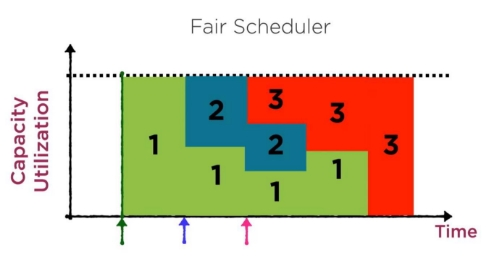
</div>

</div>

> Face à une UI YARN, sachez **reconnaître** la politique appliquée (Capacity = files hiérarchiques, Fair = partis égales).

---

# 🧮 La mémoire sur ce cluster

<div class="card card-blue">
<div class="card-title">Les valeurs mesurées de `yarn-site.xml`</div>

| Paramètre | Valeur | Sens |
|---|---|---|
| `yarn.nodemanager.resource.memory-mb` | 256 | RAM max *par nœud* allouable à YARN |
| `mapreduce.map.memory.mb` | 192 | mémoire demandée par chaque tâche **map** |

Les conteneurs sont **petits — un choix, pas un oubli** : un mapper Python tient, mais le parallélisme et ce qu'une tâche garde en mémoire sont **modestes**.

</div>

<div class="card card-pink">
<div class="card-title">Traduction concrète</div>

- Sur **slave1/slave2** : 256 Mio de YARN par nœud → un mapper de 192 tient, sans plus
- Si une tâche demande **plus que la limite**, YARN **refuse** le conteneur — c'est YARN qui bloque, pas Hadoop
- Pour des jobs gourmands, on augmente le **nombre de tâches**, pas la mémoire de chacune

</div>

> Morale : **la RAM se lit et se respecte**. Un mapper trop gourmand, c'est YARN qui bloque.

---

<!-- _class: statement -->

# 🤔 Sondage

**Votre tâche map a planté (par exemple `int()` sur la ligne 576).**

**Où regardez-vous les logs, dans l'ordre ?**

1. La UI **YARN 8088** → l'application → « Logs »
2. Directement sur `8041` / `8042` (NodeManager)
3. `yarn logs -applicationId …` en CLI
4. Le fichier `stdout` local du mapper

<!-- Laisser voter 30-45 s. Réponse : 1 puis 3 (ou 2 direct si le port est connu). 4 est le piège : dans YARN le mapper n'écrit PAS localement, son stdout part dans le conteneur. L'AM et le log aggregator centralisent. -->

---

# 💡 Corps de réponse — le trajet des logs

<div class="flex justify-center">
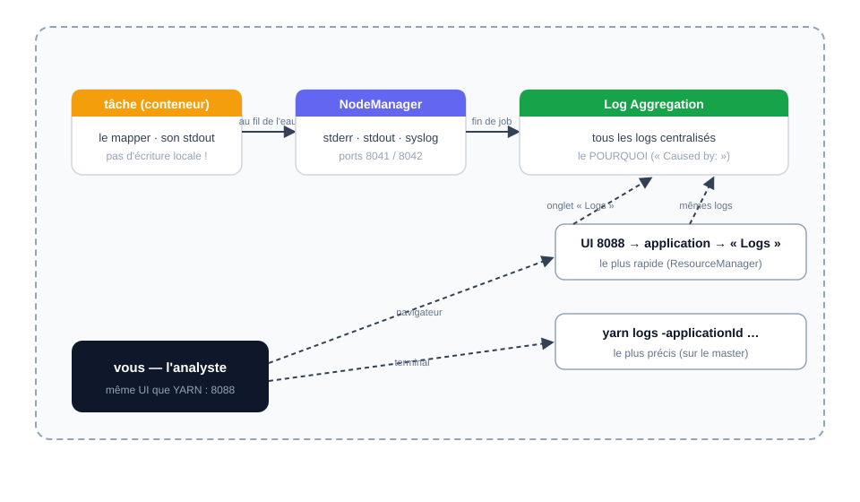
</div>

<div class="card card-green">
<div class="card-title">Le chemin d'un log de tâche</div>

- **Le plus rapide** : cliquer l'application sur **8088** puis l'onglet **Logs** (vu l'agrégation)
- **Le plus précis en CLI** : `yarn logs -applicationId application_…` (sur le master, à la racine du job)
- Les ports **8041/8042** donnent l'état du NodeManager, pas forcément les logs de la tâche

</div>

<!-- Faire le parallèle : l'UI 8088 montre "Succès/Échec" par tentative, mais le POURQUOI ("Caused by:") est dans le log de la tâche échouée. Tout le monitoring passe par 8088. -->

---

<!-- _class: section -->

# II. Hive — le SQL sur HDFS

## L'entrepôt déclaratif de l'écosystème

---

<!-- _class: statement -->

# 🤔 D'après vous…

**Faire du SQL sur un fichier de 1 To posé dans HDFS.**

Est-ce que ça ressemblerait à MySQL ? Comment la requête serait-elle exécutée ?

<!-- Laisser 30-45 s. Attendre la question de la localisation des données ; pointer que le SQL lance, en réalité, des map-reduce. -->

---

# 💡 Réponse : comme MySQL… mais sous le capot, MapReduce

<div class="card card-green">
<div class="card-title">Le SQL est une surface, pas un moteur</div>

- La syntaxe **ressemble** à MySQL — mais Hive ne lit pas le fichier comme une base : il **compile la requête en job(s) MapReduce** qui lisent les blocs **en parallèle**
- Le **Metastore** décrit *où* sont les données et *comment* elles sont structurées ; **YARN** exécute ; les fichiers, eux, restent dans **HDFS**
- Preuve à venir : `EXPLAIN` montre les stages map/reduce, et les résultats concordent avec ceux des jobs écrits à la main

</div>

---

# 🎯 Objectifs Hive

<div class="card card-blue">
<div class="card-title">À la fin + EX/05, vous saurez…</div>

- ✅ Expliquer ce qu'apporte Hive face à MapReduce (déclaratif vs impératif)
- ✅ Décrire l'architecture : **HiveServer2**, **Driver**, **Metastore** (Derby/MySQL)
- ✅ Distinguer **table externe** et **table managée** — et ce que fait `DROP`
- ✅ Écrire du SQL sur les données HDFS et le **relier à MapReduce via EXPLAIN**

</div>

---

# 🤔 Le problème : interroger sans programmer

<div class="card card-yellow">
<div class="card-title">Le quotidien d'une équipe data</div>

- _« Quels sont nos dix titres les plus streamés ? »_ → mapper, reducer, tester, lancer, lire
- Une heure plus tard : _« Et la moyenne des streams par année ? »_ → **tout** recommencer
- Les analystes ne connaissent **ni Python ni Java** — et on ne peut pas attendre un dev pour chaque question

</div>

<div class="card card-blue">
<div class="card-title">La bascule</div>

- MapReduce répond au **comment** ; l'exploration a besoin du **quoi**
- Il faut un langage **déclaratif** : on décrit le résultat, le moteur décide des étapes
- Solution historique de l'écosystème : **Hive**, né chez **Facebook en 2008**, Apache 2009

</div>

---

# 🐝 Qu'est-ce que Hive ?

<div class="card card-green">
<div class="card-title">Un data warehouse SQL au-dessus de Hadoop</div>

- **HiveQL** : un langage proche du SQL pour interroger les fichiers HDFS
- Traduction automatique : **une requête SQL de 6 lignes = un job MapReduce complet** (mapper + tri + reducer) — sans écrire de Python/Java
- **Entrepôt (OLAP)** plutôt que base (OLTP) : batch, gros volumes, il ne stocke pas lui-même — les données restent **des fichiers HDFS**

</div>

```sql
SELECT artist_name, SUM(streams) AS total
FROM spotify
GROUP BY artist_name
ORDER BY total DESC
LIMIT 10;
```

> **Promesse de Hive** : le SQL des analystes, la puissance du cluster.

---

# 🏗️ Architecture de Hive

<div class="flex justify-center">
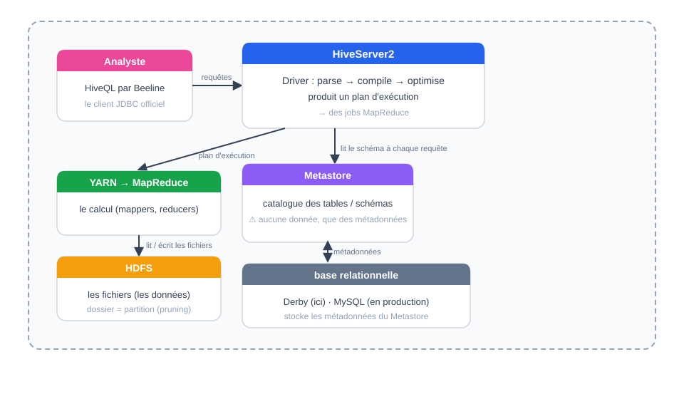
</div>

- **HiveServer2** : le service qui reçoit les requêtes ; on s'y connecte avec **Beeline** (client JDBC officiel depuis Hive 4 — la CLI `hive` a disparu)
- **Metastore** : le **catalogue** — table `spotify` → ces fichiers, ces colonnes, ce format. ⚠️ **Aucune donnée**, que des métadonnées, stockées dans Derby (embarqué ici).

---

# 📂 Le modèle de données

| Niveau | Rôle | Commande type |
|---|---|---|
| **Database** | espace de nommage logique | `CREATE DATABASE spotify_db;` |
| **Table** | schéma + localisation des fichiers | `CREATE EXTERNAL TABLE …` |
| **Partition** | sous-dossier = valeur d'une colonne | `PARTITIONED BY (released_year INT)` |
| **Bucket** | répartition en fichiers par hash | `CLUSTERED BY (artist) INTO 8 BUCKETS` |

> Le **partition pruning** : filtrer sur `released_year=2015` ne lit que le dossier `released_year=2015/` — la 1re optimisation de Hive.

> ⚠️ **Point de vigilance** : Hive **ne modifie pas** les fichiers d'entrée ni ne vérifie les contraintes (c'est du schéma « à dire »). La cohérence entre le schéma déclaré et la réalité est **votre** responsabilité.

---

# 🤝 Tables externes vs managées

| | Table **MANAGED** | Table **EXTERNAL** |
|---|---|---|
| Création | `CREATE TABLE …` | `CREATE EXTERNAL TABLE …` |
| Qui écrit les données | Hive (dépose lui-même dans HDFS) | **Vous** (`hdfs dfs -put`, job, NiFi…) |
| Cycle de vie | liée à **Hive** | liée à **HDFS** |
| `DROP TABLE` | supprime **métadonnées + données HDFS** | supprime **seulement les métadonnées** |

<div class="card card-yellow">
<div class="card-title">Dans notre cours</div>

Quasi **exclusivement des tables externes** : les données Spotify sont déjà dans HDFS (séquences 03-04), Hive ne fait que **déclarer un schéma par-dessus**. HDFS reste le maître du stockage ; Hive est une **lentille de lecture**.

</div>

---

<!-- _class: statement -->

# 🤔 Question DROP

**Vous exécutez :**

```sql
-- table livrée par un ETL, alimentée depuis des mois
CREATE TABLE spotify_staging (…);
DROP TABLE spotify_staging;
```

**Que se passe-t-il ?** Etait-ce une table **managée** ou **externe** ?

<!-- Laisser 45 s. Piège : sans le mot EXTERNAL, la table est MANAGED → DROP supprime métadonnées ET fichiers HDFS. C'est LE réflexe de survie à inculquer. -->

---

# 💡 DROP : le réflexe du data engineer

<div class="card card-pink">
<div class="card-title">Managée → les données partent avec la table</div>

- Table **managée** : Hive est **propriétaire** des fichiers → `DROP TABLE` détruit **métadonnées + données HDFS** (des heures de pipeline)
- Table **externe** : Hive ne possède que le **schéma** → `DROP TABLE` ne touche que les métadonnées, **les fichiers restent**

</div>

<div class="card card-green">
<div class="card-title">Le réflexe</div>

> **Avant tout `DROP TABLE`, demander : externe ou managée ?** On fera cette manipulation contrôlée dans EX/05 — sur une copie évidemment.

</div>

---

# ➗ Ce que compile Hive : EXPLAIN

<div class="card card-blue">
<div class="card-title">6 lignes de SQL = 1 job MapReduce</div>

```sql
EXPLAIN
SELECT artist_name, SUM(streams) AS total
FROM spotify_clean
GROUP BY artist_name;
```

```text
STAGE DEPENDENCIES:
  Stage-1 … (Map + Reduce)
  Stage-0 … (Fetch)
```

</div>

<div class="card card-yellow">
<div class="card-title">La boucle se referme avec le J2</div>

- le **map** lit chaque ligne, émet `(artiste, streams)` — comme votre mapper Python
- le **shuffle** regroupe par clé — comme le `sort` local
- le **reduce** agrège — comme votre reducer

**Hive n'est pas un nouveau moteur : c'est un compilateur de SQL vers MapReduce.**

> **Quand Hive, quand MapReduce ?** Exploration ad-hoc et ETL déclaratifs → Hive. Logique métier fine, formats exotiques → MapReduce manuel (séquence 04 vous a fait écrire ce que Hive compile pour vous).

</div>

---

# 🏭 La séparation calcul/stockage

<div class="cols-2">

<div class="card card-green">
<div class="card-title">Le concept le plus durable de l'écosystème</div>

- **Aucune donnée ne transite par Hive** : le Metastore sait *où* et *comment* lire, YARN exécute
- `hdfs dfs -put` (séq 03) → job MapReduce (séq 04) → **requête SQL** (cette séquence) → ... **mêmes fichiers**
- **Spark SQL / Trino** peuvent interroger exactement les mêmes fichiers via le même Metastore, sans copie

</div>

<div class="card card-blue">
<div class="card-title">Lakehouse 2026</div>

- HDFS → S3, formats ouverts (Parquet, ORC, **Iceberg**)
- Plusieurs moteurs de calcul à la demande sur le même stockage
- Apprendre Hive, c'est comprendre ce modèle

</div>

</div>

---

# ⚡ Premier contact avec le cluster

<div class="card card-yellow">
<div class="card-title">Démarrer Hive (rien à installer)</div>

```bash
./start-hive.sh                        # HiveServer2, port JDBC 10000
beeline -u jdbc:hive2://localhost:10000
```

```sql
0: jdbc:hive2://localhost:10000> SHOW DATABASES;   -- default + … 
0: jdbc:hive2://localhost:10000> CREATE DATABASE spotify_db;
0: jdbc:hive2://localhost:10000> USE spotify_db;
0: jdbc:hive2://localhost:10000> SHOW TABLES;      -- vide : on créera la table à l'EX 05
```

</div>

> ⚠️ Le Metastore **Derby embarqué** est attaché au master : connectez-vous toujours **depuis le master** (`localhost:10000`), pas depuis un slave.

<!-- Démo rapide : start-hive.sh → beeline → SHOW DATABASES. Montrer le prompt 0: jdbc:hive2://localhost:10000>. Attention à ne pas lancer le create de table ici (EX/05). -->

---

# 📊 HDFS vs Hive vs HBase

| | **HDFS** (séq. 03) | **Hive** (aujourd'hui) | **HBase** (séq. 06) |
|---|---|---|---|
| Nature | système de fichiers distribué | entrepôt SQL par-dessus HDFS | base **NoSQL** orientée colonnes |
| Accès | commandes shell, MapReduce | SQL (HiveQL) | clé de ligne, scans (shell, API) |
| Latence | minutes (batch) | dizaines de s à minutes | **millisecondes** (temps réel) |
| Modèle | fichiers, blocs | tables, partitions | tables larges clairsemées |
| Usage | archives, gros fichiers | analyser, agréger, explorer | lectures/écritures **à la ligne** |

> Les trois cohabitent sur le **même cluster**, parfois sur les **mêmes fichiers**, via les tables externes. HBase = la séquence de demain matin.

---

# 🛟 Hive en 2026 : datalake & lakehouse

<div class="cols-2">

<div class="card card-green">
<div class="card-title">Hive 4.x = la génération du cluster (4.1.0)</div>

- Intégration native d'**Apache Iceberg** : transactions ACID, évolution de schéma, *time travel*
- Support d'**Apache Ranger** (sécurité fine), vues matérialisées, HiveServer2 consolidé
- Toujours massivement exécuté en production (on-premise, CDP Cloudera)

</div>

<div class="card card-pink">
<div class="card-title">Concurrence assumée</div>

- Le SQL interactif rapide : **Spark SQL**, **Trino** ont pris le dessus sur les nouveaux projets
- Mais ils **partagent le même modèle** (Metastore + fichiers) popularisé par Hive
- Apprendre Hive = apprendre le **modèle**, pas un outil

</div>

</div>

---

<!-- _class: exercise -->
<!-- Repère formateur : exercices/05-hive.md — Parties I à III -->

# ✏️ EX/05 — Hive (parties I à III, ~2 h 30)

1. **PI — premiers pas** : `./start-hive.sh`, connexion Beeline, `SHOW DATABASES`, base `spotify_db`
2. **PII — table externe** : `CREATE EXTERNAL TABLE spotify_clean` (champs 0, 1, 3, 8), `LOCATION` sur le fichier, `DESCRIBE`
3. **PIII — requêtes** (les questions de la matinée, en SQL) :

```sql
-- 1. total des streams par artiste → le classement (même convention que l'EX 04 ?)
SELECT artist_name, SUM(streams) AS total
FROM spotify_clean GROUP BY artist_name ORDER BY total DESC;

-- 2. moyenne des streams par année de sortie
SELECT released_year, AVG(streams) FROM spotify_clean GROUP BY released_year;
```

> ⚠️ Question 1 : **deux réponses sont justes**, selon votre convention de duos de l'EX/04 — « externe / managée » n'y change rien. Comparez vos chiffres.

<!-- Laisser 2 h 30. L'objectif : Hive retrouve EXACTEMENT les valeurs des ex 1-3 de l'EX 04 (même convention). En cas d'écart > quelques %, chercher l'en-tête ou la ligne 576. -->

---

# 🧠 Récap du jour 3

<div class="card card-pink">
<div class="card-title">Les 4 acquis du jour</div>

- ✅ **YARN** : ResourceManager / NodeManager / ApplicationMaster ; 3 schedulers ; RAM mesurable (256 Mio/nœud, 192/map)
- ✅ **Hive** : le SQL qui compile en MapReduce ; externes vs managées ; le reflexe DROP ; le Metastore qui ne stocke rien
- ✅ **TD-02** : premier contact Hive (COUNT 954/952, GROUP BY, top artistes) — la validation croisée prouve que le moteur écrit le pipeline
- ✅ **TD-03** : premier contact HBase — rowkey qui trie, `put` qui ne confirme rien, `get` = la seule preuve

</div>

> 📅 **Demain (J4)** : **HBase** en détail (EX 06 partie IV), **NiFi** (l'ingestion visuelle), et la **chaîne complète** avant le TP final.

---

<!-- _class: exercise -->
<!-- Repère formateur : td/TD03.md — Tempo A — départ lancé -->

# 🏋️ TD-03 — HBase : une table triée avant d'être interrogée (Tempo A, ~30 min)

**Premier contact — le shell HBase, sans connaissance HBase.**

1. **Ouvrez le shell** : `hbase shell` (HBase est lancé avec `./start-all.sh` — sinon `./start-zookeeper.sh` puis `./start-hbase.sh`)
2. **Créez la table** : `create 'chrono','stats'` — HBase répond `0 row(s)` ; il répond pareil pour « table créée »
3. **Posez 3 années en désordre** (2023, 1975, 2021) — `scan 'chrono'` : **1975, 2021, 2023** : la table est **triée**, pas l'insertion
4. **`get 'chrono','1975'`** — une ligne directe par sa clé
5. Notez-le : chaque `put` répond `0 row(s)` — **la seule preuve est le `get` / `scan`**

> ⚠️ Le piège : le rowkey **trie**, pas l'insertion — comme le `sort` du TD01.

<!-- Tempo A guidé ~15 min, puis B/C en autonomie. Vérifier que le shell répond (hbase shell peut prendre ~10 s). Si les 50 années du TD02 sont rechargées (pour aller plus loin), le scan montrera 50 lignes triées de 1930 à 2023. -->

---

<!-- _class: correction -->
<!-- Repère formateur : td/TD03.md — Tempo A — correction -->

# ✅ TD-03 — Correction & pièges

<div class="cols-2">

<div class="card card-green">
<div class="card-title">Le scan trié</div>

- Le `scan` affiche **1975, 2021, 2023** alors que les `put` sont dans un autre ordre : c'est le **rowkey qui trie**
- `put 'chrono','1975','stats:total','4206105352'` → `0 row(s)`, **aucune confirmation** → `get'chrono','1975'` = la seule preuve
- `count 'chrono'` : 3 lignes (chaque rowkey différent = 1 ligne)

</div>

<div class="card card-pink">
<div class="card-title">Les pièges</div>

1. **`put` répond `0 row(s)`** — c'est aussi ce que HBase répond pour « table créée » : on ne croit pas la réponse, on **vérifie par `get`/`scan`**
2. **Le tri est lexicographique** : `99` passerait **après** `100` — comme au TD01 et en MapReduce
3. **50 lignes attendues** si on recharge les années du TD02 : si 49, un `put` manqué, pas un bug HBase

</div>

</div>

> Le lien avec le TD01 : le `sort` de vos pipes et le `scan` de HBase font **exactement le même travail** — regrouper et trier par clé.

<!-- La séquence 06 formalise les familles, le versionnage, les régions, ZooKeeper. L'EX/06 fait écrire en HBase depuis un reducer MapReduce. -->

---

<!-- _class: lead -->

# Merci !

## Rendez-vous demain pour HBase, NiFi et la chaîne complète

---

<!-- _class: lead -->

# Jour 4 — HBase, NiFi et la chaîne complète

## Le temps réel, l'ingestion · et tout ce qui nous a amenés ici

---

# 🗓️ Programme du jour 4

<div class="cols-2">

<div class="card card-blue">
<div class="card-title">🌅 Matin</div>

- **Retour J3** — TD-02 (Hive) validé, TD-03 (HBase tri) bouclé hier
- **I. HBase** — le NoSQL temps réel sur HDFS
- **EX/06** — shell, HappyBase, et les 50 années dans une table

</div>

<div class="card card-pink">
<div class="card-title">🌇 Après-midi</div>

- **TD-04** — premier contact NiFi : le fichier qui raconte son histoire (avant le cours)
- **II. NiFi** — l'usine à flux : le CSV entre tout seul dans HDFS
- **EX/07** — flux complet CSV→TSV→HDFS + Data Provenance
- **III. La chaîne complète** + **TD-05** (rejouer sur les ventes) — l'ouverture du **TP final**

</div>

</div>

> Depuis J1, chaque brique s'est ajoutée à la précédente. Aujourd'hui on les **assemble** — et vendredi, c'est vous qui le ferez seul.

<!-- TD-04 (NiFi) est un premier contact posé à la pause de midi : GetFile→PutFile + Data Provenance. Il arrive AVANT le cours NiFi (II), pour que les apprenants aient déjà touché la donnée qui bouge. TD-05 (replay ventes) termine la journée : le mini-jeu dataw_fro03_mini, même geste que toute la semaine.-->

---

# 🔁 Retour J3 : le tri et les chiffres de la veille

<div class="card card-yellow">
<div class="card-title">Hive retrouve MapReduce — mais la leçon du jour est le tri</div>

- **EX/05 + TD-02** : les 954/952/953 mesurés à Hive sont les mêmes que les pipes
- **TD-03** (fait hier) : le `scan` HBase affiche les années **triées** — comme le `sort` du TD01
- Le rowkey trie **lexicographiquement** : 1975 avant 2023, comme 100 après 99

</div>

<div class="card card-green">
<div class="card-title">À vérifier aujourd'hui</div>

- `put` → pas de confirmation → `get` = la seule preuve — c'est le réflexe HBase
- Si une année **manque** dans le `scan`, c'est un `put` oublié, pas un bug HBase

</div>

> Un seul tri partout : `sort` du TD01, `scan` du TD-03, tri de MapReduce.

---

<!-- _class: section -->

# I. HBase — le temps réel

## Des rangées qui se lisent (et s'écrivent) à la milliseconde

---

<!-- _class: statement -->

# 🤔 D'après vous…

**Une page web doit afficher instantanément une valeur, mais MapReduce peut prendre des minutes.**

Comment lire une seule clé très vite dans un cluster ?

<!-- Laisser 30-45 s. Attendre l'idée de clef/valeur indexée + pointage direct ; amorcer le NoSQL orienté colonnes. -->

---

# 💡 Réponse : une clé/valeur indexée, pointée direct

<div class="card card-green">
<div class="card-title">Lire une ligne, pas scanner un fichier</div>

- Hive/MapReduce **scannent** toute la table ou tout le fichier : parfait en batch, trop lent pour une page web
- **HBase** (NoSQL orienté colonnes) range les lignes **triées par rowkey** et indexées : une requête sait **exactement** dans quelle région se trouve sa clé
- Résultat : une lecture pontant la clé en **millisecondes** — le batch, lui, reste le travail d'Hive/MapReduce

</div>

---

# 🎯 Objectifs HBase

<div class="card card-blue">
<div class="card-title">À la fin + EX/06 + TD-03, vous saurez…</div>

- ✅ Expliquer pourquoi Hadoop ne suffit pas (batch) → le NoSQL orienté colonnes
- ✅ Décrire le **modèle** de HBase (rowkey, familles, versions)
- ✅ Raconter l'**architecture** : Master, RegionServers, régions, ZooKeeper
- ✅ Manipuler le **shell** (`create`, `put`, `get`, `scan`) et **HappyBase** (Thrift 9090)
- ✅ Maîtriser le piège n°1 : **la rowkey trie, pas l'insertion**

</div>

---

# 😩 Les limites du modèle Hadoop classique

<div class="cols-2">

<div class="card card-pink">
<div class="card-title">Hadoop est fait pour le batch</div>

- **HDFS** : stockage de gros fichiers ; **MapReduce** : traitement séquentiel
- Les fichiers volumineux produits en sont… d'autres fichiers volumineux
- **Impossible d'accéder aléatoirement** à une donnée précise, en temps réel

</div>

<div class="card card-green">
<div class="card-title">Ce qu'on ne peut pas faire avec Hadoop seul</div>

| Besoin | Pourquoi Hadoop ne suit pas |
|---|---|
| **Écritures aléatoires fréquentes** | le batch n'écrit des fichiers complets |
| **Lectures aléatoires rapides** | pas d'index, lecture séquentielle |
| **Réponse en millisecondes** | un job = du MapReduce |

</div>

</div>

> Le créneau des **NoSQL** : l'accès aléatoire à grande échelle. Chez Hadoop : **HBase**.

---

# 🧭 NoSQL : les 4 familles

<div class="cols-2">

<div class="card card-yellow">
<div class="card-title">« Not Only SQL » — pas une base unique, quatre familles</div>

| Famille | Exemples | Caractéristique |
|---|---|---|
| **Clé-valeur** | Redis, Memcached, Riak | accès par clé |
| **Colonnes** | **HBase**, Cassandra, SimpleDB | tables larges clairsemées |
| **Documents** | MongoDB, CouchDB | JSON flexible |
| **Graphe** | Neo4j | relations entre entités |

</div>

<div class="card card-blue">
<div class="card-title">Pour les Big Data</div>

- **Scalabilité horizontale** : on ajoute des machines, pas de la puissance
- **Flexibilité** : sans schéma strict (ou schéma évolutif)
- **Performance** : accès rapide à de très grands volumes
- ⚠️ NoSQL **complète** les SGBDR / les data warehouses, il ne les remplace pas

</div>

</div>

---

# 🍯 HBase, en une phrase

<div class="cols-2">

<div class="card card-blue">
<div class="card-title">Une base distribuée, orientée colonnes, sur HDFS</div>

- **Distribuée** : table fragmentée en **régions** réparties sur des RegionServers
- **Orientée colonnes** : stockées **par familles de colonnes**, pas par ligne
- **Sur HDFS** : la durabilité vient des HFiles posés sur le système de fichiers de la séquence 03
- Conçue pour **haute disponibilité** et **temps quasi réel**

</div>

<div class="card card-pink">
<div class="card-title">Simple à retenir</div>

> **HDFS = fichiers** · **MapReduce/Filer = batch (minutes)** · **Hive = SQL (secondes→minutes)** · **HBase = ligne isolée (millisecondes)**

La latence se commande : HBase lit/écrit **une ligne** quand Hive scanne tout un fichier.

</div>

</div>

---

# 🗂️ Le modèle de données HBase

<div class="cols-2">

<div class="card card-green">
<div class="card-title">Les règles du jeu</div>

- **RowKey** : une clé unique par ligne (toutes les données sont des `byte[]`)
- Les **familles de colonnes** seules sont déclarées à l'avance (`cf1`, `cf2`)
- Les **colonnes** naissent dynamiquement à l'insertion (`cf1:name`, `cf1:city`…)
- Une **cellule** = `(rowkey, famille:colonne, version)` → valeur
- Les valeurs absentes **ne sont pas stockées** (pas de `NULL`)

</div>

<div class="card card-yellow">
<div class="card-title">Le tri — la règle d'or</div>

- Les lignes sont **stockées dans l'ordre lexicographique (binaire) des rowkeys**
- Les colonnes d'une même famille sont **aussi ordonnées**
- **L'ordre de l'insertion n'a aucune importance** : `scan` rendra les rowkeys **triées** — comme le shuffle triait les clés MapReduce (J2 !)

</div>

</div>

<div class="flex justify-center">
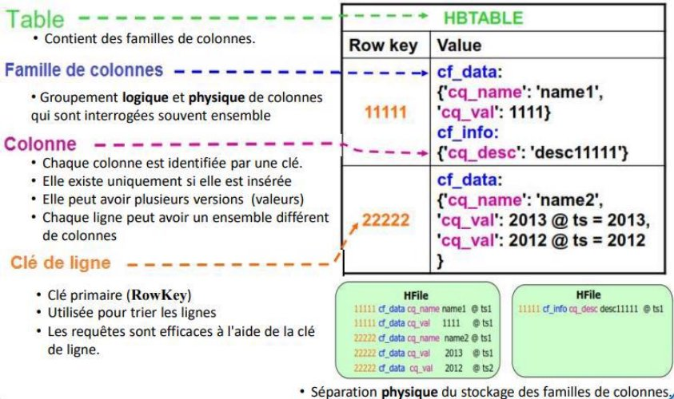
</div>

---

# ⚖️ HBase vs RDBMS — un exemple

<div class="card card-blue">
<div class="card-title">Visualiser la compensation</div>

<div class="flex justify-center">
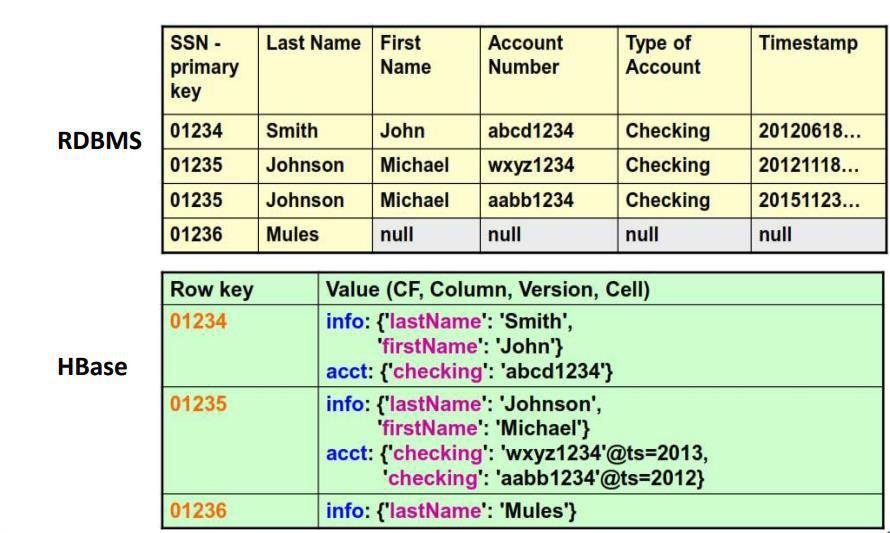
</div>

- La table relationnelle impose **ligne + colonnes fixes** ; HBase tolère des lignes **clairsemées** et des colonnes **personnalisées par ligne**

</div>

---

# 🏰 Architecture du cluster

<div class="cols-2">

<div class="card card-blue">
<div class="card-title">HBase Master (1 actif)</div>

- Gère les opérations **globales** (création/suppression de tables, familles)
- **Assigne les régions** aux RegionServers, équilibre la charge
- S'appuie sur ZooKeeper pour la **haute disponibilité** (veille active)

</div>

<div class="card card-green">
<div class="card-title">RegionServers (les ouvriers)</div>

- **Hébergent les tables** et leurs régions
- Exécutent les **lectures/écritures** et communiquent **directement** avec les clients

</div>

</div>

<div class="card card-yellow">
<div class="card-title">Le client ne passe jamais par le Master</div>

Le client demande à **ZooKeeper** où est le RegionServer, puis lui parle **directement**. Le Master administre, il ne sert pas les requêtes.

</div>

> Un seul ZooKeeper ici : `QuorumPeerMain` — HBase s'en sert pour localiser les régions.

---

# 🐝 Le rôle de ZooKeeper

<div class="card card-pink">
<div class="card-title">Le coordinateur indispensable</div>

- **Correspondance régions ↔ RegionServers** (métadonnées)
- **Heartbeats** : détecte un RegionServer mort → réassigne ses régions
- **Élection** : garantit l'**unicité** du Master actif (les autres veillent)
- Aide les clients à **localiser les RegionServers**

</div>

<div class="card card-blue">
<div class="card-title">Ordre de démarrage non négociable</div>

```bash
./start-zookeeper.sh     # TOUJOURS avant HBase
jps | grep Quorum        # → QuorumPeerMain
./start-hbase.sh
```

> ⚠️ **Piège `PATH`** : `/home` n'est pas dans le `PATH` → lancez toujours **avec `./`**, sinon le shell exécute le script d'HBase du même nom.

</div>

---

# 📦 La région : découpage & taille

<div class="card card-green">
<div class="card-title">Une région = une tranche horizontale de table</div>

- Bornée par une **rowkey de début** et une **rowkey de fin**
- Une région est **découpée** quand elle dépasse sa taille maximale
- C'est l'unité de **distribution** et de **disponibilité** : un équilibreur la déplace entre RegionServers ; une panne = réassignation automatique

</div>

<div class="card card-yellow">
<div class="card-title">⚠️ 1 Go, PAS 128 Mio</div>

- Sur notre cluster : `hbase.hregion.max.filesize = 1073741824` → **1 Go**
- **Ne pas confondre** avec les **128 Mio** de `dfs.blocksize` : une région s'appuie sur **plusieurs blocs HDFS**, les deux tailles sont indépendantes
- C'est précisément le **chaînon** entre la séquence 03 (blocs) et celle-ci (régions)

</div>

---

<!-- _class: statement -->

# 🤔 Sondage

**Rowkey 1975 vs Rowkey 2023 — insérées dans cet ordre : `put 'streams_year','2023',…` puis `put 'streams_year','1975',…`.**

**Quelle ligne apparaît en premier à `scan` ?**

1. `2023` (l'ordre d'insertion)
2. `1975` (l'ordre lexicographique des rowkeys)
3. Ça dépend du RegionServer

<!-- Laisser voter 30-45 s. Réponse 2 : les rowkeys sont TRIÉES binairement, l'insertion n'a aucun effet sur l'ordre de lecture. Reconnecter au tri du shuffle MapReduce. -->

---

# 💡 Rowkey : le tri gagne toujours

<div class="card card-green">
<div class="card-title">Ce que le scan va montrer</div>

```text
hbase:002:0> scan 'streams_year'
ROW       COLUMN+CELL
1975      column=stats:total, timestamp=…, value=4206105352
2023      column=stats:total, timestamp=…, value=25808484104
```

- `"1975"` < `"2023"` **en octets** (`1` < `2`) → **1975 sort première**
- L'ordre de vos `put` ne change rien : c'est le **rowkey** qui décide
- Le scatter-read (J2) et le rowkey (J4) obéissent à la **même règle de tri**

</div>

<div class="card card-pink">
<div class="card-title">Conséquence pour le TD-03</div>

> Une rowkey numeric (`100` < `99` en ASCII) peut paraître incohérente : préfixez (pad) vos clés (`0099`, `0100`) quand l'ordre numérique compte. C'est le piège du lexicographique déjà vu au TD01 (pipe `sort`).

</div>

---

# 🧱 Stockage : WAL → MemStore → HFile

<div class="flex justify-center">

</div>

<div class="card card-blue">
<div class="card-title">Le chemin d'une écriture</div>

1. On écrit d'abord dans le **WAL** (Write-Ahead Log) → durabilité immédiate
2. Puis dans le **MemStore** (tampon en mémoire) du RegionServer
3. À la **compaction**, le MemStore s'évacue dans des **HFiles** persistés sur **HDFS**

> Chaque **Store** = 1 famille de colonnes = 1 MemStore + ses HFiles.

</div>

---

<!-- _class: statement -->

# 🤔 Question piège

**Vous exécutez `put 'store','1001','customer:name','John White'`.**

**Le shell répond… `0 row(s) in 0.0050 seconds`.**

**John White est-il dans la table ? Comment le prouver ?**

<!-- Laisser 45 s-1 min sans répondre. Rappel de l'EX 06 : HBase 'lit peu' et ne confirme presque jamais les écritures ; la seule preuve est get/scan. C'est le dernier grand piège du cours à faire passer aux apprenants. -->

---

# 💡 Réponse — « 0 row(s) »

<div class="card card-green">
<div class="card-title">HBase ne confirme pas les écritures</div>

- `put` → `0 row(s) in …` = **rien à redire**, pas « rien écrit » : c'est l'absence de confirmation
- **La seule preuve** : `get 'store','1001'` (ou `scan`) qui affiche la cellule

```text
hbase:000:0> get 'store','1001'
COLUMN              CELL
customer:city       timestamp=…, value=Los Angeles, CA
customer:name       timestamp=…, value=John White
sales:amount        timestamp=…, value=$400.00
sales:product       timestamp=…, value=Chairs
```

</div>

<div class="card card-pink">
<div class="card-title">Même logique partout</div>

- `create`, `disable` … ne renvoient **pas** de confirmation lisible
- **Toujours** vérifier par `list`, `exists`, `get`, `scan`
- Le **TD-03** (hier) vous a fait pratiquer ce geste : le `put` ne confirme rien, `scan` prouve

</div>

---

# 🐍 HappyBase & Thrift

<div class="card card-blue">
<div class="card-title">Python → HBase, via Thrift (port 9090)</div>

- Seul **Java** accède directement à HBase ; **ThriftServer** fait le pont réseau
- `happybase` est **déjà installé** (1.3.0) — le ThriftServer doit juste tourner :

```bash
./start-zookeeper.sh
./start-hbase.sh
./start-thrift.sh
jps | grep Thrift      # → ThriftServer
```

</div>

<div class="card card-green">
<div class="card-title">Le code minimal</div>

```python
import happybase
connection = happybase.Connection('127.0.0.1', 9090)
connection.open()
table = connection.table('store')
for key, data in table.scan():
    print(key, data)
connection.close()
```

> Depuis la machine hôte (hors conteneur), remplacez `127.0.0.1` par l'adresse qui héberge Docker.

</div>

---

<!-- _class: exercise -->
<!-- Repère formateur : exercices/06-hbase.md — Parties I à IV -->

# ✏️ EX/06 — HBase (~1 h 30 puis autonomie)

1. **I — shell** : `create 'store','customer','sales'`, douze `put`, puis `get`/`scan` (l'absence de confirmation !), `deleteall`, `count`
2. **II — HappyBase** : `./start-thrift.sh`, `Connection('127.0.0.1',9090)`, `connection.tables()`, `table.put/table.row/table.scan`
3. **III — autonomes** : créer vos tables + profiter des extensions
4. **IV — exercices HBase (EX 06)** : le reducer écrit les streams par année dans `streams_year` (voir `ANNEXES/utils/5-reducer-hbase.py`), puis PDF depuis HBase

> ⚠️ **Le reducer et le `drop`** : `ANNEXES/utils/5-reducer-hbase.py` crée/remet à zéro la table **AVANT** le traitement — le `drop` doit rester **HORS du reducer** (un reducer qui droppe pendant l'écriture tue les écritures concurrentes).

<!-- Laisser 1 h 30 pour la partie guidée + le départ des autonomes. Passer sur les postes : vérifier jps|grep Quorum avant HBase, puis le 'get' comme preuve. Les exercices IV (MR + HBase) ne finissent pas tous aujourd'hui — les terminer en autonomie avant la pause. -->

---

<!-- _class: exercise -->
<!-- Repère formateur : td/TD04.md — Tempo A — départ lancé -->

# 🏋️ TD-04 — NiFi : le fichier qui raconte son histoire

**Premier contact — un seul processeur, une seule preuve.**

1. `docker compose ps` → NiFi UP ? Sinon, prévenez le formateur
2. `https://localhost:8443/nifi` → certificat auto-signé → login (`etudiant` / `etudiant`)
3. Déposez un petit `test.csv` (3 lignes) dans `nifi/input/` (sur la machine hôte)
4. **GetFile** : `/opt/nifi/input`, `File Filter = .*\.csv`, auto-terminate **success** → démarrer → compteur **out** = 1 → le fichier **disparaît**
5. **Data Provenance** : `RECEIVE`, horodaté — c'est la trace du premier passage
6. Ajoutez **PutFile** : `/opt/nifi/output`, `Conflict Resolution = replace`, auto-terminate **success** et **failure** → relancez → le fichier **apparaît** dans `nifi/output/`
7. **Data Provenance** : 2 événements — `RECEIVE` + écriture — la traînée complète

> ⚠️ NiFi ne « valide » pas le contenu : un fichier corrompu traverse sans erreur. C'est `ConvertRecord` (present dans l'EX/07) qui le rejettera sur `failure`.

<!-- Tempo A guidé ~15 min. Bloquer sur Data Provenance : c'est la preuve visuelle que le fichier a bougé. Les tempos B/C partent ensuite en autonomie. Placé entre midi J4 — premier contact avant le cours NiFi de l'après-midi. -->

---

<!-- _class: section -->

# II. NiFi — l'usine à flux

## La donnée entre toute seule dans HDFS

---

<!-- _class: statement -->

# 🤔 D'après vous…

**Chaque jour, un nouveau CSV arrive et doit entrer dans HDFS.**

Déposer le fichier à la main avec `hdfs dfs -put` ? Comment automatiser et fiabiliser cette ingestion ?

<!-- Laisser 30-45 s. Attendre l'idée d'un flux programmé + surprise à l'arrivée ; amorcer l'outil d'ingestion visuel. -->

---

# 💡 Réponse : une usine à flux, plus un `-put`

<div class="card card-green">
<div class="card-title">Automatiser, fiabiliser, tracer</div>

- L'idée : un **flux programmé** qui surveille une source, transforme, dépose dans HDFS — **sans humain**, au bon endroit et au bon moment
- Un flux doit savoir **rejouer** une ingestion échouée (disque plein, source coupée) et **tout tracer** : qui a déposé quoi, quand, depuis où
- C'est le métier d'**Apache NiFi**, l'outil d'ingestion visuel — on y arrive dans quelques slides

</div>

---

# 🎯 Objectifs NiFi

<div class="card card-blue">
<div class="card-title">À la fin + EX/07 + TD-04, vous saurez…</div>

- ✅ Expliquer le problème de **l'ingestion** et le modèle **FlowFile / processeur / connection**
- ✅ Construire un **dataflow** à la souris (GetFile → ConvertRecord → PutFile → `moveFromLocal`)
- ✅ Utiliser la **Data Provenance** pour tracer (et rejouer) un événement
- ✅ Situer NiFi en 2026 (2.x) et dans la chaîne du cours

</div>

---

# 🚪 Le problème : amener les données jusqu'à Hadoop

<div class="card card-pink">
<div class="card-title">Depuis J1, une seule porte : votre `hdfs dfs -put`</div>

- Le CSV de la promo arrive le lundi par mail, le jeudi par FTP : **qui le dépose à la main**, au bon endroit, au bon nom ?
- L'ingestion échouée à 3 h du matin (disque plein, réseau coupé) : **ni suivie, ni rejouée**
- **Rien ne trace** qui a déposé quoi, quand, depuis où
- Multiplier les sources = multiplier les **petits scripts fragiles**

</div>

<div class="card card-green">
<div class="card-title">Le métier oublié : l'ingestion</div>

C'est la **porte d'entrée** de toute plateforme data. Pour les **fichiers** (CSV, logs, JSON), la référence reste **Apache NiFi** (Sqoop, pour le relationnel, est désaffecté — remplacé par Spark JDBC / Kafka Connect).

</div>

---

# 🐠 Présentation de NiFi

<div class="card card-blue">
<div class="card-title">L'ancêtre à l'ADN militaire</div>

- Né au sein de la **NSA** (« **Ni**agara **Fi**les ») → Apache **2015**
- Une **plateforme de routage et de transformation de données visuelle** : le dataflow se construit **à la souris**
- Trois forces héritées de la NSA :
  - **Guaranteed delivery** — un événement entré est acké de bout en bout, jamais perdu silencieusement
  - **Back pressure** — si un maillon ralentit, le flux se met en pression (et s'arrête proprement) au lieu de déborder
  - **Data Provenance** — historique complet et requêtable de chaque événement

</div>

<div class="card card-yellow">
<div class="card-title">Usages types</div>

Collecte de logs · ingestion fichiers → datalake (**notre cas**) · sync entre systèmes · ETL léger · IoT/edge (MiNiFi)

</div>

---

# 🧩 Les 3 objets du modèle mental

<div class="card card-blue">
<div class="card-title">1. Le FlowFile = l'unité en mouvement</div>

- **Contenu** : le fichier lui-même (CSV…)
- **Attributs** : clé/valeur attachées (`filename`, `path`, `ingestion_date`)
- *Une enveloppe (contenu) + une fiche de renseignement (attributs)* qui s'enrichit à chaque étape

</div>

<div class="card card-green">
<div class="card-title">2. Le processeur = la brique</div>

- **Source** (`GetFile`, `ListenHTTP`) · **Transfo** (`ConvertRecord`, `UpdateAttribute`) · **Routage** (`RouteOnAttribute`) · **Destination** (`PutFile`, `PutS3Object`)
- Émet vers des **relationships** : `success` / `failure` — **une relation non câblée = de la donnée perdue silencieusement**

</div>

<div class="card card-yellow">
<div class="card-title">3. La connection = la file</div>

- Vraie **queue** bornée (back pressure : nombre d'objets ou octets)
- Quand elle est pleine, le processeur amont **s'arrête proprement** (stop and wait)

</div>

---

# 🧯 Le réflexe failure

<div class="card card-green">
<div class="card-title">Un flux qui ne gère pas ses échecs n'est pas un flux</div>

```text
GetFile ──success──► ConvertRecord ──success──► PutFile
   │                                              │
   └──failure──► (funnel ou PutFile vers _errors/)  └──failure──► (idem)
```

- **Une relationship `failure` non connectée** = « si ça échoue, la donnée disparaît sans laisser de trace »
- On câble **chaque** échec vers un funnel, ou un dossier `_errors/`
- Le **funnel** (entonnoir) **n'est pas un processeur** : il fusionne plusieurs queues sans config

</div>

> La question d'un data engineer à chaque flux : **que deviennent les échecs ?**

---

# 🎨 L'interface : le canvas

<div class="card card-blue">
<div class="card-title">https://localhost:8443/nifi</div>

- Déposer des processeurs depuis la **palette**, les relier par des **connections**
- Configurer via **Properties / Settings / Scheduling** (fréquence, run schedule)
- Le cycle : **conception → configuration → ▶ Start → supervision → itération**

</div>

<div class="card card-yellow">
<div class="card-title">Ce que dit la couleur des queues</div>

- **Vide** → le flux s'écoule
- **Jaune** → remplissage, la *back pressure* approche
- **Rouge** → back pressure atteinte : le flux **s'arrête proprement** en amont

</div>

<div class="card card-pink">
<div class="card-title">⚠️ 2.x impose le HTTPS (certificat autosigné) puis un login</div>

Le couple se lit dans `nifi/credentials.env` (ou `docker logs hadoop-nifi` s'il a été généré aléatoirement — il change à chaque recréation). Un mot de passe < **12 caractères** est rejeté silencieusement.

</div>

---

# 🕰️ Data Provenance : l'audit trail

<div class="card card-green">
<div class="card-title">« Il manque les données du 12 mars » → 3 clics</div>

- Clic droit sur un **événement** de la queue → **View Data Provenance**
- Le **Lineage** : le graphe des processeurs traversés, horodaté
- **Content** : le contenu avant/après, visualisable et téléchargeable
- **Replay** : rejouer une donnée depuis le point de l'échec

</div>

<div class="card card-yellow">
<div class="card-title">Ce qui justifie NiFi vs `cron + dfs -put`</div>

La **reprise sur erreur avec traçabilité** : c'est un pipeline, pas un script. Chaque étape est attestée.

</div>

---

# 🏭 Le flux du cours : CSV → TSV → HDFS

<div class="card card-blue">
<div class="card-title">GetFile → ConvertRecord → PutFile → `moveFromLocal`</div>

| Processeur | Rôle dans notre flux |
|---|---|
| **GetFile** | scrute `/opt/nifi/input` (le dossier partagé `nifi/input/`) — tout `*.csv` devient un FlowFile |
| **ConvertRecord** | CSVReader (`,` + quotes) → CSVRecordSetWriter (`\t`) : la transformation **CSV → TSV** des séquences 03-05, en flux |
| **PutFile** | écrit le FlowFile dans `/opt/nifi/output` (monté **dans le master** sous `/home/staging`) |
| `hdfs dfs -moveFromLocal` | la passerelle main → HDFS (commande depuis le master) |

</div>

<div class="card card-pink">
<div class="card-title">⚠️ Pourquoi le dernier pas n'est PAS un processeur</div>

L'image officielle `apache/nifi:2.x` embarque **aucun NAR Hadoop** : `PutHDFS`/`GetHDFSFile` n'existent pas dans la palette (profil Maven désactivé). `PutFile` + votre geste `moveFromLocal` rend **visible** la frontière « l'orchestrateur finit, HDFS commence » — en production on rétablirait un connecteur HDFS.

</div>

> **Lien pédagogique** : la transformation CSV→TSV que vous avez scriptée à l'EX 05 existe **déjà en processeur**. Le TSV de NiFi atterrit **exactement** là où la table externe Hive lit ses données.

---

# 🛸 NiFi en 2026

<div class="card card-green">
<div class="card-title">2.x = la génération du cours</div>

- NiFi **2.x** (fin 2024+) : UI restylée, **Java 21** minimum, TLS 1.3, load balancing des connections
- La branche **1.x** est en fin de vie (1.28.x, maintenance seule) — sauf stacks Hadoop 2.x legacy

</div>

<div class="card card-yellow">
<div class="card-title">Le paysage d'ingestion 2026</div>

- **Kafka Connect** : quand la source est un flux Kafka
- **Airbyte** : sync API/SaaS → entrepôt
- **Spark JDBC** : le remplaçant de Sqoop pour le relationnel
- **NiFi** : la référence du **routage et de la transformation visuels** multi-sources (et MiNiFi sur l'edge/IoT)

</div>

---

<!-- _class: exercise -->
<!-- Repère formateur : exercices/07-nifi.md — Parties I à III -->

# ✏️ EX/07 — NiFi (~2 h)

1. **I — prise en main** : `https://localhost:8443/nifi`, GetFile sur `/opt/nifi/input`, un `test.csv`, compteur **out** passe à 1 — le fichier source disparaît
2. **Data Provenance** : retrouver l'événement `RECEIVE`, son **Lineage** et son **Content**
3. **II — le flux Spotify → HDFS** : GetFile `success` → **ConvertRecord** (CSV → TSV) → **PutFile** vers `/opt/nifi/output`, les **failure** vers `_errors/`
4. **III — autonomes** : flux complets, filtres, rejeu de la donnée corrompue

> ⚠️ NiFi ne démarre pas un processeur `Invalid`. Le piège classique : saisir une propriété dynamique sans validateur (`File Filter Regex`) au lieu du **`File Filter`** — le processeur passe `Invalid` sans message dans le canvas (cloche *bulletins*).

<!-- Laisser ~2 h. En partie II, surveiller les ConvertRecord (CSVReader/CSVRecordSetWriter : en-tête !), puis le -moveFromLocal qui doit conduire au fichier de la table externe. -->

---

<!-- _class: section -->

# III. La chaîne complète

## L'assemblage de la semaine, et le TP de vendredi

---

<!-- _class: statement -->

# 🤔 D'après vous…

**HDFS stocke, MapReduce/Hive calculent par lots, HBase lit vite, NiFi ingère.**

Par où passe une donnée, de son arrivée jusqu'à son affichage ?

<!-- Laisser 30-45 s. Faire dessiner le parcours au tableau ; recadrer ensuite sur le schéma de la chaîne complète. -->

---

# 🔗 La chaîne complète

<div class="flex justify-center">
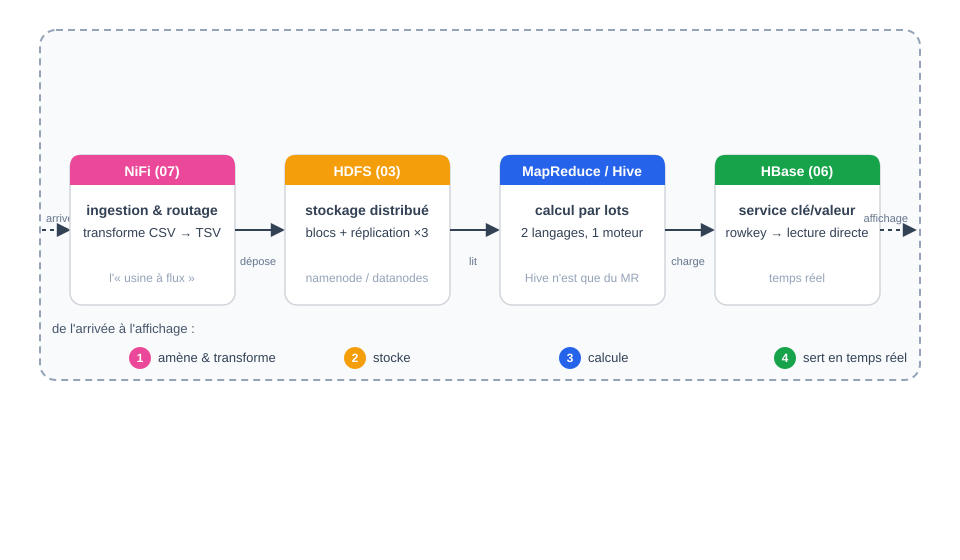
</div>

```text
 NiFi (07)     HDFS (03)     MapReduce (04) / Hive (05)     HBase (06)
┌─────────┐   ┌──────────┐   ┌──────────────────────────┐   ┌─────────┐
│ingestion│──►│ stockage │──►│ calcul (batch ou SQL)    │◄──│ service │
│ routage │   │ fichiers │   │                           │   │ clé/valeur│
└─────────┘   └──────────┘   └──────────────────────────┘   └─────────┘
```

<div class="card card-blue">
<div class="card-title">Une seule donnée, cinq briques</div>

**NiFi** amène et transforme · **HDFS** stocke · **MapReduce/Hive** calculent (deux langages, un moteur) · **HBase** sert les accès temps réel.

</div>

---

<!-- _class: statement -->

# 🤔 Question bilan

**Dans la chaîne…**

1. **Qui ingère** la donnée ?
2. **Qui stocke** physiquement ?
3. **Qui calcule** (et en quoi) ?
4. **Qui sert** les accès temps réel ?

*C'est exactement le plan du rapport demandé pour le TP final.*

<!-- Laisser 1-2 min en binôme. La réponse est la matrice de la slide précédente. Souligner : cette question est posée mot pour mot dans le TP final (section question de contrôle). -->

---

# 🏁 Le TP final : vendredi

<div class="card card-pink">
<div class="card-title">TP — Analyse des ventes par ville</div>

- Une **journée (4 à 5 h)** : le TP de synthèse évalué du cursus
- **Une seule donnée** traverse toute la chaîne : HDFS → MapReduce → Hive → HBase → NiFi → visualisation → **documentation**
- **Plusieurs questions** : Q1 classement des villes · Q2 clé composite ville#année · Q3 Hive (validation croisée MR ↔ SQL) · Q4 HBase (rowkey ville) · Q5 NiFi (ingestion) · graphique du top 10
- Donnée : `dataw_fro03_mini_1000.csv` (mini dans l'énoncé, fichier complet ~135 000 lignes en bonus)

</div>

<div class="card card-green">
<div class="card-title">Rien de nouveau à inventer</div>

> **Chaque commande du TP a déjà été faite dans un EX.** En cas de doute, le lien vers l'exercice d'origine est donné dans l'énoncé.

- **II. HDFS** → EX/03 · **III-IV. MapReduce** → EX/04 (9-mapper-ventes-annee.py, clé composite) · **V. Hive** → EX/05 + TD-02 · **VI. HBase** → EX/06 + TD-03 · **VII. NiFi** → EX/07 + TD-04 · **VIII. visu** → EX/06 partie IV · **chaîne entière** → TD-05 (juste après)

</div>

<div class="card card-yellow">
<div class="card-title">Livrables</div>

**Documentation des actions et de leurs retours** (commande lancée → retour observé → conclusion), + les scripts, les résultats (`part-00000`, requêtes, `scan`/`get`) et le PDF du graphique.

</div>

---

<!-- _class: exercise -->
<!-- Repère formateur : td/TD05.md — Tempo A — départ lancé -->

# 🏋️ TD-05 — Le pré-échauffement du TP (~15 min)

**La chaîne entière, encore une fois, sur la donnée du TP** (`data/dataw_fro03_mini_1000.csv`).

1. Le pipe complet : `cat dataw_fro03_mini_1000.csv | python3 ANNEXES/utils/8-mapper-ventes.py | sort | python3 ANNEXES/utils/2-structure-reducer.py`
2. Top 5 des villes — notez `LE MANS` (30) en tête
3. Même classement en sqlite3 (GROUP BY ville) — **les deux sont d'accord**

> Le TP de demain fait **exactement ça** — mais sur le cluster (HDFS → MapReduce → Hive → HBase → NiFi). Rien de nouveau à inventer : chaque commande a déjà été faite.

---

<!-- _class: correction -->
<!-- Repère formateur : td/TD05.md — Tempo A — correction -->

# ✅ TD-05 — Correction & pièges

<div class="cols-2">

<div class="card card-green">
<div class="card-title">Le pipe sur les ventes</div>

- LE MANS 30 · MAMERS 18 · DOMFRONT EN POIRAIE 16 · LAVAL 15 · DOUDEVILLE 15
- Le mapper extrait villecli (col 5) et qte (col 15) ; le reducer additionne
- La requête sqlite `GROUP BY ville` rend le **même** classement — validation croisée

</div>

<div class="card card-pink">
<div class="card-title">Les pièges à rapporter à demain</div>

1. **Casse** : `LE MANS` ≠ `Le Mans` — deux clés pour le reducer (et une ligne de plus sur le fichier complet)
2. **Ligne 576** : inexistante ici, mais le réflexe « protège `int()` » reste
3. Le mini-jeu est un **échantillon local** : le fichier complet (~135 000 lignes) change de tête

</div>

</div>

> L'essentiel : vous maîtrisez déjà les commandes du TP. Demain, elles passent sur le cluster — la question du rapport est simplement « où **chaque** outil intervient dans la chaîne ».

---

# 🧠 Récap du jour 4 — et de la semaine

<div class="card card-blue">
<div class="card-title">Ce que vous savez faire, en une slide</div>

- ✅ **HBase** : rowkey qui trie, familles/colonnes dynamiques, WAL→MemStore→HFile, régions (1 Go vs blocs 128 Mio), ZooKeeper d'abord, `put` ne confirme rien — vérifier par `get`/`scan`
- ✅ **NiFi** : FlowFile/processeur/connection, failure câblée, Data Provenance, `GetFile→ConvertRecord→PutFile→moveFromLocal`, en-tête & `File Filter`
- ✅ **La chaîne** : NiFi (ingère) → HDFS (stocke) → MapReduce/Hive (calculent) → HBase (sert), avec **la même donnée** partout

</div>

<div class="card card-pink">
<div class="card-title">⚡ Le fil d'Ariane</div>

Depuis J1 : le **CSV Spotify**, nouvelle brique à chaque séquence — **déposé à la main, découpé en blocs, parallélisé par MapReduce, interrogé en SQL, stocké en NoSQL, ingéré par flux**. Vendredi : à vous de la refaire entièrement.

</div>

> Q&R puis point matériel (lancement des decks, export PDF, mode présentateur) avant de vous rendre autonomes sur le TP.

---

<!-- _class: lead -->

# Merci !

## La chaîne complète Hadoop : vous l'avez en mains
